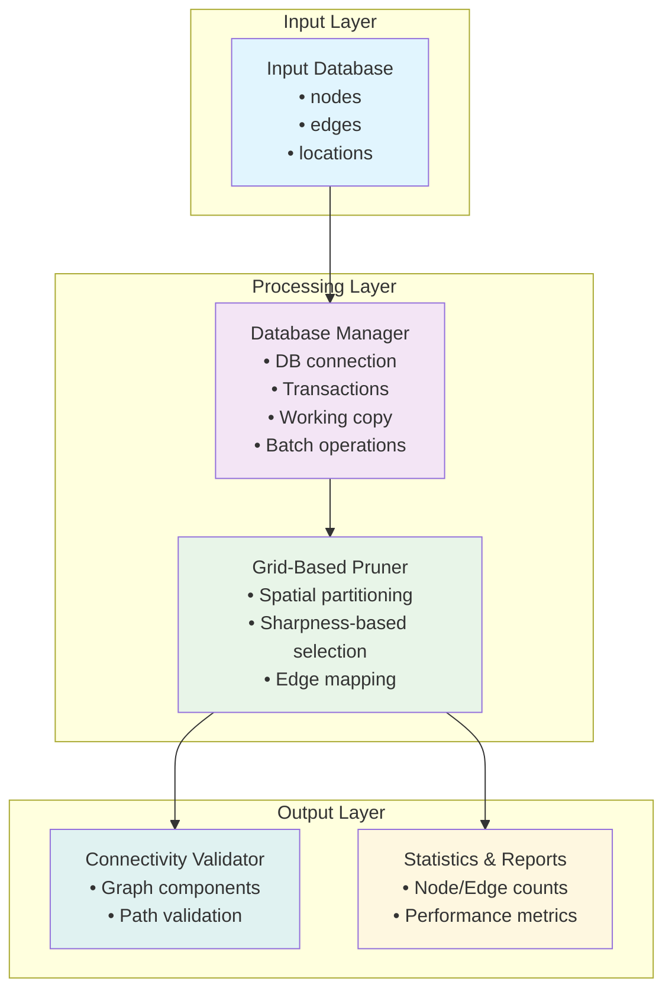
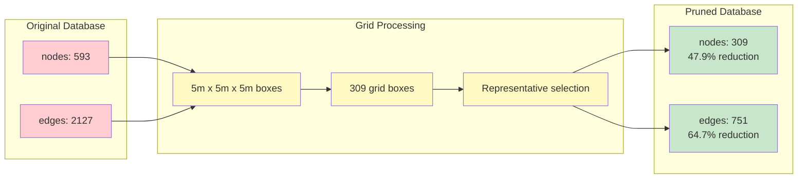

# Graph Processor

This module implements a grid-based approach to graph pruning for building walkable paths, using spatial partitioning and connectivity preservation techniques.

## Overview

The graph processor addresses the challenges of:
- Redundant connections in cyclic graphs
- Closely spaced nodes from multiple passes
- Maintaining connectivity while reducing complexity
- Ensuring 5m coverage requirements
- Handling parallel branches efficiently

## Architecture

### System Overview



### Data Flow


### Database Transformation



### Key Features

- **Spatial Grid Partitioning** (5m x 5m x 5m boxes)
- **Sharpness-based Node Selection** (highest image quality per box)
- **Edge Redirection** (maintains connectivity)
- **Database Transaction Safety**
- **Batch Processing** for Large Graphs

## Key Features

### Grid-Based Spatial Partitioning
- Partitions 3D space into configurable grid boxes (default: 5m x 5m x 5m)
- Selects sharpest node as representative for each grid box
- Maintains connectivity through edge redirection
- Reduces visual clutter while preserving coverage

### Sharpness-Based Selection
- Uses image sharpness as primary selection heuristic
- Falls back to spatial centrality if no sharpness data available
- Preserves highest quality visual references for better SLAM performance

## Installation

1. Install dependencies:
```bash
pip install -r requirements.txt
```

2. Ensure your database is accessible and contains the required tables (nodes, edges).

## Usage

### Grid-Based Pruning
```bash
python run_pruning.py prune cv.db
```

### Custom Grid Size
```bash
python run_pruning.py prune cv.db --grid-size 3.0
```

### Custom Coordinate Scaling
```bash
python run_pruning.py prune cv.db --coords-to-metres 20.0
```


### Shell Script Integration
```bash
# Using the cv_run_6_prune_graph.sh script
export CV_HOME_DIR="/path/to/sitexplorer"
export CV_DB_DIR="/path/to/databases/"
export CV_PRUNE_DB_NAME="your-database.db"
export CV_PRUNE_DB_PREFIX="grid_"
export CV_PRUNE_GRID_SIZE="5.0"
export CV_PRUNE_COORDS_TO_METRES="15.0"

./bin/scripts/cv_run_6_prune_graph.sh
```

## Output

The grid-based approach creates working copies with configurable prefixes:
- `cv.db` → `grid_cv.db` (default: `refined_`)
- `tga-pub.db` → `grid_tga-pub.db`
- Custom prefix: `cv.db` → `custom_cv.db`

## Algorithm Details

### 1. Spatial Grid Partitioning
- Partitions 3D space into fixed-size grid boxes (default: 5m x 5m x 5m)
- Assigns each node to its corresponding grid box based on coordinates
- Scales coordinates by configurable factor (default: 15x) for metre conversion

### 2. Representative Node Selection
- Selects the sharpest node within each grid box as representative
- Uses image sharpness as primary selection criterion
- Falls back to spatial centrality if no sharpness data available
- Maintains original node properties (coordinates, zone, etc.)

### 3. Edge Redirection & Connectivity
- Redirects all edges to point to representative nodes
- Maintains original connectivity between grid boxes
- Preserves graph structure while reducing node count

## Configuration

Key parameters in `config.py`:
- `outer_ring`: Grid box size in metres (default: 5.0m)
- `inner_ring`: Minimum grid step for coverage testing (default: 0.5m)
- `coords_to_metres`: Coordinate scaling factor (default: 15.0)

## Performance

The grid-based approach provides:
- Consistent node reduction (typically 40-60% depending on density)
- Maintained connectivity through edge redirection
- Predictable spatial distribution (5m grid spacing)
- Efficient processing for large graphs

## Troubleshooting

### Common Issues

1. **Coverage gaps detected**: The algorithm will suggest additional node positions
2. **Connectivity lost**: Check for isolated components in the original graph
3. **Memory issues**: Reduce grid step size in coverage validation

### Verbose Logging
Add `--verbose` flag for detailed logging:
```bash
python run_pruning.py refined cv.db --verbose
```

## Comparison with Old Approach

The grid-based approach typically achieves:
- More predictable node reduction (grid-based vs. clustering)
- Consistent spatial distribution (fixed grid vs. variable clusters)
- Simpler algorithm (easier to understand and debug)
- Faster processing (no iterative clustering)

## File Structure

```
GraphProcessor/
├── grid_pruner.py         # Grid-based pruning algorithm with sharpness selection
├── db_manager.py          # Database operations
├── config.py              # Configuration parameters
├── run_pruning.py         # Command-line interface
├── requirements.txt       # Python dependencies
└── README.md             # This file
```


