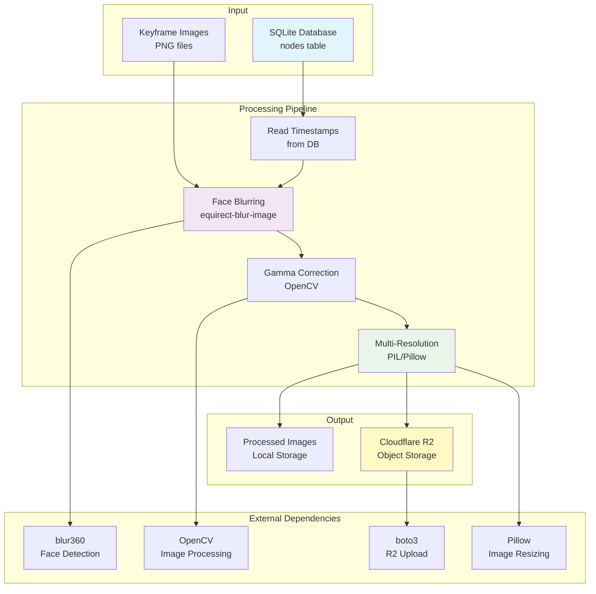

# Image Processor

Python application for processing keyframe images: face blurring, gamma correction, resizing, and uploading to Cloudflare R2 storage.

## Overview

The Image Processor handles post-processing of keyframe images extracted from the database:
- Face blurring using equirectangular blur tool
- Gamma correction for brightness adjustment
- Multi-resolution image generation (preview, low, high, ultra)
- Upload to Cloudflare R2 object storage

## Environment Variables

### Required Variables (from script)
- `CV_HOME_DIR` - Root directory of the Sitexplorer project
- `CV_KEYFRAME_IMG_DIR` - Directory containing input keyframe images
- `CV_EXTRACT_USED_IMAGES_DIR` - Output directory for processed images
- `CV_EXTRACT_IN_DB_NAME` - Name of the input SQLite database
- `CV_DB_DIR` - Directory containing SQLite databases

### Optional Variables
- `BLUR360_MODELS_DIR` - Directory containing blur360 face detection models (default: `/usr/local/share/blur360/models`)

### Cloudflare R2 Variables (for upload)
- `CV_R2_ENDPOINT` - R2 endpoint URL
- `CV_R2_BUCKET` - R2 bucket name
- `CV_R2_ACCESS_KEY_ID` - R2 access key
- `CV_R2_SECRET_ACCESS_KEY` - R2 secret access key
- `CV_R2_REGION` - R2 region (default: `"auto"`)

## Scripts

### `bin/scripts/cv_run_12_extract_images.sh`
Processes images from the database:
- Reads timestamps from the database `nodes` table
- Processes each image: blur faces, apply gamma correction
- Uploads multiple resolution versions to R2

**Usage:**
```bash
./bin/scripts/cv_run_12_extract_images.sh [INPUT_DIR] [OUTPUT_DIR] [DB_PATH]
```

**Environment Variables:**
- Uses `CV_KEYFRAME_IMG_DIR`, `CV_EXTRACT_USED_IMAGES_DIR`, `CV_EXTRACT_IN_DB_NAME`, `CV_DB_DIR`

## Architecture



### Resolution Levels

The processor creates four resolution versions:
- **preview**: 480x240, JPEG, quality 70
- **low**: 1920x960, JPEG, quality 80
- **high**: 3840x1920, PNG, quality 100
- **ultra**: 5760x2880, PNG, quality 100

## Functionality

### Processing Steps

1. **Database Query**: Reads timestamps from the `nodes` table in the SQLite database
2. **Face Blurring**: Uses `equirect-blur-image` tool to blur faces in equirectangular images
3. **Gamma Correction**: Applies gamma correction (gamma=1.3) to brighten images
4. **Multi-Resolution**: Creates four resolution versions of each image
5. **R2 Upload**: Uploads all resolution versions to Cloudflare R2 (if configured)

### Features

- **Batch Processing**: Processes all images listed in the database
- **Skip Existing**: Skips upload if file already exists in R2
- **Error Handling**: Continues processing even if individual images fail

## Pipeline Position

The Image Processor runs **after** the following steps:
- `cv_run_1_process_files.sh` - File processing (creates keyframe images)
- `cv_run_2_map.sh` - VSLAM mapping
- `cv_run_4_export_sqlite.sh` - Database export
- `cv_run_6_prune_graph.sh` - Graph pruning (optional)
- `cv_run_9_init_data.sh` - Data initialization

**Before:**
- Database must be exported with node timestamps
- Keyframe images must be available

**After:**
- Processed images ready for deployment
- Images uploaded to R2 for web serving

## Dependencies

### Python Packages
- `opencv-python` - Image processing and gamma correction
- `boto3` - AWS SDK for Cloudflare R2 uploads
- `python-dotenv` - Environment variable management
- `Pillow` - Image resizing and format conversion

### External Tools
- `equirect-blur-image` - Face blurring tool (from blur360-images project)
- Face detection models (PCN models) in `BLUR360_MODELS_DIR`

## Installation

1. Install Python dependencies:
```bash
pip install -r requirements.txt
```

2. Ensure `equirect-blur-image` is built and available in PATH

3. Set up Cloudflare R2 credentials (optional, for upload functionality)

## Usage

### Via Script
```bash
./bin/scripts/cv_run_12_extract_images.sh
```

### Direct Usage
```bash
python image_processor.py db <db_path> <input_dir> <output_dir>
```

**Modes:**
- `db` - Process images from database (used by script)
- `folder` - Process all images in a folder (not currently used)

## File Structure

```
ImageProcessor/
├── image_processor.py    # Main processing script
└── requirements.txt      # Python dependencies
```

## Output

For each processed image with timestamp `ts`:
- `{ts}_blurred.png` - Blurred and processed image (local)
- `{ts}-preview.jpg` - Preview resolution (uploaded to R2)
- `{ts}-low.jpg` - Low resolution (uploaded to R2)
- `{ts}-high.png` - High resolution (uploaded to R2)
- `{ts}-ultra.png` - Ultra resolution (uploaded to R2)


