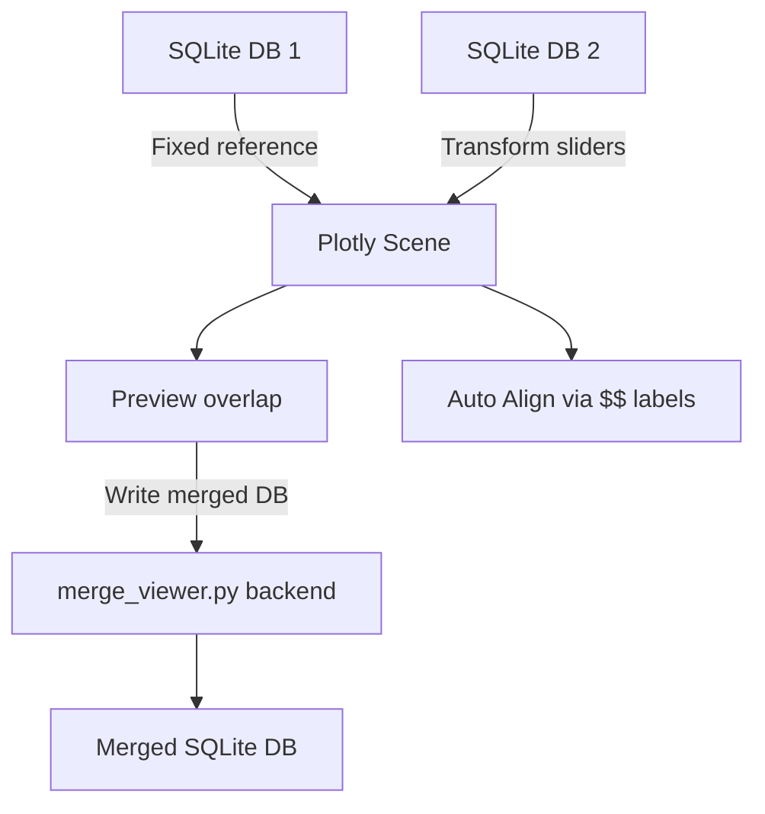
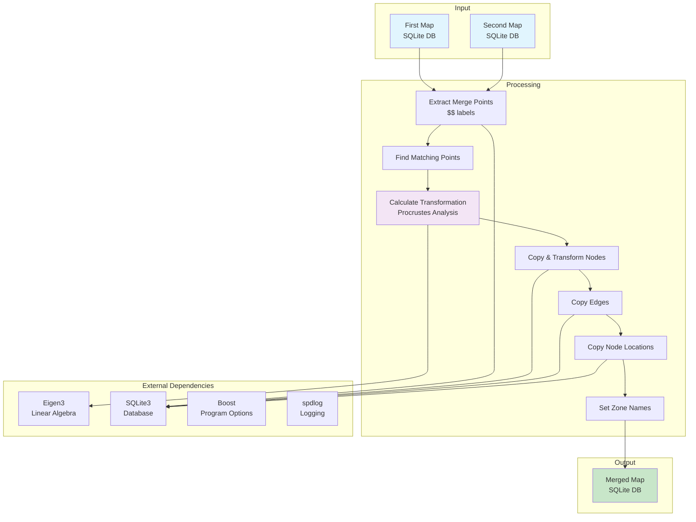

# Map Merge

Python + C++ tooling for merging two SLAM maps (SQLite databases) into a single unified map using labelled merge points. The new `merge_viewer.py` script offers both a headless CLI (feature parity with the legacy C++ binary) and an interactive Plotly/Dash viewer for visual alignment.

## Python viewer and CLI

### Dependencies

```bash
python -m venv .venv
source .venv/bin/activate
pip install numpy dash[standard] plotly
```

### Command line usage

```bash
python Apps/MapMerge/merge_viewer.py FIRST.db SECOND.db OUTPUT.db \
  --zone2 "Building B" [--zone1 "Building A"] [--overwrite]
```

- `--viewer` or `--manual` launches the Dash UI instead of running headless.
- `--transform-json` accepts a 4x4 homogeneous transform (JSON array) to bypass automatic alignment.

### Launch the viewer

```bash
python Apps/MapMerge/merge_viewer.py first.db second.db merged.db \
  --zone2 "Building B" --viewer
```

The viewer exposes:

- Numeric inputs for translation (X/Y/Z), rotation (roll/pitch/yaw, degrees) and uniform scale.
- **Auto Align (labels)**: seeds the controls using the `$$` merge points via the built-in Procrustes solver.
- **Write merged DB**: persists the currently selected transform by copying data from the second DB into the output file, mirroring the CLI flow.



## Overview

The Map Merge tool combines two separate SLAM maps by:
- Finding matching merge points (nodes labeled with `$$` prefix)
- Calculating optimal 3D transformation using Procrustes analysis
- Copying and transforming nodes, edges, and locations from the second map
- Assigning zone names to distinguish merged maps

## Environment Variables

### Required Variables
- `SX_DB_DIR` - Directory containing SQLite database files

### Optional Variables
- `SX_MERGE_1_NAME` - Name of the first input database (default: uses command-line argument)
- `SX_MERGE_2_NAME` - Name of the second input database (default: uses command-line argument)
- `SX_MERGE_OUTPUT_NAME` - Name of the output merged database (default: uses command-line argument)
- `SX_MERGE_2_ZONE` - Zone name for the second map (required)
- `SX_MERGE_1_OVERWRITE_ZONE_NAME` - Zone name for the first map (optional, overwrites existing zones)
- `SX_MERGE_OVERWRITE_EXISTING_OUTPUT` - Overwrite existing output file if true (default: `false`)

## Scripts

### `bin/scripts/sx_run_7_merge_maps.sh`
Merges two maps using labeled merge points:

**Usage:**
```bash
./bin/scripts/sx_run_7_merge_maps.sh [MAP1] [MAP2] [OUTPUT] [ZONE2] [ZONE1]
```

**Arguments:**
- `MAP1` - First input database (or `SX_MERGE_1_NAME`)
- `MAP2` - Second input database (or `SX_MERGE_2_NAME`)
- `OUTPUT` - Output merged database (or `SX_MERGE_OUTPUT_NAME`)
- `ZONE2` - Zone name for second map (or `SX_MERGE_2_ZONE`)
- `ZONE1` - Zone name for first map (optional, or `SX_MERGE_1_OVERWRITE_ZONE_NAME`)

**Example:**
```bash
./bin/scripts/sx_run_7_merge_maps.sh map1.db map2.db merged.db "Building A" "Building B"
```

## Architecture



### Transformation Algorithm

1. **Extract Merge Points**: Finds nodes with labels starting with `$$` in both databases
2. **Match Points**: Identifies matching merge points by label name
3. **Calculate Transformation**: Uses Procrustes analysis (SVD) to find optimal 2D rotation and translation in XZ plane
4. **Apply Transformation**: Transforms all nodes from the second map
5. **Merge Data**: Copies nodes, edges, and locations with ID offset to avoid conflicts

## Functionality

### Merge Process

1. **Copy First Map**: Creates output database as a copy of the first map
2. **Zone Assignment**: Optionally sets zone names for both maps
3. **Extract Merge Points**: Finds labeled nodes (`$$...`) in both databases
4. **Calculate Transformation**: Computes optimal 2D rotation and translation using at least 2 matching points
5. **Copy Second Map Data**:
   - Nodes: Transformed with ID offset
   - Edges: Copied with updated node IDs
   - Node Locations: Copied with updated node IDs
   - Labels: Copied with updated node IDs

### Requirements

- **Minimum 2 matching merge points** required for transformation calculation
- Merge points must be labeled with `$$` prefix in `user_defined_labels` table
- Matching is done by exact label name comparison

## Pipeline Position

The Map Merge tool runs **after** the following steps:
- `sx_run_2_map.sh` - VSLAM mapping (creates individual maps)
- `sx_run_4_export_sqlite.sh` - Database export
- `sx_run_6_prune_graph.sh` - Graph pruning (optional)

**Before:**
- Two separate maps must be created and exported
- Merge points must be labeled in both maps

**After:**
- Merged map ready for further processing
- Can be used as input for additional merges or processing steps

## Dependencies

### Python runtime

- **Python 3.10+**
- **numpy** – linear algebra and matrix operations
- **dash[standard]** – Plotly Dash UI runtime
- **plotly** – 3D scatter visualisation

### Legacy C++ Libraries
- **Eigen3** - Linear algebra and matrix operations (Procrustes analysis)
- **SQLite3** - Database operations
- **Boost** - Program options and filesystem utilities
  - `boost_system`
  - `boost_program_options`
  - `boost_filesystem`
- **spdlog** - Logging (via fmt)
- **fmt** - String formatting

### Build Requirements
- C++ compiler (g++)
- CMake or Makefile support

## Installation

### Python script

No compilation is needed. Install the Python dependencies (see above) and run `merge_viewer.py` directly.

### Legacy C++ binary

1. Build the project:
```bash
cd Apps/MapMerge
make
```

2. Install (optional):
```bash
sudo make install
```

The binary `sx_merge_maps` will be created in `../../bin/linux/` or installed to `/usr/local/bin/`.

## Usage

### Recommended: Python CLI / Viewer

See [Python viewer and CLI](#python-viewer-and-cli) for examples.

### Legacy shell script
```bash
./bin/scripts/sx_run_7_merge_maps.sh
```

### Legacy binary
```bash
sx_merge_maps <first_map> <second_map> <output_map> --zone2 <zone2_name> [--zone1 <zone1_name>] [--overwrite]
```

**Options:**
- `--zone1 <name>` - Zone name for first map (optional)
- `--zone2 <name>` - Zone name for second map (required)
- `--overwrite` - Overwrite existing output file

## File Structure

```
MapMerge/
├── merge.cpp         # Legacy C++ merge implementation
├── merge_viewer.py   # Python CLI + Plotly/Dash viewer
└── Makefile          # Build configuration for the C++ binary
```

## Notes

- The transformation is calculated in 2D (XZ plane) to avoid pan/roll rotations
- Node IDs from the second map are offset to avoid conflicts
- All edges and relationships are preserved during the merge
- Zone names help distinguish merged maps in the final database


