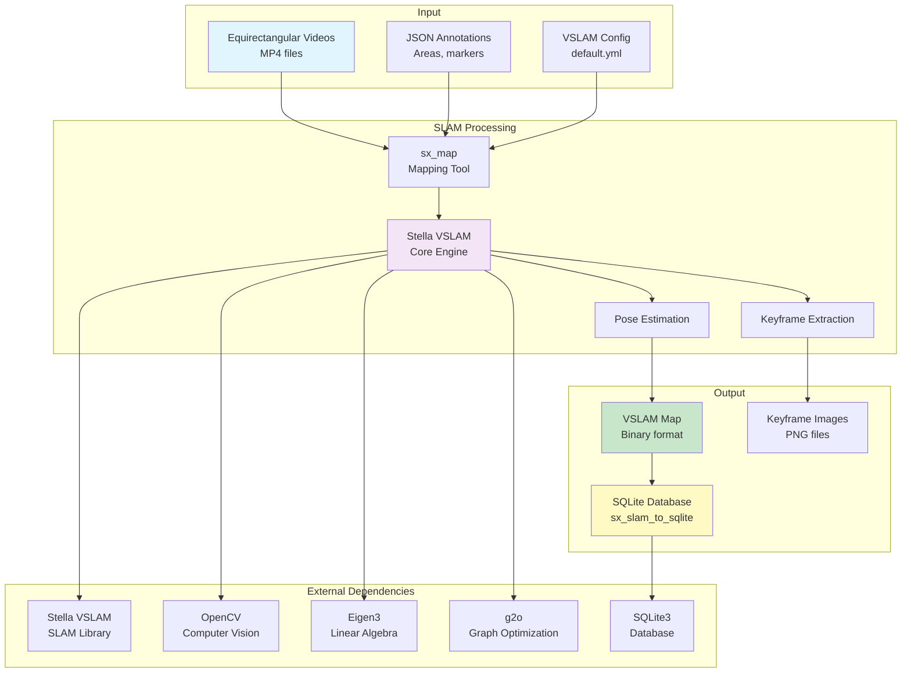

# SLAM (Simultaneous Localisation and Mapping)

Main SLAM project directory containing the SitexplorerInterface for visual SLAM processing using Stella VSLAM.

## Overview

The SLAM directory contains the interface to Stella VSLAM, a visual SLAM system for processing 360-degree equirectangular videos. It provides tools for mapping, viewing, and exporting SLAM data.

## Environment Variables

### Required Variables

#### For Mapping (`sx_run_2_map.sh`)
- `SX_HOME_DIR` - Root directory of the Sitexplorer project
- `SX_VSLAM_MAP_DIR` - Directory for VSLAM map files
- `SX_JSON_DIR` - Directory containing JSON annotation files
- `SX_KEYFRAME_IMG_DIR` - Directory for keyframe images
- `SX_VSLAM_MAP_HEADLESS` - Run in headless mode (`true`/`false`)
- `SX_VSLAM_EPOCH_START` - Epoch start timestamp
- `SX_VIDEO_DIR` - Directory containing video files
- `SX_VSLAM_CONFIG_FILE` - Path to VSLAM configuration YAML file
- `SX_VSLAM_MAP_VIDEOS_COMMA_SEPARATED_NAMES` - Comma-separated video names (or command-line argument)
- `SX_VSLAM_MAP_NAME` - Output map name (or command-line argument)

#### For Editing (`sx_run_3_edit_vslam_map.sh`)
- `SX_HOME_DIR` - Root directory
- `SX_VSLAM_MAP_DIR` - Directory for VSLAM map files
- `SX_VSLAM_MAP_NAME` - Input map name (or command-line argument)
- `SX_EDIT_VSLAM_OUTPUT_MAP_NAME` - Output map name (or command-line argument)

#### For Export (`sx_run_4_export_sqlite.sh`)
- `SX_HOME_DIR` - Root directory
- `SX_VSLAM_MAP_DIR` - Directory for VSLAM map files
- `SX_VSLAM_CONFIG_FILE` - Path to VSLAM configuration YAML file
- `SX_DB_DIR` - Directory for SQLite databases
- `SX_EXPORT_IN_MAP_NAME` - Input map name (or command-line argument)
- `SX_EXPORT_DB_NAME` - Output database name (or command-line argument)

## Scripts

### `bin/scripts/sx_run_2_map.sh`
Runs VSLAM mapping on video files:
- Processes videos to create a SLAM map
- Extracts keyframes and saves images
- Reads JSON annotations for area/location markers
- Can extend existing maps with `--in` option

**Usage:**
```bash
./bin/scripts/sx_run_2_map.sh [VIDEOS] [MAP_NAME] [IN_MAP]
```

### `bin/scripts/sx_run_3_edit_vslam_map.sh`
Opens interactive viewer for map editing:
- Loads map for visual inspection
- Allows manual editing and adjustment
- Saves edited map to output file

**Usage:**
```bash
./bin/scripts/sx_run_3_edit_vslam_map.sh [MAP_IN] [MAP_OUT]
```

### `bin/scripts/sx_run_4_export_sqlite.sh`
Exports VSLAM map to SQLite database:
- Converts VSLAM map format to SQLite
- Creates nodes, edges, and pose data
- Prepares data for further processing

**Usage:**
```bash
./bin/scripts/sx_run_4_export_sqlite.sh [MAP_NAME] [DB_NAME]
```

## Architecture



## Functionality

### Mapping (`sx_map`)
- Processes equirectangular 360-degree videos
- Extracts keyframes at regular intervals
- Tracks camera pose using visual features
- Handles loop closures and relocalisation
- Reads JSON annotations for area markers
- Supports extending existing maps

### Viewing (`sx_view_map`)
- Interactive map viewer
- Visual inspection of poses and keyframes
- Manual editing capabilities

### Export (`sx_slam_to_sqlite`)
- Converts VSLAM binary map to SQLite format
- Creates `nodes` table with poses and timestamps
- Creates `edges` table with connections
- Handles elevator and special node types

## Pipeline Position

The SLAM processing runs **after**:
- `sx_run_1_process_files.sh` - File processing (creates videos)

**Before:**
- Equirectangular videos must be available
- JSON annotation files (optional) for area markers

**After:**
- `sx_run_4_export_sqlite.sh` - Export to SQLite
- `sx_run_6_prune_graph.sh` - Graph pruning
- `sx_run_7_merge_maps.sh` - Map merging (if multiple maps)

## Dependencies

### Core Libraries
- **Stella VSLAM** - Visual SLAM framework (forked version)
- **OpenCV** - Computer vision and image processing
- **Eigen3** - Linear algebra
- **g2o** - Graph optimization
- **SQLite3** - Database operations

### Build Dependencies
- **CMake** - Build system
- **Boost** - Utilities (filesystem, program options)
- **FFmpeg** - Video codec support (for OpenCV)
- **Pangolin/Iridescence** - Optional viewers

### Third-Party Components
- `3rd/filesystem` - Filesystem utilities (gulrak/filesystem)
- `3rd/popl` - Command-line parsing (badaix/popl)
- `3rd/nlohmann` - JSON parsing

## Installation

The SLAM interface is built as part of the main Sitexplorer build process:

```bash
./BUILD_SITEXPLORER.sh
```

This builds:
- `sx_map` - Mapping executable
- `sx_view_map` - Viewing executable
- `sx_slam_to_sqlite` - Export executable

## Configuration

The VSLAM system uses a YAML configuration file (typically `Config/default.yml`) that specifies:
- Camera parameters (equirectangular projection)
- Feature detector settings
- Vocabulary file path (`FBoW/orb_vocab.fbow`)
- Map database settings
- Loop closure parameters

## File Structure

```
SLAM/
├── Config/
│   └── default.yml           # VSLAM configuration
├── FBoW/
│   └── orb_vocab.fbow        # ORB vocabulary file
├── SitexplorerInterface/
│   ├── src/
│   │   ├── map.cc            # Main mapping tool
│   │   ├── view.cc           # Map viewer
│   │   ├── slam_to_sqlite.cc # SQLite export
│   │   └── util/             # Utility functions
│   ├── CMakeLists.txt        # Build configuration
│   └── README.md             # Interface documentation
└── README.md                 # This file
```

## Notes

- The system uses equirectangular projection for 360-degree videos
- JSON annotations can mark areas, elevators, toilets, and anchors
- Maps can be extended by providing an existing map as input
- The export process converts poses to SQLite format for downstream processing


