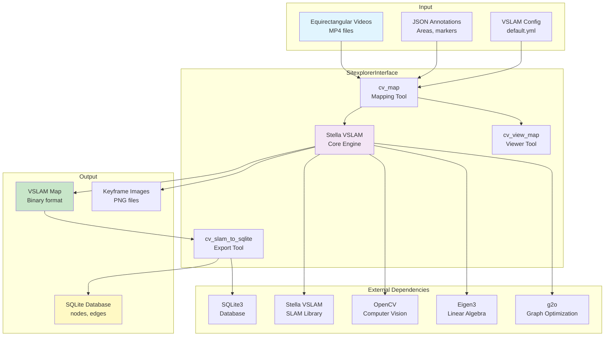

# Sitexplorer Interface

C++ interface to Stella VSLAM for processing equirectangular 360-degree videos and creating SLAM maps. Provides tools for mapping, viewing, and exporting SLAM data.

## Overview

The SitexplorerInterface is a modified version of the openvslam example interface, adapted for the Sitexplorer/CampusVirtual system. It processes equirectangular videos, extracts keyframes, tracks camera poses, and exports data to SQLite databases.

The interface reads JSON annotation files for area markers, elevators, toilets, and anchors to enhance the SLAM mapping process.

## Environment Variables

### Required Variables (from scripts)

#### For Mapping (`cv_run_2_map.sh`)
- `CV_HOME_DIR` - Root directory of the Sitexplorer project
- `CV_VSLAM_MAP_DIR` - Directory for VSLAM map files
- `CV_JSON_DIR` - Directory containing JSON annotation files
- `CV_KEYFRAME_IMG_DIR` - Directory for keyframe images
- `CV_VSLAM_MAP_HEADLESS` - Run in headless mode (`true`/`false`)
- `CV_VSLAM_EPOCH_START` - Epoch start timestamp
- `CV_VIDEO_DIR` - Directory containing video files
- `CV_VSLAM_CONFIG_FILE` - Path to VSLAM configuration YAML file
- `CV_VSLAM_MAP_VIDEOS_COMMA_SEPARATED_NAMES` - Comma-separated video names
- `CV_VSLAM_MAP_NAME` - Output map name

#### For Editing (`cv_run_3_edit_vslam_map.sh`)
- `CV_HOME_DIR` - Root directory
- `CV_VSLAM_MAP_DIR` - Directory for VSLAM map files
- `CV_VSLAM_MAP_NAME` - Input map name
- `CV_EDIT_VSLAM_OUTPUT_MAP_NAME` - Output map name

#### For Export (`cv_run_4_export_sqlite.sh`)
- `CV_HOME_DIR` - Root directory
- `CV_VSLAM_MAP_DIR` - Directory for VSLAM map files
- `CV_VSLAM_CONFIG_FILE` - Path to VSLAM configuration YAML file
- `CV_DB_DIR` - Directory for SQLite databases
- `CV_EXPORT_IN_MAP_NAME` - Input map name
- `CV_EXPORT_DB_NAME` - Output database name

## Scripts

### `bin/scripts/cv_run_2_map.sh`
Runs VSLAM mapping on video files using `runSitexplorer` (which calls `cv_map`):
- Processes videos to create a SLAM map
- Extracts keyframes and saves images
- Reads JSON annotations for area/location markers

### `bin/scripts/cv_run_3_edit_vslam_map.sh`
Opens interactive viewer for map editing using `runSitexplorer` (which calls `cv_view_map`):
- Loads map for visual inspection
- Allows manual editing and adjustment

### `bin/scripts/cv_run_4_export_sqlite.sh`
Exports VSLAM map to SQLite database using `runSitexplorer` (which calls `cv_slam_to_sqlite`):
- Converts VSLAM map format to SQLite
- Creates nodes, edges, and pose data

## Architecture



## Functionality

### JSON Annotation Format

The interface reads JSON files with the following structure:

```json
{
  "data": [
    {"g": "Area Name", "t": 123.45}
  ],
  "user_defined": [
    {"g": "Marker Description", "t": 123.45, "info": "Optional info"}
  ],
  "disable_loop": [
    {"disable": false, "t": 123.45}
  ]
}
```

Where:
- `g`: Group/description text (area name or marker)
- `t`: Timestamp in seconds
- `info`: Optional additional information
- `disable`: Boolean indicating if loop detection is disabled

### Executables

1. **`cv_map`** - Main mapping tool
   - Processes equirectangular videos
   - Extracts keyframes
   - Tracks camera pose
   - Handles loop closures

2. **`cv_view_map`** - Interactive map viewer
   - Visual inspection of poses
   - Manual editing capabilities

3. **`cv_slam_to_sqlite`** - Database export
   - Converts VSLAM binary map to SQLite
   - Creates nodes and edges tables
   - Handles special node types (elevators, etc.)

## Pipeline Position

The SitexplorerInterface runs **after** the following steps:
- `cv_run_1_process_files.sh` - File processing (creates videos)

**Before:**
- Equirectangular videos must be available
- JSON annotation files (optional) for area markers

**After:**
- `cv_run_4_export_sqlite.sh` - Export to SQLite
- `cv_run_6_prune_graph.sh` - Graph pruning
- `cv_run_7_merge_maps.sh` - Map merging (if multiple maps)

## Dependencies

### Core Libraries
- **Stella VSLAM** - Visual SLAM framework (forked version)
- **OpenCV** - Computer vision and image processing
- **Eigen3** - Linear algebra
- **g2o** - Graph optimization
- **SQLite3** - Database operations

### Build Dependencies
- **CMake** - Build system
- **Boost** - Utilities (filesystem, program options)
- **FFmpeg** - Video codec support (for OpenCV)

### Third-Party Components
- `3rd/filesystem` - Filesystem utilities (gulrak/filesystem, MIT license)
- `3rd/popl` - Command-line parsing (badaix/popl v1.2.0, MIT license)
- `3rd/nlohmann` - JSON parsing

## Installation

The interface is built as part of the main Sitexplorer build process:

```bash
./BUILD_SITEXPLORER.sh
```

This builds:
- `cv_map` - Mapping executable
- `cv_view_map` - Viewing executable
- `cv_slam_to_sqlite` - Export executable

## Configuration

The VSLAM system uses a YAML configuration file (typically `Config/default.yml`) that specifies:
- Camera parameters (equirectangular projection)
- Feature detector settings
- Vocabulary file path (`FBoW/orb_vocab.fbow`)
- Map database settings
- Loop closure parameters

## File Structure

```
SitexplorerInterface/
├── src/
│   ├── map.cc            # Main mapping tool
│   ├── view.cc           # Map viewer
│   ├── slam_to_sqlite.cc # SQLite export
│   └── util/             # Utility functions
├── 3rd/                  # Third-party libraries
│   ├── filesystem/       # Filesystem utilities
│   ├── popl/             # Command-line parsing
│   └── nlohmann/         # JSON parsing
├── CMakeLists.txt        # Build configuration
└── README.md             # This file
```

## License

This module was originally included in xdspacelab/openvslam. Therefore, the license follows the original license of xdspacelab/openvslam (BSD 2-Clause).

(Note: Though it has since been modified, with only minor relations back to the original example script)

The following files are derived from third-party libraries:
- `./3rd/filesystem` : [gulrak/filesystem](https://github.com/gulrak/filesystem) (MIT license)
- `./3rd/popl` : [badaix/popl \[v1.2.0\]](https://github.com/badaix/popl) (MIT license)

## Notes

- The system uses equirectangular projection for 360-degree videos
- JSON annotations can mark areas, elevators, toilets, and anchors
- Maps can be extended by providing an existing map as input
- The export process converts poses to SQLite format for downstream processing
