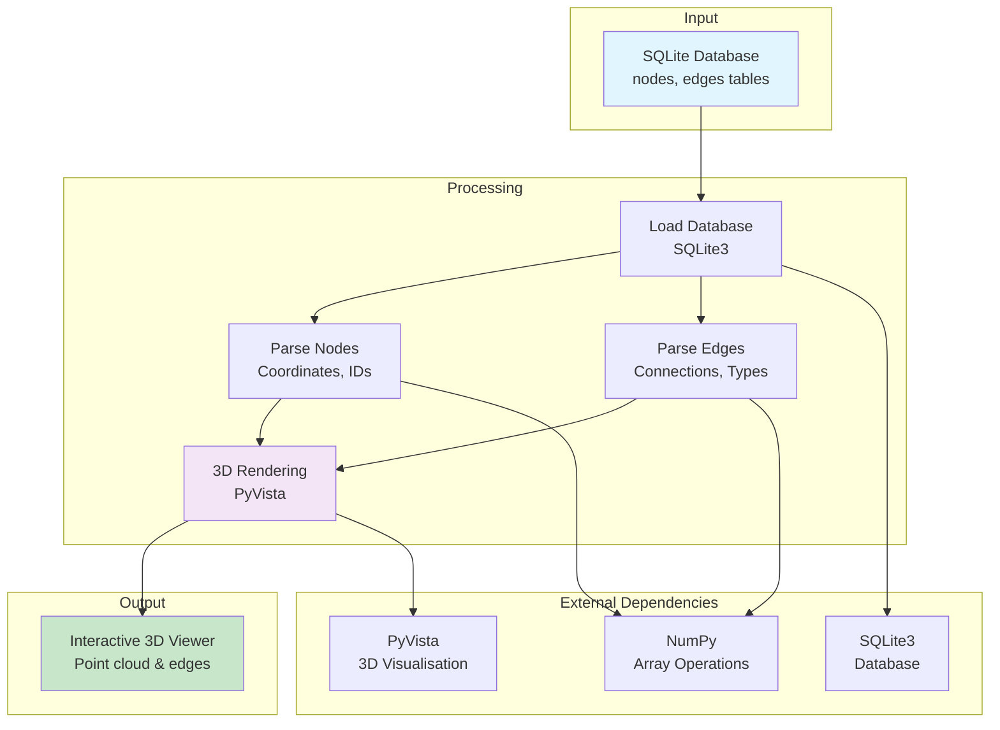

# SQLiteViewer - Enhanced Edge Visualisation

Python-based 3D visualisation tool for SQLite databases containing SLAM map data. This enhanced version supports comprehensive edge visualisation with the `refined_edges` table structure.

## Overview

SQLiteViewer provides interactive 3D visualisation of spatial graph data stored in SQLite databases. It displays nodes, edges, and supports various edge types with colour coding for easy inspection and debugging of SLAM maps.

## Environment Variables

This application does not use any CV_ environment variables. It is a standalone visualisation tool that takes database file paths as command-line arguments.

## Scripts

This application is not called by any `bin/scripts/` scripts. It is a manual tool for visualising and inspecting databases.

## Architecture



## Pipeline Position

SQLiteViewer is a **manual inspection tool** that can be used at any point after database creation:

- **After** `cv_run_4_export_sqlite.sh` - View exported SLAM data
- **After** `cv_run_6_prune_graph.sh` - Inspect pruned graph
- **After** `cv_run_7_merge_maps.sh` - Verify merged maps
- **After** `cv_run_9_init_data.sh` - Check floorplan data

It is not part of the automated pipeline but is useful for debugging and visual verification.

## Features

### Edge Visualisation
- **Colour-coded edges**: Different edge types are displayed with distinct colours
- **Edge type support**: Supports the full `refined_edges` table structure with `type` and `zone` columns
- **Toggle visibility**: Press 't' to show/hide all edges
- **Elevator edges**: Special cyan-coloured lines for elevator connections

### Edge Types and Colours
- **Type 0**: Blue lines (default/unknown type)
- **Type 1**: Green lines
- **Type 2**: Orange lines (default edge type)
- **Type 3**: Red lines (edge contraction - displayed with thicker lines)
- **Type -1**: Purple lines (covisibility edges)
- **Elevator edges**: Cyan lines (thicker lines for visibility)

### Database Structure Support
The viewer now properly handles the `refined_edges` table structure:

```sql
CREATE TABLE refined_edges (
    keyframe_id0 INTEGER NOT NULL,
    keyframe_id1 INTEGER NOT NULL,
    type INTEGER DEFAULT 2,
    zone TEXT DEFAULT NULL,
    FOREIGN KEY (keyframe_id0) REFERENCES refined_nodes(keyframe_id) ON DELETE CASCADE,
    FOREIGN KEY (keyframe_id1) REFERENCES refined_nodes(keyframe_id) ON DELETE CASCADE,
    UNIQUE(keyframe_id0, keyframe_id1),
    PRIMARY KEY (keyframe_id0, keyframe_id1)
)
```

## Usage

### Basic Usage
```bash
python view.py <database_file> [table_prefix]
```

### Examples
```bash
# View with refined_ prefix
python view.py my_database.db refined_

# View without prefix (uses default table names)
python view.py my_database.db

# Test with the provided test database
python test_edges.py
python view.py test_edges.db refined_
```

### Controls
- **p**: Select point
- **d**: Add selected point to 'remove' list
- **1**: Store the selected point as the 1st of 2 points
- **2**: Connect the current selected point to the point stored in 1
- **e**: Execute the actions - e.g. remove IDs from the remove list
- **n**: Show neighbours of selected point
- **t**: Toggle edge visibility

## Testing

A test script is provided to verify the edge functionality:

```bash
python test_edges.py
```

This creates a test database (`test_edges.db`) with:
- 25 nodes in a 5x5 grid pattern
- Various edge types (0, 1, 2, 3) with different colours
- Demonstrates the enhanced visualisation capabilities

## Requirements

- Python 3.6+
- numpy
- pyvista
- tqdm

Install with:
```bash
pip install -r requirements.txt
```

## Enhanced Features

### Automatic Table Detection
The viewer automatically detects whether the edge table has the enhanced structure (with `type` and `zone` columns) and adapts accordingly.

### Backward Compatibility
The viewer maintains backward compatibility with older database structures that only have basic edge information.

### Debugging Information
Enhanced logging shows:
- Number of edges loaded
- Edge structure type (basic vs enhanced)
- Sample edge data for verification
- Valid/invalid edge counts during rendering

### Performance Optimisations
- Efficient edge actor management for visibility toggling
- Proper memory management for large datasets
- Progress bars for loading operations
