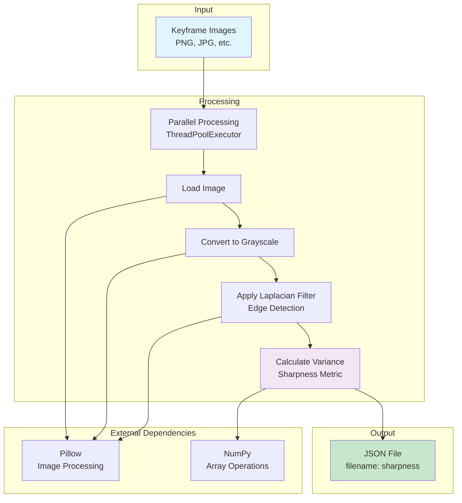

# Sharpness Calculator

Python application for calculating image sharpness using Laplacian variance (edge intensity) for keyframe images.

## Overview

The Sharpness Calculator processes images in a directory and calculates sharpness values using the variance of the Laplacian operator. This metric is used to assess image quality and is particularly useful for selecting the best representative images during graph pruning.

## Environment Variables

### Required Variables (from script)
- `CV_HOME_DIR` - Root directory of the Sitexplorer project
- `CV_KEYFRAME_IMG_DIR` - Directory containing keyframe images to process
- `CV_PRECALCULATE_IMAGE_SHARPNESS_JSON_PATH` - Output JSON file path for sharpness results

## Scripts

### `bin/scripts/cv_run_5_sharpness_calculate.sh`
Calculates sharpness for all images in the keyframe directory:

**Usage:**
```bash
./bin/scripts/cv_run_5_sharpness_calculate.sh [CV_HOME_DIR] [KEYFRAME_DIR] [OUTPUT_JSON]
```

**Environment Variables:**
- Uses `CV_KEYFRAME_IMG_DIR` and `CV_PRECALCULATE_IMAGE_SHARPNESS_JSON_PATH`

**Features:**
- Creates Python virtual environment if needed
- Installs dependencies automatically
- Processes all images in parallel using thread pool

## Architecture



### Sharpness Calculation

The sharpness metric uses the **variance of the Laplacian**:
1. Convert image to grayscale
2. Apply Laplacian filter (edge detection)
3. Calculate variance of the resulting edge intensity
4. Higher variance = sharper image

**Formula:**
```
sharpness = variance(Laplacian(grayscale(image)))
```

## Functionality

### Processing Steps

1. **Directory Scanning**: Finds all image files (PNG, JPG, JPEG, BMP, GIF)
2. **Parallel Processing**: Uses ThreadPoolExecutor for concurrent processing
3. **Sharpness Calculation**: Applies Laplacian filter and calculates variance
4. **Error Handling**: Continues processing even if individual images fail
5. **JSON Export**: Saves results as JSON mapping filename to sharpness value

### Output Format

```json
{
    "image1.png": 1234.56,
    "image2.png": 987.65,
    "image3.png": "Error"
}
```

## Pipeline Position

The Sharpness Calculator runs **after** the following steps:
- `cv_run_1_process_files.sh` - File processing (creates keyframe images)
- `cv_run_2_map.sh` - VSLAM mapping
- `cv_run_4_export_sqlite.sh` - Database export

**Before:**
- Keyframe images must be extracted and available

**After:**
- Sharpness data available for graph pruning (`cv_run_6_prune_graph.sh`)
- Used by GraphProcessor to select best representative nodes

## Dependencies

### Python Packages
- `numpy` - Array operations and variance calculation
- `pillow` (PIL) - Image loading and filtering

## Installation

1. Install dependencies:
```bash
pip install -r requirements.txt
```

Or via the script (automatically creates venv):
```bash
./bin/scripts/cv_run_5_sharpness_calculate.sh
```

## Usage

### Via Script
```bash
./bin/scripts/cv_run_5_sharpness_calculate.sh
```

### Direct Usage
```bash
python main.py sharpness <image_directory> <output_json_file>
```

**Example:**
```bash
python main.py sharpness /path/to/images /path/to/sharpness.json
```

## File Structure

```
SharpnessCalculator/
├── main.py           # Command-line interface
├── sharpness.py      # Core sharpness calculation logic
└── requirements.txt  # Python dependencies
```

## Notes

- Sharpness values are relative and depend on image content
- Higher values indicate sharper images
- Processing is parallelised for performance
- Failed images are marked as "Error" in the output JSON
- The output JSON is used by GraphProcessor for node selection during pruning


