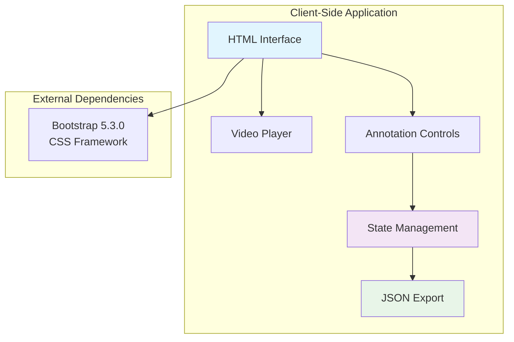

# Annotator

A simple web-based video annotation tool for marking areas, points of interest, and loop detection settings in video files.

## Overview

The annotator is a standalone HTML/JavaScript application that allows users to:
- Load video files via drag-and-drop or file path
- Add area annotations with timestamps
- Add marker annotations (regular points, toilets, elevators, anchors)
- Toggle loop detection at specific timestamps
- Export annotations as JSON

## Features

### Area Annotations
- Mark location/area names at specific timestamps
- Autocomplete suggestions based on previously entered areas

### Marker Annotations
- **Regular Points of Interest**: General markers with descriptions
- **Toilets**: Toilet markers with required descriptions
- **Elevators**: Elevator markers with shaft group names and descriptions
- **Anchors**: Special anchor markers (no additional fields)

### Loop Detection Control
- Enable/disable loop detection at specific timestamps
- Visual status indicator

## Environment Variables

This application does not use any CV_ environment variables. It is a standalone client-side tool.

## Scripts

This application is not called by any `bin/scripts/` scripts. It is a manual tool for video annotation.

## Usage

1. Open `index.html` in a web browser
2. Load a video file by:
   - Dragging and dropping a video file onto the drop zone, or
   - Entering a file path and clicking "Load from Path"
3. Play the video and use the annotation buttons to add markers
4. Click "Download JSON" to export annotations

## Output Format

The tool exports a JSON file with the following structure:

```json
{
  "data": [
    {
      "g": "Area Name",
      "t": 12345
    }
  ],
  "user_defined": [
    {
      "g": "Marker Description",
      "t": 12345,
      "info": "Optional info"
    }
  ],
  "disable_loop": [
    {
      "disable": false,
      "t": 12345
    }
  ]
}
```

Where:
- `g`: Group/description text
- `t`: Timestamp in milliseconds
- `info`: Optional additional information
- `disable`: Boolean indicating if loop detection is disabled

## Architecture



## Pipeline Position

This tool is independent of the main Sitexplorer pipeline. It is used manually for annotating videos before or during the mapping process.

## Dependencies

- Bootstrap 5.3.0 (loaded via CDN)
- Modern web browser with HTML5 video support

## File Structure

```
annotator/
├── index.html    # Main HTML interface
├── app.js        # Application logic
└── style.css     # Custom styles
```


