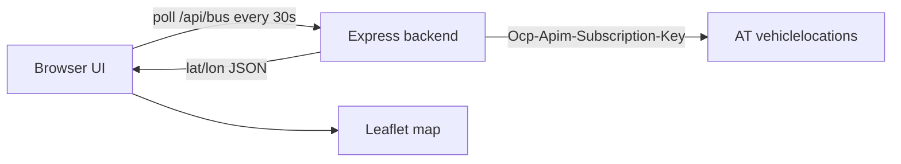

# AT bus tracker (NB5836)

Small web app that tracks Auckland Transport bus **NB5836** (plate **QCH657**, AVL id **15836**) using the AT realtime vehicle locations API.

The Auckland Transport subscription key stays on the backend (`AT_API_KEY`). The browser only talks to this app’s `/api/bus` endpoint.



## Setup

```bash
cd Apps/at-bus-tracker
cp .env.example .env
# put your AT developer portal key in .env
npm install
npm start
```

Open [http://localhost:3000](http://localhost:3000).

## Environment

| Variable | Default | Purpose |
|---|---|---|
| `AT_API_KEY` | _(required)_ | AT developer portal subscription key |
| `PORT` | `3000` | HTTP port |
| `BUS_VEHICLE_ID` | `15836` | AVL vehicle id |
| `BUS_FLEET_LABEL` | `NB5836` | Fleet label fallback match |
| `BUS_PLATE` | `QCH657` | Number plate fallback match |
| `CACHE_TTL_MS` | `15000` | Server-side cache for AT responses |

## Notes

- The UI polls every 30 seconds to match AT feed cadence.
- If the bus is off-duty / not reporting, the page shows **Offline** and keeps Auckland centred until a position appears.
- Rotate any API key that has been shared in chat or committed by mistake.
