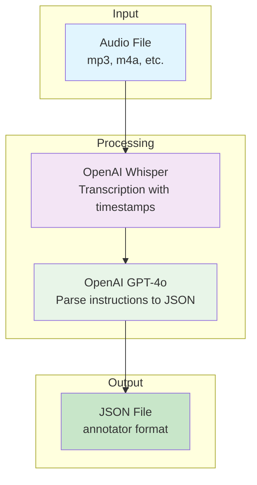

# Audio Annotator

A Python CLI application that processes audio files (mp3, m4a, etc.) to generate timestamped annotations in the format expected by the annotator tool. The application uses OpenAI Whisper for transcription and OpenAI GPT-4o for intelligent parsing of spoken instructions into structured JSON.

## Overview

The Audio Annotator converts spoken instructions recorded in audio files into structured JSON annotations that can be imported into the video annotator tool. It handles:

- **Area transitions**: Instructions about moving between areas (e.g., "Moving to area 'Floor 1'")
- **Point markers**: Instructions about marking specific points (e.g., "This point is the Tech Bar")
- **Loop detection control**: Instructions to enable/disable loop detection

## Architecture



## Environment Variables

### Required Variables

- `OPENAI_API_KEY` - OpenAI API key for accessing GPT-4o and Whisper models

## Scripts

This application is not called by any `bin/scripts/` scripts. It is a standalone tool for converting audio recordings to annotation JSON.

## Pipeline Position

This tool is independent of the main Sitexplorer pipeline. It is used manually to convert audio recordings into annotation files that can be imported into the annotator tool.

## Dependencies

### Python Packages

- `openai-whisper` - Audio transcription with timestamp extraction
- `openai` - GPT-4o API client for JSON conversion
- `python-dotenv` - Environment variable management (optional)

## Installation

1. Install Python dependencies:
```bash
pip install -r requirements.txt
```

2. Set up OpenAI API key:
```bash
export OPENAI_API_KEY="your-api-key-here"
```

Or create a `.env` file:
```
OPENAI_API_KEY=your-api-key-here
```

## Usage

### Basic Usage

```bash
python audio_annotator.py input.m4a output.json
```

### With Custom Whisper Model Size

```bash
python audio_annotator.py input.m4a output.json --model-size large
```

### With API Key as Argument

```bash
python audio_annotator.py input.m4a output.json --api-key "your-api-key"
```

### Command-Line Options

- `input_file` - Path to input audio file (required)
- `output_file` - Path to output JSON file (required)
- `--model-size` - Whisper model size: `tiny`, `base`, `small`, `medium`, `large` (default: `base`)
- `--api-key` - OpenAI API key (default: from `OPENAI_API_KEY` environment variable)

## Output Format

The tool generates JSON files matching the annotator export structure:

```json
{
  "data": [
    {
      "g": "Floor 1",
      "t": 12345
    },
    {
      "g": "1 to 2 - staircase",
      "t": 45678
    }
  ],
  "user_defined": [
    {
      "g": "Tech Bar",
      "t": 3000
    },
    {
      "g": "reception desk",
      "t": 15000
    }
  ],
  "disable_loop": [
    {
      "disable": true,
      "t": 60000
    }
  ]
}
```

### Field Descriptions

- **`data`**: Array of area transitions/movement annotations. Used when moving between areas.
  - Example instructions: "Moving to area 'Floor 1'", "Moving on a staircase from 1 to 2"
  
- **`user_defined`**: Array of custom labelled points/static markers. Used for marking specific locations.
  - Example instructions: "This point is the Tech Bar", "This is the reception desk"
  
- **`disable_loop`**: Array of loop detection control entries. Used to enable/disable loop detection.
  - Example instructions: "Stop loop detection", "Start loop detection"

- **`g`**: Group/description text extracted from the instruction
- **`t`**: Timestamp in milliseconds (rounded from transcription timestamps)

## Instruction Patterns

The LLM processor recognises the following instruction patterns:

### Area Transitions (→ `data` array)

- "Moving to area 'Floor 1'"
- "Moving on a staircase from 1 to 2"
- "Entering the lobby"
- "Going to the second floor"

### Point Markers (→ `user_defined` array)

- "This point is the Tech Bar"
- "This is the reception desk"
- "Mark this as the entrance"
- "This location is the library"

### Loop Detection (→ `disable_loop` array)

- "Stop loop detection"
- "Start loop detection"
- "Enable loop detection"
- "Disable loop detection"

## File Structure

```
audio-annotator/
├── audio_annotator.py      # Main CLI application
├── whisper_transcriber.py  # Whisper transcription wrapper
├── llm_processor.py        # GPT-4o JSON conversion
├── requirements.txt        # Python dependencies
└── README.md              # This file
```

## How It Works

1. **Audio Transcription**: The application uses OpenAI Whisper to transcribe the audio file, extracting timestamped segments.

2. **LLM Processing**: Each transcription segment is processed by GPT-4o with a system prompt that explains:
   - The annotator JSON format structure
   - The distinction between `data` (area transitions) and `user_defined` (point markers)
   - How to extract timestamps and descriptions from instructions

3. **JSON Generation**: The LLM responses are merged into a single JSON structure, sorted by timestamp, and written to the output file.

## Examples

### Example 1: Basic Area Navigation

**Audio recording contains:**
- "Moving to area 'Floor 1'"
- "This point is the Tech Bar"
- "Moving on a staircase from 1 to 2"

**Output JSON:**
```json
{
  "data": [
    {"g": "Floor 1", "t": 5000},
    {"g": "1 to 2 - staircase", "t": 30000}
  ],
  "user_defined": [
    {"g": "Tech Bar", "t": 15000}
  ],
  "disable_loop": []
}
```

### Example 2: With Loop Detection Control

**Audio recording contains:**
- "This point is the entrance"
- "Stop loop detection"
- "Moving to area 'outdoors'"

**Output JSON:**
```json
{
  "data": [
    {"g": "outdoors", "t": 45000}
  ],
  "user_defined": [
    {"g": "entrance", "t": 2000}
  ],
  "disable_loop": [
    {"disable": true, "t": 30000}
  ]
}
```

## Troubleshooting

### Common Issues

1. **"OpenAI API key not provided"**
   - Ensure `OPENAI_API_KEY` environment variable is set
   - Or pass `--api-key` argument

2. **"Audio file not found"**
   - Check that the input file path is correct
   - Ensure the file exists and is readable

3. **Transcription fails**
   - Check that the audio file format is supported (mp3, m4a, wav, etc.)
   - Try a different Whisper model size if the file is very long

4. **Empty or incomplete JSON output**
   - Check that the audio contains clear spoken instructions
   - Review the transcription segments to ensure they were captured correctly
   - The LLM may skip unclear or irrelevant segments

4. **"Failed to parse JSON response" warnings"**
   - This indicates the LLM returned invalid JSON for a segment
   - The segment will be skipped, but processing continues
   - Check the transcription quality for that segment

## Performance Notes

- **Whisper Model Sizes**: Larger models (medium, large) provide better accuracy but are slower. Use `base` for a good balance.
- **Processing Time**: Each transcription segment requires an API call to GPT-4o, so processing time scales with the number of segments.
- **API Costs**: Both Whisper and GPT-4o API calls incur costs. Monitor usage accordingly.

## Integration with Annotator

The generated JSON file can be used with the annotator tool by:

1. Opening the annotator web interface
2. Loading your video file
3. Manually importing the JSON data, or
4. Using the JSON as a reference while manually adding annotations

Note: The annotator currently doesn't have automatic JSON import, so you may need to manually copy the annotations or extend the annotator to support import functionality.

