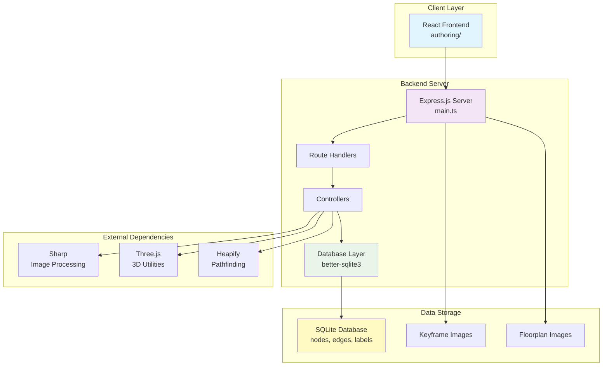

# Authoring Backend

Node.js/TypeScript backend server providing REST API for interactive map authoring and editing. Serves the React frontend and provides endpoints for managing maps, points, labels, images, and location groups.

## Overview

The authoring backend is an Express.js server that provides:
- REST API endpoints for map editing operations
- SQLite database access for spatial data
- Image serving and upload capabilities
- Pathfinding and graph operations
- Integration with the React frontend (`authoring/`)

## Environment Variables

The following CV_ environment variables are used:

### Required Variables
- `CV_DB_DIR` - Directory containing SQLite database files (default: `"maps/"`)
- `CV_AUTHORING_DB_NAME` - Name of the SQLite database file (default: `"campus.db"`)

### Optional Variables
- `CV_AUTHORING_PORT` - Server port number (default: `3004`)
- `CV_KEYFRAME_IMG_DIR` - Directory containing keyframe images
- `CV_SERVER_FLOORPLAN_IMG_DIR` - Directory for floorplan images
- `CV_AUTHORING_KEYFRAME_IMG_EXTENSION` - Image file extension (default: `".png"`)
- `CV_COORDS_TO_METRES` - Coordinate scaling factor (default: `10`)
- `CV_AUTHORING_DONT_OVERWRITE_MAP_POINTS` - Skip if map already configured (default: `false`)
- `NEIGHBOURS_INCLUDES_PROXIMITY` - Include proximity in neighbour calculations (default: `false`)

## Scripts

### `bin/scripts/cv_run_10_start_authoring.sh`
Starts the authoring backend server:
- Builds the project (TypeScript compilation)
- Builds the frontend (`authoring/` directory)
- Starts the Express server
- Serves the React frontend at the root path

**Usage:**
```bash
./bin/scripts/cv_run_10_start_authoring.sh
```

## Architecture



### API Endpoints

- `/api/v1/maps` - Map operations (get points, location groups, images)
- `/api/v1/images` - Image serving and processing
- `/api/v1/authoring` - Authoring operations (connect/disconnect points, update map points)
- `/api/v1/labels` - Label management
- `/api/v1/point` - Point operations
- `/api/v1/location-groups` - Location group management
- `/api/v1/other-nodes` - Other node operations

## Functionality

### Core Features
1. **Map Management**: Load and display floorplan maps with nodes and edges
2. **Point Editing**: Add, update, and delete map points
3. **Edge Management**: Connect and disconnect points
4. **Label Management**: Add and remove labels from map points
5. **Image Handling**: Serve keyframe images and handle floorplan image uploads
6. **Pathfinding**: Calculate paths between points using graph algorithms
7. **Location Groups**: Manage location groups and their associated floorplans

### Database Operations
- Reads from SQLite database using `better-sqlite3`
- Operates directly on the canonical tables for refined data
- Handles floorplan_points, nodes, edges, labels, and other_nodes tables

## Pipeline Position

The authoring backend runs **after** the following steps:
- `cv_run_1_process_files.sh` - File processing
- `cv_run_2_map.sh` - VSLAM mapping
- `cv_run_4_export_sqlite.sh` - Database export
- `cv_run_6_prune_graph.sh` - Graph pruning
- `cv_run_9_init_data.sh` - Data initialization

**Before:**
- Database must be exported and initialized
- Floorplan data must be available

**After:**
- Manual editing and authoring operations
- Can be used for ongoing map refinement

## Dependencies

### Runtime Dependencies
- `express` - Web server framework
- `better-sqlite3` - SQLite database driver
- `cors` - Cross-origin resource sharing
- `body-parser` - Request body parsing
- `multer` - File upload handling
- `sharp` - Image processing
- `three` - 3D utilities
- `heapify` - Priority queue for pathfinding
- `winston` - Logging
- `dotenv` - Environment variable management

### Development Dependencies
- `typescript` - TypeScript compiler
- Type definitions for all runtime dependencies

## Installation

1. Install dependencies:
```bash
npm install
```

2. Build the project:
```bash
npm run build
```

3. Start the server:
```bash
npm start
```

The server will start on the port specified by `CV_AUTHORING_PORT` (default: 3004).

## Usage

The backend is typically started via the pipeline script:
```bash
./bin/scripts/cv_run_10_start_authoring.sh
```

Or manually:
```bash
cd Apps/authoring-backend
npm run build
npm start
```

The React frontend is automatically served at the root path (`/`).

## File Structure

```
authoring-backend/
├── src/
│   ├── controllers/      # Request handlers
│   ├── routes/          # API route definitions
│   ├── logic/          # Business logic (pathfinding, etc.)
│   ├── main.ts         # Server entry point
│   ├── db.ts           # Database connection
│   ├── consts.ts       # Configuration constants
│   ├── logger.ts       # Logging setup
│   └── types.ts        # TypeScript type definitions
├── authoring/          # React frontend (separate project)
├── package.json        # Dependencies and scripts
└── tsconfig.json       # TypeScript configuration
```


