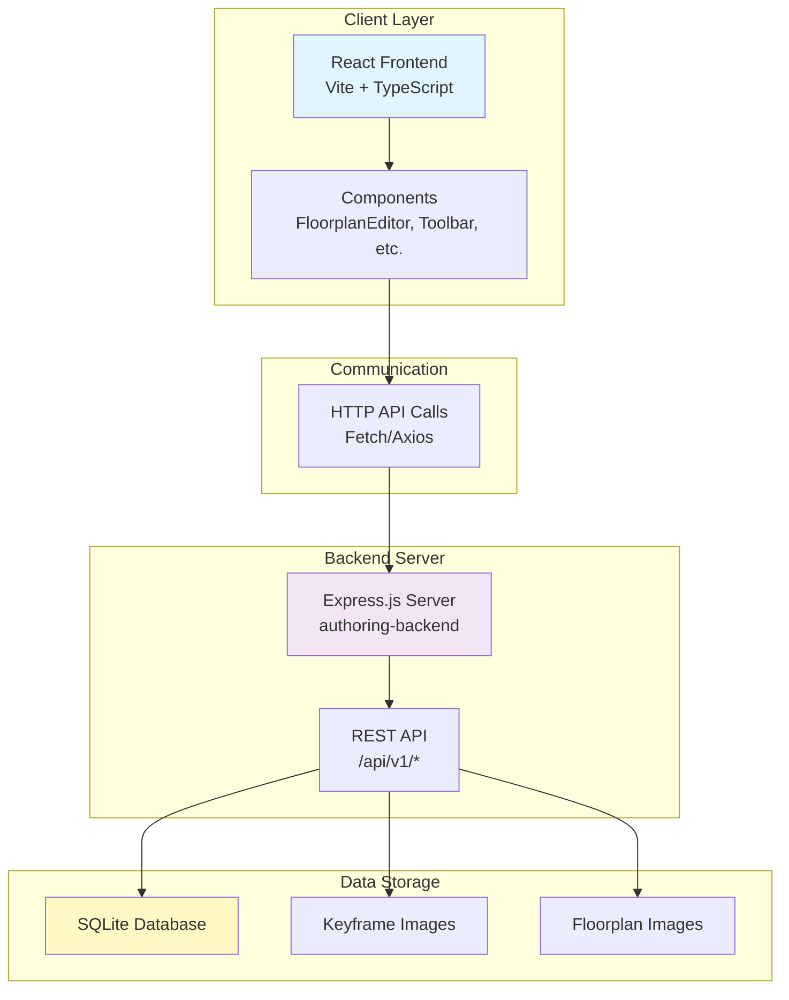

# Authoring Frontend

React + TypeScript frontend application for interactive map authoring and editing. Provides a web-based interface for managing maps, points, labels, and location groups.

## Overview

The authoring frontend is a React application built with Vite that provides an interactive interface for:
- Visualising and editing floorplan maps
- Managing map points and connections
- Adding and removing labels
- Uploading floorplan images
- Managing location groups

The frontend communicates with the authoring backend API (running on `CV_AUTHORING_PORT`) to perform all operations.

## Environment Variables

The frontend does not directly use CV_ environment variables. However, it connects to the backend which uses:

- `CV_AUTHORING_PORT` - Backend server port (default: `3004`)
- `CV_AUTHORING_DB_NAME` - Database name
- `CV_DB_DIR` - Database directory
- `CV_KEYFRAME_IMG_DIR` - Keyframe images directory
- `CV_SERVER_FLOORPLAN_IMG_DIR` - Floorplan images directory

The frontend is served by the backend Express server at the root path (`/`).

## Scripts

The frontend is built and served by the authoring backend:

### `bin/scripts/cv_run_10_start_authoring.sh`
Builds and starts the authoring system:
- Builds the React frontend (`npm run build` in `authoring/`)
- Builds the backend (`npm run build` in `authoring-backend/`)
- Starts the Express server which serves the frontend

The frontend is automatically available at `http://localhost:${CV_AUTHORING_PORT}/` when the backend is running.

## Architecture



## Functionality

### Core Features

1. **Floorplan Visualisation**
   - Display floorplan maps with nodes and edges
   - Interactive pan and zoom
   - Node selection and inspection

2. **Point Management**
   - Add, update, and delete map points
   - Connect and disconnect points
   - Visual feedback for selections

3. **Label Management**
   - Add labels to map points
   - Remove labels
   - Label type support (anchors, elevators, toilets)

4. **Image Upload**
   - Upload floorplan images for locations
   - Image preview and management

5. **Location Groups**
   - Manage location groups
   - Switch between different floorplans

## Pipeline Position

The authoring frontend runs **after** the following steps:
- `cv_run_1_process_files.sh` - File processing
- `cv_run_2_map.sh` - VSLAM mapping
- `cv_run_4_export_sqlite.sh` - Database export
- `cv_run_6_prune_graph.sh` - Graph pruning (optional)
- `cv_run_9_init_data.sh` - Data initialization

**Before:**
- Database must be exported and initialized
- Floorplan data must be available

**After:**
- Manual editing and authoring operations
- Ongoing map refinement and maintenance

## Dependencies

### Runtime Dependencies
- **React** - UI framework
- **TypeScript** - Type safety
- **Vite** - Build tool and dev server
- **Tailwind CSS** - Styling (if configured)

### Development Dependencies
- **@vitejs/plugin-react** - Vite React plugin
- **TypeScript** - TypeScript compiler
- **ESLint** - Linting

## Installation

1. Install dependencies:
```bash
cd Apps/authoring-backend/authoring
npm install
```

2. Build the project:
```bash
npm run build
```

3. The frontend is automatically built and served by the backend when running:
```bash
cd Apps/authoring-backend
npm run build
npm start
```

## Usage

### Development

For development with hot module replacement:
```bash
cd Apps/authoring-backend/authoring
npm run dev
```

This starts the Vite dev server (typically on port 5173). Note that you'll need to configure the API endpoint to point to the backend.

### Production

The frontend is built and served by the backend:
```bash
./bin/scripts/cv_run_10_start_authoring.sh
```

Access the frontend at `http://localhost:${CV_AUTHORING_PORT}/` (default: `http://localhost:3004/`).

## File Structure

```
authoring/
├── src/
│   ├── components/      # React components
│   │   ├── App.tsx
│   │   ├── FloorplanEditor.tsx
│   │   ├── Toolbar.tsx
│   │   └── ...
│   ├── logic/          # Business logic
│   ├── assets/         # Static assets
│   └── main.tsx        # Entry point
├── public/             # Public assets
├── package.json        # Dependencies
├── vite.config.ts      # Vite configuration
└── tsconfig.json       # TypeScript configuration
```

## Connection to Backend

The frontend communicates with the backend via REST API:

- **Base URL**: `http://localhost:${CV_AUTHORING_PORT}/api/v1`
- **Endpoints**:
  - `/maps` - Map operations
  - `/images` - Image serving
  - `/authoring` - Authoring operations
  - `/labels` - Label management
  - `/point` - Point operations
  - `/location-groups` - Location group management

The backend serves the built frontend at the root path (`/`), so all API calls are relative to the same origin.

## Notes

- The frontend is a Single Page Application (SPA) built with React
- All data operations go through the backend API
- The frontend is statically built and served by the Express server
- Development mode requires separate configuration for API endpoints
- The frontend uses modern React patterns (hooks, functional components)
