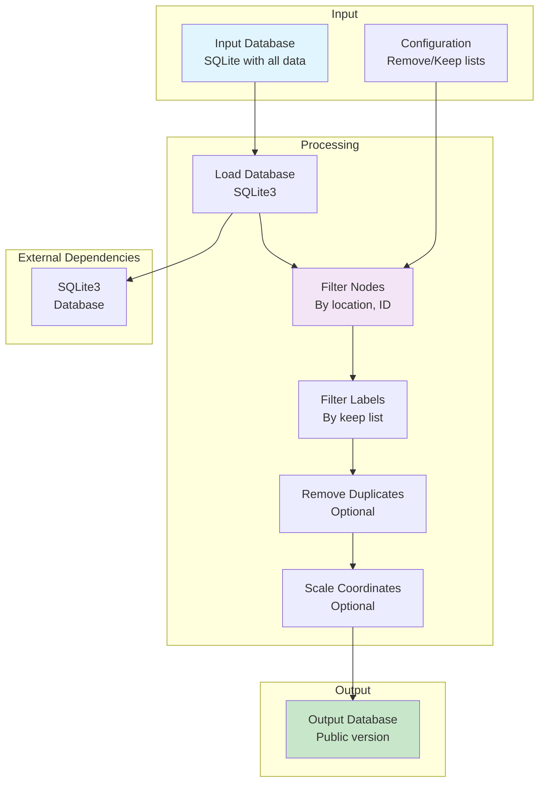

# Strip Restricted

Python script for creating public versions of databases by removing restricted locations, nodes, and labels while preserving specified nodes and labels.

## Overview

The Strip Restricted tool creates sanitised versions of databases by:
- Removing nodes from specified restricted locations
- Removing nodes by ID (except those in keep list)
- Removing labels (except those in keep list)
- Optionally removing duplicate entries
- Scaling coordinates by a factor

This is useful for creating public-facing databases that exclude sensitive or restricted areas.

## Environment Variables

### Required Variables (from script)
- `CV_HOME_DIR` - Root directory of the Sitexplorer project
- `CV_DB_DIR` - Directory containing SQLite database files
- `CV_STRIP_INPUT_DB` - Name of the input database (or command-line argument)
- `CV_STRIP_OUTPUT_DB` - Name of the output database (or command-line argument)
- `CV_STRIP_REMOVE` - JSON array of location names to remove (or command-line argument)

### Optional Variables
- `CV_STRIP_KEEP_ID` - JSON array of node IDs to keep (default: `"[]"`)
- `CV_STRIP_KEEP_LABELS` - JSON array of label names to keep (default: `'["save"]'`)
- `CV_STRIP_TABLE_PREFIX` - Table prefix to use (default: `"refined_"`)
- `CV_STRIP_SCALE_FACTOR` - Scale factor for coordinates (optional)

## Scripts

### `bin/scripts/cv_run_11_strip_restricted_locations.sh`
Creates a public version of the database by stripping restricted content:

**Usage:**
```bash
./bin/scripts/cv_run_11_strip_restricted_locations.sh [INPUT_DB] [OUTPUT_DB] [REMOVE_LIST] [KEEP_ID_LIST] [KEEP_LABELS] [SCALE_FACTOR]
```

**Arguments:**
- `INPUT_DB` - Input database path (or `CV_DB_DIR/$CV_STRIP_INPUT_DB`)
- `OUTPUT_DB` - Output database path (or `CV_DB_DIR/$CV_STRIP_OUTPUT_DB`)
- `REMOVE_LIST` - JSON array of locations to remove (or `CV_STRIP_REMOVE`)
- `KEEP_ID_LIST` - JSON array of node IDs to keep (or `CV_STRIP_KEEP_ID`)
- `KEEP_LABELS` - JSON array of labels to keep (or `CV_STRIP_KEEP_LABELS`)
- `SCALE_FACTOR` - Coordinate scaling factor (or `CV_STRIP_SCALE_FACTOR`)

**Example:**
```bash
./bin/scripts/cv_run_11_strip_restricted_locations.sh input.db output.db '["Level 4"]' '[]' '["save"]'
```

## Architecture



## Functionality

### Filtering Operations

1. **Location Removal**: Removes all nodes from specified locations
2. **ID Filtering**: Removes nodes by ID, except those in the keep list
3. **Label Filtering**: Removes labels, except those in the keep list
4. **Duplicate Removal**: Optionally removes duplicate `other_nodes` entries
5. **Coordinate Scaling**: Optionally scales x_trans, y_trans, z_trans values

### Database Tables

The script operates on tables with configurable prefixes:
- `{prefix}_nodes` - Node data
- `{prefix}_node_locations` - Node location mappings
- `{prefix}_user_defined_labels` - User-defined labels
- `{prefix}_other_nodes` - Other node data

## Pipeline Position

The Strip Restricted tool runs **after** the following steps:
- `cv_run_4_export_sqlite.sh` - Database export
- `cv_run_6_prune_graph.sh` - Graph pruning (optional)
- `cv_run_9_init_data.sh` - Data initialization (optional)

**Before:**
- Complete database must be available
- Restricted locations must be identified

**After:**
- Public database ready for distribution
- `cv_run_13_export.sh` - Export files (optional)

## Dependencies

### Python Packages
- SQLite3 (standard library)
- JSON (standard library)

No external dependencies required - uses only Python standard library.

## Installation

No installation required - uses Python standard library only.

## Usage

### Via Script
```bash
./bin/scripts/cv_run_11_strip_restricted_locations.sh
```

### Direct Usage
```bash
python strip_restricted_nodes.py <input_db> <output_db> \
  --remove_areas='["location1", "location2"]' \
  --keep_id='[15, 16, 17]' \
  --keep_labels='["save"]' \
  --scale_factor=15.0
```

**Options:**
- `--remove_areas` - JSON array of location names to remove
- `--keep_id` - JSON array of node IDs to preserve
- `--keep_labels` - JSON array of label names to preserve
- `--remove_duplicates` - Remove duplicate other_nodes entries
- `--scale_factor` - Scale factor for coordinates

**Example:**
```bash
python strip_restricted_nodes.py input.db output.db \
  --remove_areas='["floor1", "floor2"]' \
  --keep_id='[15, 16, 17]' \
  --keep_labels='["reserved"]' \
  --scale_factor=15.0
```

## File Structure

```
strip_restricted/
├── strip_restricted_nodes.py  # Main script
├── requirements.txt           # (empty - uses stdlib)
└── README.md                  # This file
```

## Notes

- The `--remove`, `--keep_id`, and `--keep_labels` arguments must be valid JSON arrays
- The script assumes tables with the configured prefix exist (default: `refined_`)
- The scale factor is **embedded in the X/Y/Z coordinates** - it modifies x_trans, y_trans, and z_trans values
- Duplicate removal keeps the entry with the lowest ID when ref_id, label, and description match
