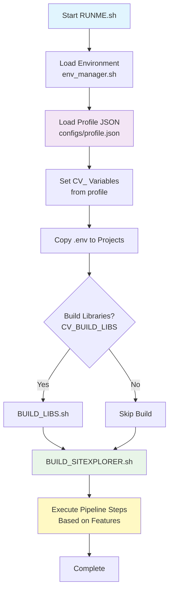
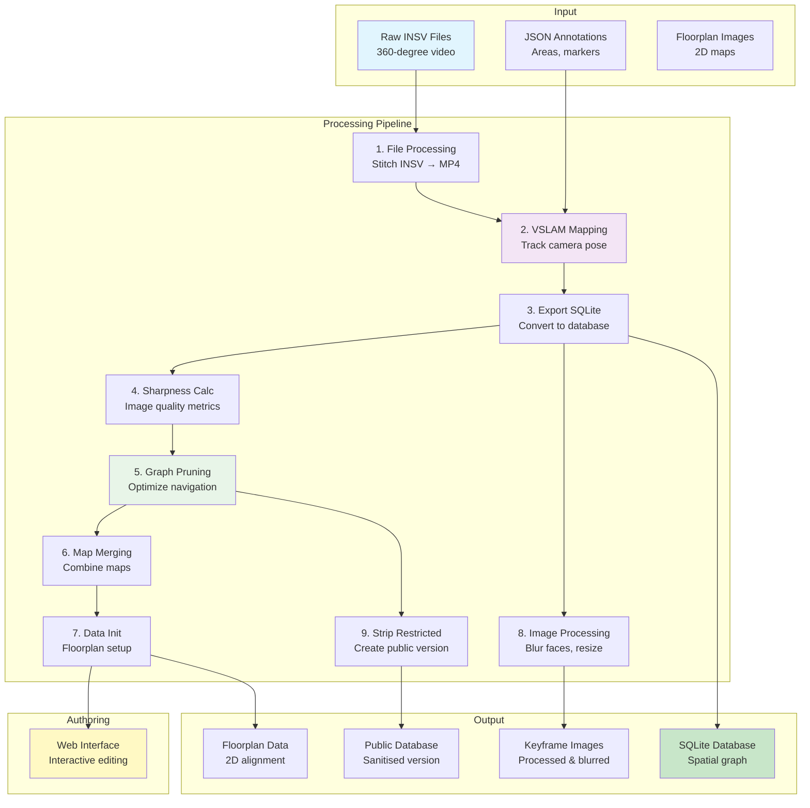

# Sitexplorer

A comprehensive system for creating and managing large-scale panoramic virtual tours. The system processes equirectangular videos (stitched from Insta360 INSV files), tracks camera movement using VSLAM, and creates an interactive 3D navigation experience.

## Quick Start

1. Clone the repository recursively:
   ```bash
   git clone --recursive https://github.com/Skwangles/Sitexplorer.git
   ```
   > **Important**: The `--recursive` flag is required as the project uses submodules. Some submodules are private and may need to be cloned manually.

2. Set up the environment:
   ```bash
   source SOURCE_SETUP.sh
   cp .env.example .env  # Update with your configuration
   ```

3. Build and run:
   ```bash
   ./RUNME.sh  # This runs BUILD_LIBS.sh and BUILD_CAMPUSVIRTUAL.sh
   ```

## System Overview

### Video Processing Pipeline

1. **Video Input**: Equirectangular videos (stitched from Insta360 INSV files)
2. **Location Data**: JSON files describing points of interest and building/floor transitions
3. **VSLAM Processing**: Tracks camera path and builds XYZ graph
4. **Database Conversion**: Converts VSLAM SQLite3 maps to custom Campus Virtual DB format
5. **Graph Optimization**: Pruning and merging of navigation graphs
6. **Web Interface**: Interactive 3D navigation using React and THREE.js

### Key Features

- **Video Processing**: Insta360 SDK integration for video stitching
- **VSLAM Tracking**: Modified Stella VSLAM for accurate pose tracking
- **Graph Management**: Custom node/edge structure for navigation
- **Interactive UI**: 3D visualization with floorplan alignment
- **Environment Management**: Flexible configuration system

## Required Libraries

- **Docker**: [https://www.docker.com/get-started/](https://www.docker.com/get-started/) - For PostgreSQL database
- **Stella VSLAM**: [https://github.com/Skwangles/stella_vslam.git](https://github.com/Skwangles/stella_vslam.git) - Forked version for pose tracking
- **Insta360 SDK**: Required for video processing (apply at [https://www.insta360.com/sdk/apply](https://www.insta360.com/sdk/apply))

### Automatically Installed by BUILD_LIBS.sh

- OpenCV
- Stella VSLAM
- g2o
- Stella VSlam custom FBoW implementation
- Iridescence
- Node.js

## Usage Guide

### Basic Usage

1. **Environment Setup**:
   ```bash
   source SOURCE_SETUP.sh
   ```

2. **Configuration**:
   - Copy `.env.example` to `.env`
   - Create or select a profile in `configs/` directory
   - Update configuration values as needed

3. **Building and Running**:
   ```bash
   ./RUNME.sh <profile_name> [custom_env_file]
   ```
   
   Example:
   ```bash
   ./RUNME.sh dev
   ./RUNME.sh tga-pub .env.custom
   ```

## Configuration System

The Sitexplorer system uses a flexible JSON-based configuration system that allows you to define different profiles for different projects or environments.

### Configuration Files

Configuration profiles are stored in the `configs/` directory as JSON files. Each profile defines:
- **Features**: Which processing steps to enable/disable
- **Paths**: Directory paths for inputs and outputs
- **Config**: Processing parameters and settings

### Profile Structure

Each profile JSON file has the following structure:

```json
{
  "name": "profile-name",
  "features": {
    "build_libs": false,
    "stitch_insv": true,
    "vslam_map": true,
    "export_db": true,
    "graph_prune": true,
    ...
  },
  "paths": {
    "home_dir": "/path/to/sitexplorer",
    "video_dir": "/path/to/videos",
    "keyframe_img_dir": "/path/to/images",
    "db_dir": "/path/to/databases",
    ...
  },
  "config": {
    "coords_to_metres": 15,
    "stitch_resolution": "5760x2880",
    "vslam_map_name": "map.db",
    ...
  },
  "env_file": ".env.profile"
}
```

### Features

The `features` section controls which pipeline steps are executed:

- `build_libs` - Build dependencies (OpenCV, Stella VSLAM, etc.)
- `stitch_insv` - Stitch INSV files to equirectangular videos
- `vslam_map` - Run VSLAM mapping on videos
- `edit_vslam` - Edit VSLAM map interactively
- `export_db` - Export VSLAM map to SQLite
- `precalculate_image_sharpness` - Calculate image sharpness metrics
- `graph_prune` - Prune navigation graph
- `merge_maps` - Merge multiple maps
- `edit_db_visually` - Edit database visually
- `init_data` - Initialize floorplan data
- `start_authoring` - Start authoring web interface
- `strip_restricted_nodes` - Create public version by removing restricted areas
- `extract_used_images` - Extract and process keyframe images
- `export_files` - Export database and floorplans to client directory

### Paths

The `paths` section defines directory locations:

- `home_dir` - Root directory of Sitexplorer project
- `video_dir` - Directory containing input videos
- `keyframe_img_dir` - Directory for keyframe images
- `db_dir` - Directory for SQLite databases
- `vslam_map_dir` - Directory for VSLAM map files
- `json_dir` - Directory containing JSON annotation files
- `floorplan_dir` - Directory for floorplan images
- `export_dir` - Output directory for exports

### Config

The `config` section contains processing parameters:

- `coords_to_metres` - Coordinate scaling factor
- `stitch_resolution` - Video output resolution (e.g., "5760x2880")
- `vslam_map_name` - Output VSLAM map filename
- `prune_grid_size` - Grid size for graph pruning
- `authoring_port` - Port for authoring web interface
- And many more processing-specific settings

### Environment Variable Mapping

The configuration system automatically converts JSON values to `CV_` environment variables:

- `features.stitch_insv` → `CV_STITCH_INSV=true`
- `paths.video_dir` → `CV_VIDEO_DIR=/path/to/videos`
- `config.coords_to_metres` → `CV_COORDS_TO_METRES=15`

### Configuration Loading Order

1. **Base Environment** (`.env`) - Common settings loaded first
2. **Profile Configuration** (`configs/<profile>.json`) - Profile-specific settings
3. **Secrets** (`.env.secrets`) - Sensitive data (not committed)
4. **Custom Environment** (optional) - Additional overrides
5. **Project Secrets** (`Apps/*/.env.secrets`) - Per-project secrets

## Building Steps

The build process consists of two main phases:

### Phase 1: Build Libraries (`BUILD_LIBS.sh`)

This step builds all required dependencies (only runs if `build_libs: true` in profile):

1. **System Dependencies**: Installs system packages via apt
   - Build tools (cmake, g++, etc.)
   - OpenCV dependencies
   - g2o dependencies
   - Eigen3, Boost, SQLite3, etc.

2. **Submodules**: Initializes and updates git submodules

3. **OpenCV**: Builds OpenCV from source

4. **Stella VSLAM**: Builds Stella VSLAM library

5. **g2o**: Builds graph optimization library

6. **FBoW**: Builds custom FBoW vocabulary implementation

7. **Iridescence**: Builds viewer library (optional)

8. **Node.js**: Installs Node.js for JavaScript/TypeScript projects

### Phase 2: Build Sitexplorer (`BUILD_SITEXPLORER.sh`)

This step builds all Sitexplorer applications:

1. **Face Blurring** (`blur360-images`): Builds face detection and blurring tool
2. **VSLAM Interface** (`SLAM/SitexplorerInterface`): Builds mapping, viewing, and export tools
3. **Map Merger** (`MapMerge`): Builds map merging tool
4. **CLI Interfaces** (`ENTRYPOINT`): Builds command-line utilities
5. **File Processing** (`Sitexplorer-FileProcessing`): Builds video stitching tool

All binaries are installed to `/usr/local/bin/` for system-wide access.

## How RUNME.sh Works

The `RUNME.sh` script orchestrates the entire pipeline:

### Execution Flow



### Step-by-Step Process

1. **Load Configuration**:
   - Calls `env_manager.sh` with profile name
   - Loads base `.env` file
   - Loads profile JSON from `configs/<profile>.json`
   - Converts JSON to `CV_` environment variables
   - Loads secrets and custom environment files

2. **Prepare Environment**:
   - Makes scripts executable
   - Copies environment files to Node.js projects
   - Sets up working directory

3. **Build Phase**:
   - Conditionally runs `BUILD_LIBS.sh` if `CV_BUILD_LIBS=true`
   - Always runs `BUILD_SITEXPLORER.sh` to build applications

4. **Execute Pipeline**:
   - Checks each feature flag in the profile
   - Runs corresponding `cv_run_X.sh` script if enabled
   - Each step validates required environment variables
   - Errors stop the pipeline with clear messages

### Pipeline Execution Order

The pipeline steps execute in this order (if enabled in profile):

1. `cv_run_0_copy_env_file.sh` - Copy environment files
2. `cv_run_1_process_files.sh` - Stitch INSV files
3. `cv_run_2_map.sh` - VSLAM mapping
4. `cv_run_3_edit_vslam_map.sh` - Edit VSLAM map (optional)
5. `cv_run_4_export_sqlite.sh` - Export to SQLite
6. `cv_run_5_sharpness_calculate.sh` - Calculate sharpness
7. `cv_run_6_prune_graph.sh` - Prune graph
8. `cv_run_7_merge_maps.sh` - Merge maps (optional)
9. `cv_run_8_edit_db.sh` - Visual database editing (optional)
10. `cv_run_9_init_data.sh` - Initialize floorplan data
11. `cv_run_10_start_authoring.sh` - Start authoring interface
12. `cv_run_11_strip_restricted_locations.sh` - Strip restricted nodes
13. `cv_run_12_extract_images.sh` - Extract and process images
14. `cv_run_13_export.sh` - Export final files
15. `cv_run_14_export-to-postgres.sh` - Export SQLite database to PostgreSQL

## Complete Pipeline Flow

The following diagram shows the complete data flow from raw files to final output:



### Detailed Pipeline Steps

```mermaid
graph LR
    subgraph "Step 1: File Processing"
        A1[INSV Files] --> A2[Stitch Videos<br/>cv_stitch_insv]
        A2 --> A3[Equirectangular MP4]
    end
    
    subgraph "Step 2: VSLAM Mapping"
        B1[MP4 Videos] --> B2[Extract Keyframes<br/>cv_map]
        B2 --> B3[Track Poses<br/>Stella VSLAM]
        B3 --> B4[VSLAM Map<br/>Binary format]
    end
    
    subgraph "Step 3: Database Export"
        C1[VSLAM Map] --> C2[Convert to SQLite<br/>cv_slam_to_sqlite]
        C2 --> C3[SQLite DB<br/>nodes, edges]
    end
    
    subgraph "Step 4: Graph Processing"
        D1[SQLite DB] --> D2[Calculate Sharpness<br/>Optional]
        D2 --> D3[Prune Graph<br/>Grid-based]
        D3 --> D4[Optimized DB<br/>Fewer nodes]
    end
    
    subgraph "Step 5: Final Processing"
        E1[Optimized DB] --> E2[Init Floorplan Data]
        E2 --> E3[Process Images<br/>Blur, resize]
        E3 --> E4[Strip Restricted<br/>Optional]
        E4 --> E5[Final Database<br/>Ready for deployment]
    end
    
    A3 --> B1
    B4 --> C1
    C3 --> D1
    D4 --> E1
    
    style A2 fill:#e1f5fe
    style B3 fill:#f3e5f5
    style C2 fill:#e8f5e8
    style D3 fill:#fff9c4
    style E5 fill:#c8e6c9
```



### Advanced Usage

The system provides several scripts for different operations:

- `bin/scripts/cv_run_X.sh`: Various processing scripts (numbered 0-13)
- Individual scripts can be run manually if environment is set up
- Each script validates required environment variables

For examples of complex operations, see the `/examples` directory.

## Database Structure

### Nodes

Nodes represent points in 3D space with different types:
- Type 0: Normal image points
- Type 1: Elevator points
- Type 2+: Special points (e.g., merge points)

### Edges

Edges connect nodes and define navigable paths:
- Type -1: Covisibility edges (shared landmarks)
- Type 0: Normal navigation edges
- Type 1: Loop closure edges
- Type 2: Merge point edges
- Type 3: Edge contraction edges
- Type 4: Pathfind-only edges

## Creating a New Profile

To create a new configuration profile:

1. **Copy an existing profile**:
   ```bash
   cp configs/dev.json configs/my-project.json
   ```

2. **Edit the profile**:
   - Update `name` field
   - Set `features` to enable/disable steps
   - Update `paths` with your directory locations
   - Configure `config` parameters for your project
   - Optionally set `env_file` to use a custom `.env` file

3. **Run with your profile**:
   ```bash
   ./RUNME.sh my-project
   ```

### Profile Examples

- **`dev.json`**: Development profile with all features enabled
- **`tga-pub.json`**: Production profile for public release (strips restricted areas)
- **`uow-ham-test.json`**: Test profile for specific project

Each profile can have different:
- Input/output directories
- Database names
- Processing parameters
- Feature flags

## Optional Features

### Face Blurring

For privacy concerns, consider using [blur360](https://github.com/thaytan/blur360) for face blurring in 360-degree images.

### Authoring Interface

The authoring interface (`<url>/authoring`) allows:
- Aligning points to 2D floorplans
- Editing node positions
- Managing floorplan images
- Configuring navigation paths

> **Note**: The authoring interface should only be enabled for admin use.

## Troubleshooting

### Common Issues

1. **Submodule Issues**:
   - Ensure all submodules are cloned
   - Check for private repository access

2. **Build Failures**:
   - Verify all dependencies are installed
   - Check system requirements

3. **Database Issues**:
   - Ensure PostgreSQL is running
   - Check database permissions

### Performance Tuning

- Adjust `coords_to_metres` in `sitexplorer-backend/ui/src/consts.ts` for better point spacing
- Configure graph pruning parameters for optimal navigation
- Tune VSLAM parameters for better tracking

## Contributing

1. Fork the repository
2. Create a feature branch
3. Make your changes
4. Submit a pull request

## License

[License](LICENSE)

## Contact

hi@skwangles.com
