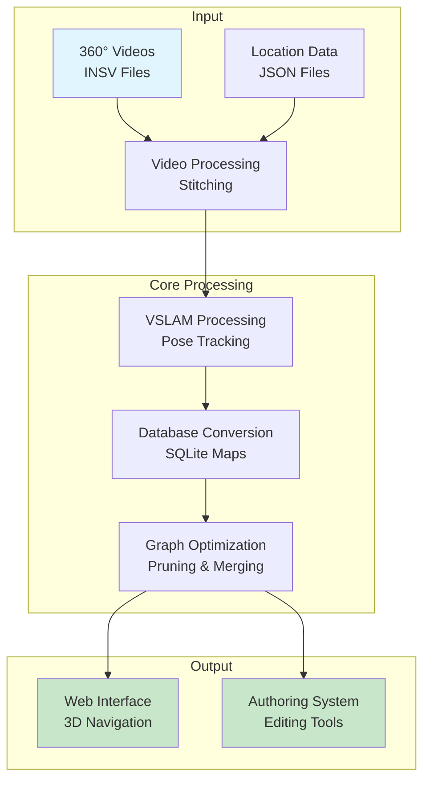
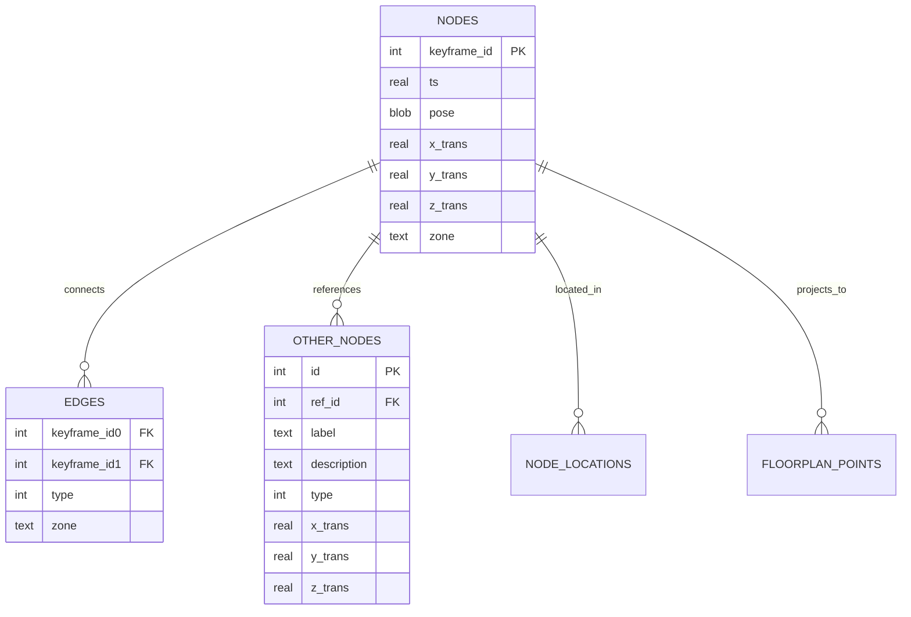
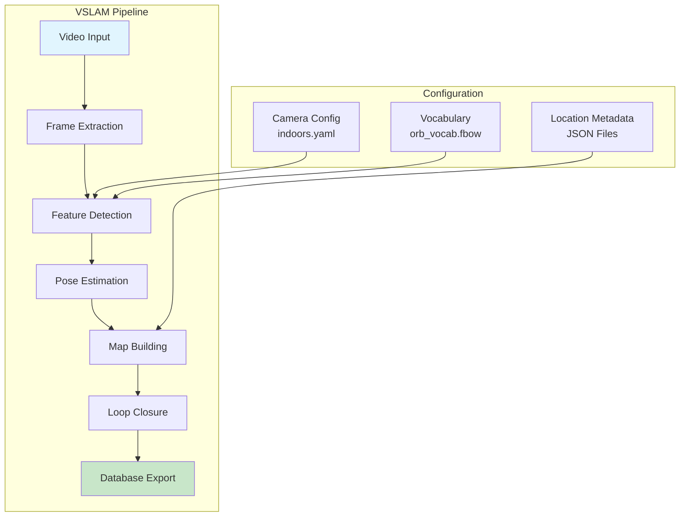
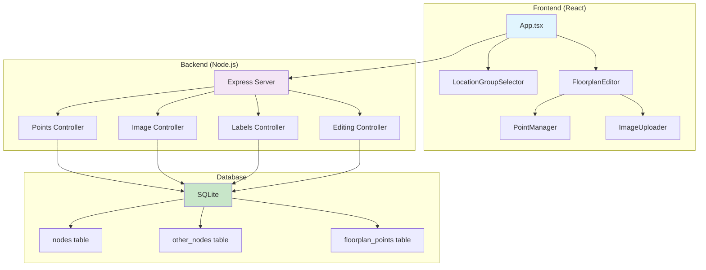

# Sitexplorer AI Overview

Welcome to Sitexplorer, a comprehensive system for creating large-scale panoramic virtual tours. This documentation provides an AI-generated overview to help new developers understand the repository structure, architecture, and workflows.

## Table of Contents

- [Essential Knowledge](#essential-knowledge)
- [Common Knowledge](#common-knowledge)
- [Advanced Knowledge](#advanced-knowledge)

---

## Essential Knowledge

### What is Sitexplorer?

Sitexplorer is a sophisticated system that transforms 360° video recordings into interactive virtual tours. It processes equirectangular videos (stitched from Insta360 INSV files), tracks camera movement using Visual Simultaneous Localization and Mapping (VSLAM), and creates an interactive 3D navigation experience.

### Core Problem Solved

The system addresses the challenge of creating large-scale virtual tours from 360° video data by:
- **Processing**: Converting raw 360° videos into navigable 3D spaces
- **Mapping**: Using VSLAM to track camera movement and build spatial graphs
- **Optimization**: Pruning and optimizing navigation graphs for performance
- **Interaction**: Providing web-based interfaces for both viewing and editing

### High-Level Architecture



### Key Technologies

- **VSLAM**: Modified Stella VSLAM for pose tracking
- **Video Processing**: Insta360 SDK for video stitching
- **Database**: SQLite3 for map storage
- **Web Interface**: React + THREE.js for 3D visualization
- **Backend**: Node.js/TypeScript for authoring system

### Quick Start

1. **Clone and Setup**:
   ```bash
   git clone --recursive https://github.com/Skwangles/Sitexplorer.git
   source SOURCE_SETUP.sh
   cp .env.example .env  # Update with your configuration
   ```

2. **Build and Run**:
   ```bash
   ./RUNME.sh <profile_name>  # e.g., ./RUNME.sh dev
   ```

3. **Access Interfaces**:
   - **Authoring Interface**: `http://localhost:3005/authoring`
   - **Viewer Interface**: `http://localhost:3001`

---

## Common Knowledge

### System Architecture

#### Pipeline Overview

The system follows a sequential 13-stage pipeline:


#### Core Components

1. **VSLAM Processing** (`Apps/SLAM/`)
   - Modified Stella VSLAM system
   - Monocular camera setup for 360° video
   - Real-time pose tracking and map building

2. **Authoring Backend** (`Apps/authoring-backend/`)
   - Node.js/TypeScript REST API
   - React frontend for spatial editing
   - SQLite database integration

3. **Graph Processing** (`Apps/GraphProcessor/`)
   - Python-based spatial graph optimization
   - Grid-based pruning (5x5x5m spatial partitioning)
   - Sharpness-based node selection

4. **Image Processing** (`Apps/SharpnessCalculator/`)
   - Python-based image quality analysis
   - Variance of Laplacian for sharpness calculation
   - Concurrent processing with ThreadPoolExecutor

### Database Schema

#### Core Tables



#### Node Types
- **Type 0**: Normal image points
- **Type 1**: Elevator points
- **Type 2+**: Special points (merge points, etc.)

#### Edge Types
- **Type -1**: Covisibility edges (shared landmarks)
- **Type 0**: Normal navigation edges
- **Type 1**: Loop closure edges
- **Type 2**: Merge point edges
- **Type 3**: Edge contraction edges
- **Type 4**: Pathfind-only edges

### Configuration System

#### Profile-Based Configuration

The system uses JSON configuration files in `configs/` directory:

```json
{
  "name": "profile_name",
  "features": {
    "build_libs": false,
    "vslam_map": true,
    "graph_prune": true,
    "start_authoring": true
  },
  "paths": {
    "home_dir": "/path/to/sitexplorer",
    "video_dir": "/path/to/videos",
    "db_dir": "/path/to/databases"
  },
  "config": {
    "coords_to_metres": 10,
    "prune_grid_size": 5.0,
    "authoring_port": 3005
  }
}
```

#### Environment Management

- **Base Environment** (`.env`): Core system variables
- **Profile Configuration** (`configs/*.json`): Environment-specific settings
- **Secret Management** (`.env.secrets`): Sensitive data
- **Project-Specific Secrets**: Per-component configurations

### Key Constants (`consts.ts`)

```typescript
export const COORDS_TO_METRES: number = 10; // Coordinate scaling factor
export const PORT = 3004; // Authoring server port
export const KEYFRAME_IMG_DIR = process.env.SX_KEYFRAME_IMG_DIR ?? "";
export const FLOORPLAN_IMG_DIR = process.env.SX_SERVER_FLOORPLAN_IMG_DIR ?? "";
```

---

## Advanced Knowledge

### Detailed Architecture

#### VSLAM Processing Deep Dive



**Key Components**:
- `sx_map`: Main mapping tool for video processing
- `sx_view_map`: Static map viewer for inspection
- `sx_slam_to_sqlite`: Converts VSLAM maps to SQLite format

#### Graph Processing Algorithm

The grid-based pruning algorithm:

1. **Spatial Partitioning**: Nodes partitioned into 5x5x5m grid boxes
2. **Representative Selection**: Sharpest node selected per grid box
3. **Reference Redirection**: All references redirected to representatives
4. **Edge Mapping**: Edges redirected to representative nodes
5. **Connectivity Validation**: Ensures graph remains connected

**Performance**: Achieves 60-80% node reduction while maintaining connectivity.

#### Authoring System Architecture



### Deployment Architecture

#### Docker Configuration

```yaml
services:
  backend:
    build:
      context: ./Apps/sitexplorer-backend
      dockerfile: Dockerfile
    restart: always
    ports:
      - '3001:3001'
    volumes:
      - '${SX_KEYFRAME_IMG_DIR}:/app/served-img/'
      - '${SX_SERVER_FLOORPLAN_IMG_DIR}:/app/served-floorplans/'
      - '${SX_DB_DIR}:/app/served-map/'
    environment:
      - NODE_ENV=production
```

#### Cloud Storage Integration

- **R2 Storage**: Cloudflare R2 for image hosting
- **Bucket Configuration**: Per-project bucket management
- **CDN Integration**: Automatic content delivery

### Performance Optimization

#### Configuration Tuning

- **Coordinate Scaling**: `coords_to_metres` for spatial accuracy
- **Grid Pruning**: Configurable grid sizes (5x5x5m default)
- **Image Processing**: Batch sizes and sharpness thresholds
- **Database Integration**: Consistent use of canonical tables across tools

#### Monitoring & Logging

- **Combined Logs**: `combined.log` for application events
- **Error Tracking**: `error.log` for critical failures
- **Exception Handling**: `exceptions.log` for detailed debugging
- **Winston Integration**: Structured logging in Node.js components

### Security & Privacy

#### Content Management

- **Restricted Node Stripping**: Remove sensitive locations
- **Face Blurring**: Privacy protection for images
- **Access Control**: Environment-based feature restrictions
- **Data Sanitization**: Public vs private data separation

#### Multi-Environment Support

- **Development**: Local processing with debugging
- **Staging**: Limited processing with restricted content
- **Production**: Full pipeline with public content only

### Advanced Features

#### Image Quality Analysis

The sharpness calculation uses variance of Laplacian:

```python
def calculate_sharpness(image_path):
    with Image.open(image_path) as img:
        grayscale_img = img.convert("L")
        laplacian = grayscale_img.filter(ImageFilter.FIND_EDGES)
        laplacian_array = np.array(laplacian)
        sharpness = laplacian_array.var()
    return sharpness
```

#### Spatial Graph Optimization

The system implements sophisticated graph optimization:
- **Grid-based pruning** with configurable spatial partitioning
- **Sharpness-based node selection** for optimal image quality
- **Reference redirection** to maintain data integrity
- **Connectivity validation** to ensure navigation remains possible

#### Multi-Modal Data Integration

The system combines:
- **3D Spatial Data**: VSLAM-generated navigation graphs
- **2D Floorplans**: Architectural drawings for context
- **Metadata**: Location labels, descriptions, and classifications
- **Media Assets**: 360° images and video content

---

## Getting Started as a Developer

### Essential Files to Understand

1. **`RUNME.sh`**: Main orchestration script
2. **`configs/dev.json`**: Development configuration
3. **`Apps/authoring-backend/src/consts.ts`**: Core constants
4. **`Apps/SLAM/SitexplorerInterface/src/map.cc`**: VSLAM processing
5. **`Apps/GraphProcessor/grid_pruner.py`**: Graph optimization

### Development Workflow

1. **Setup Environment**: Use `SOURCE_SETUP.sh` and configure `.env`
2. **Choose Profile**: Select appropriate configuration from `configs/`
3. **Run Pipeline**: Execute `./RUNME.sh <profile_name>`
4. **Access Tools**: Use authoring interface for editing
5. **Monitor Logs**: Check log files for debugging

### Common Tasks

- **Adding New Locations**: Update JSON metadata files
- **Modifying Graph Parameters**: Adjust pruning settings in configuration
- **Extending Authoring Interface**: Add new React components
- **Optimizing Performance**: Tune coordinate scaling and grid sizes

---

## Conclusion

Sitexplorer is a sophisticated system that combines computer vision, spatial computing, and web technologies to create immersive virtual tours. The modular architecture allows for flexible deployment and customization, while the comprehensive configuration system supports multiple environments and use cases.

For new developers, start with the Essential Knowledge section to understand the core concepts, then explore the Common Knowledge for implementation details, and finally dive into Advanced Knowledge for deep technical understanding.