# Sitexplorer Architecture Documentation

## System Overview

Sitexplorer is a comprehensive system for creating large-scale panoramic virtual tours. The architecture combines computer vision, spatial computing, and web technologies to transform 360° video recordings into interactive virtual experiences.

## High-Level Architecture

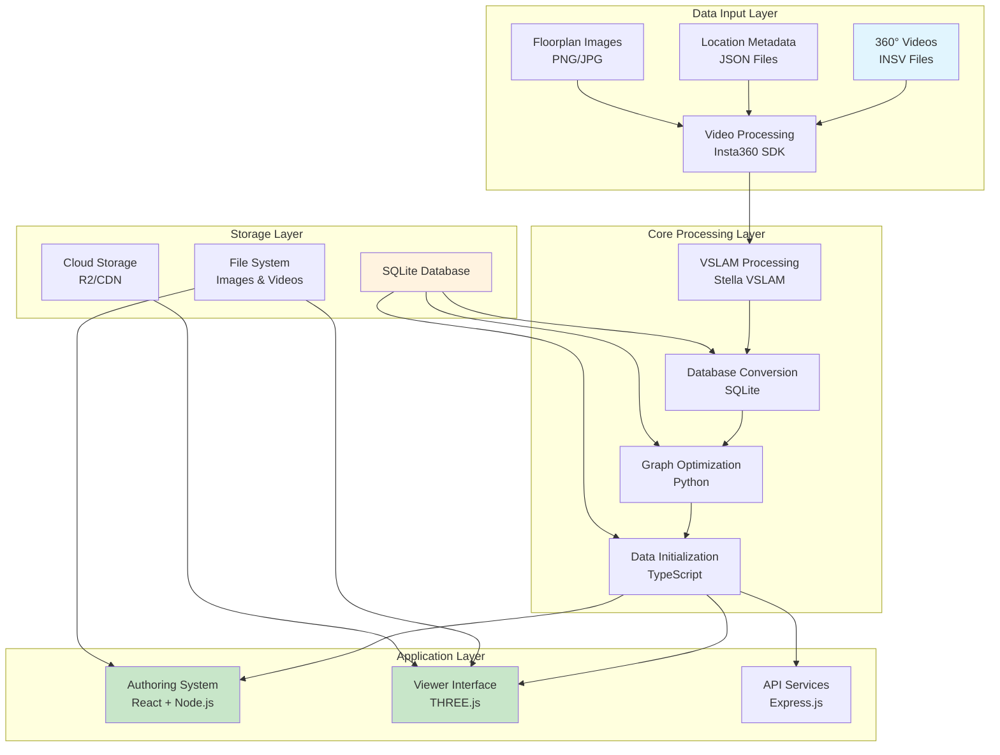

## Component Architecture

### 1. VSLAM Processing Pipeline

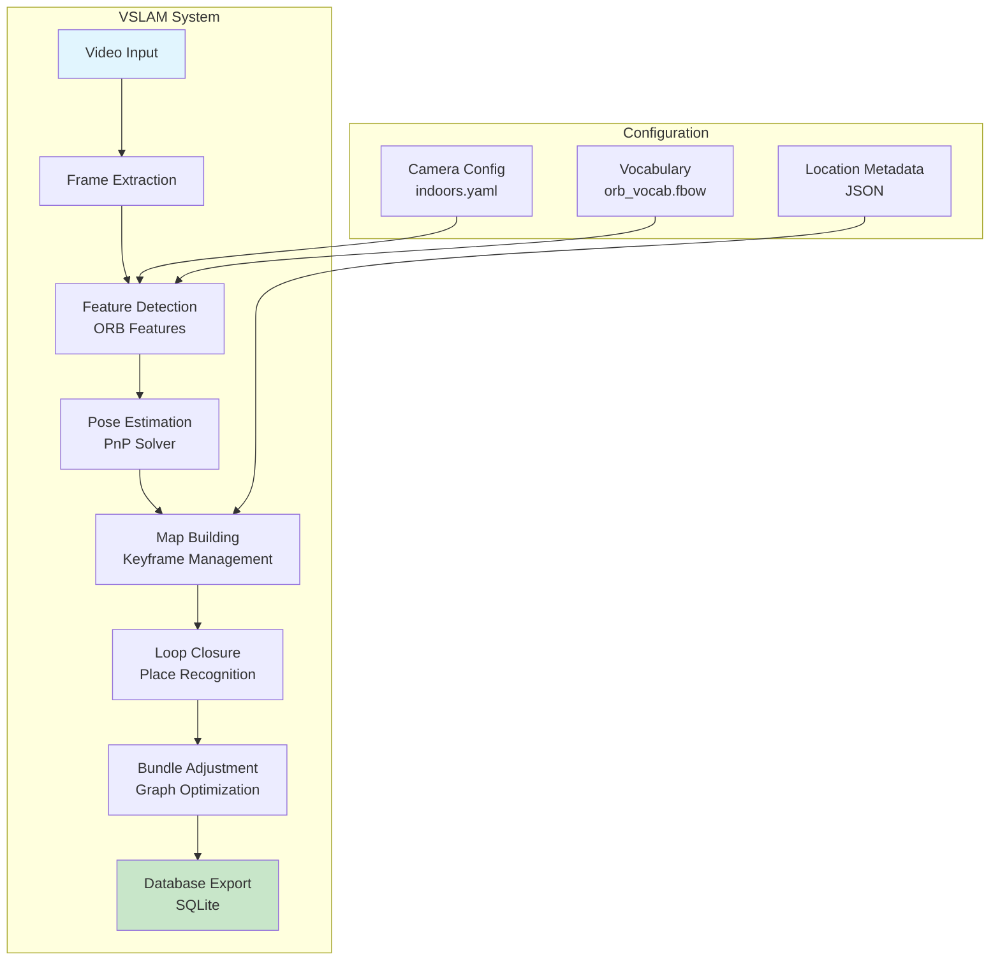

**Key Components**:
- **`cv_map`**: Main mapping tool for video processing
- **`cv_view_map`**: Static map viewer for inspection
- **`cv_slam_to_sqlite`**: Converts VSLAM maps to SQLite format

### 2. Graph Processing Architecture

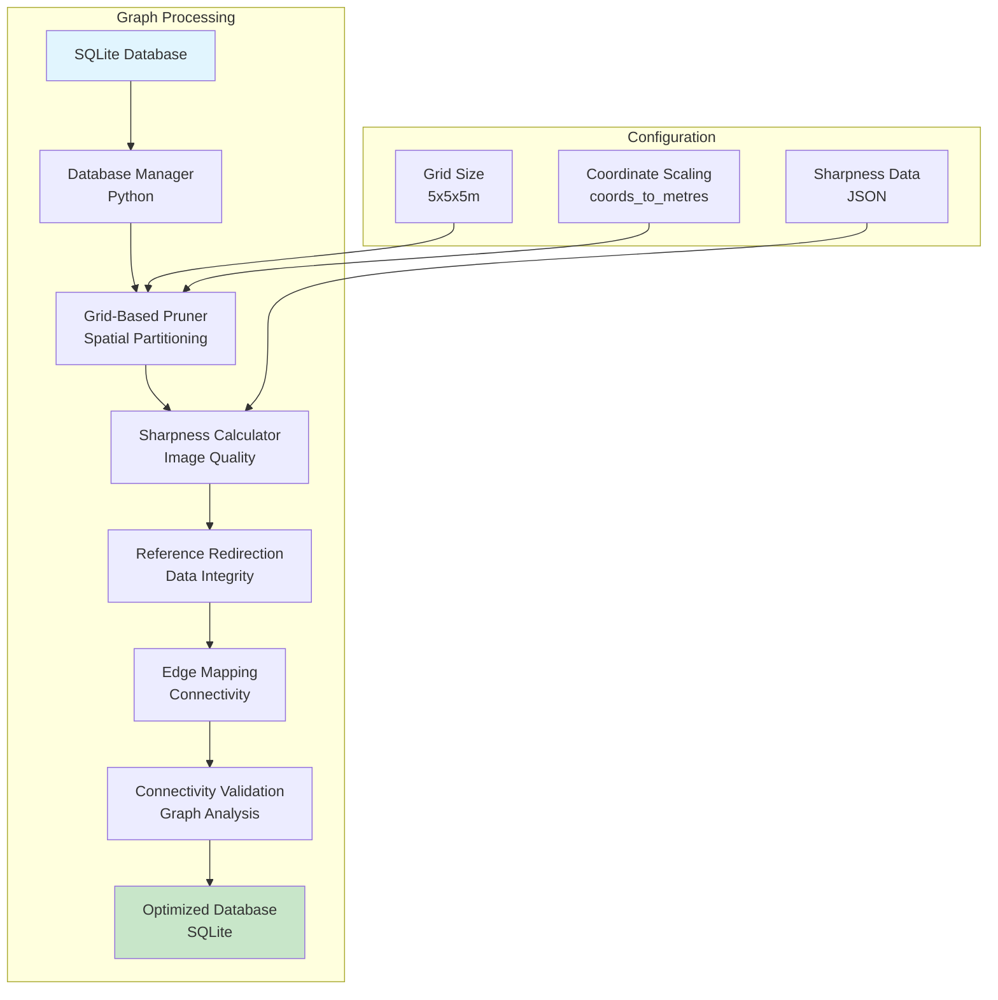

**Algorithm Details**:
1. **Spatial Partitioning**: Nodes partitioned into 5x5x5m grid boxes
2. **Representative Selection**: Sharpest node selected per grid box
3. **Reference Redirection**: All references redirected to representatives
4. **Edge Mapping**: Edges redirected to representative nodes
5. **Connectivity Validation**: Ensures graph remains connected

### 3. Authoring System Architecture

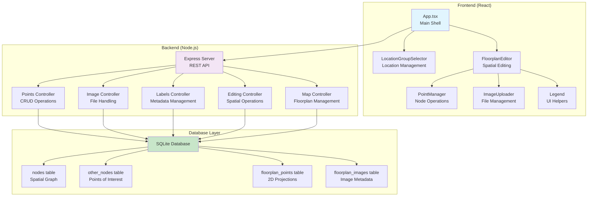

## Data Flow Architecture

### Processing Pipeline

```mermaid
flowchart LR
    A[Raw Videos<br/>INSV Files] --> B[Video Stitching<br/>Insta360 SDK]
    B --> C[VSLAM Processing<br/>Pose Tracking]
    C --> D[Database Conversion<br/>SQLite Maps]
    D --> E[Sharpness Calculation<br/>Image Quality]
    E --> F[Graph Pruning<br/>Spatial Optimization]
    F --> G[Map Merging<br/>Multi-Session]
    G --> H[Data Initialization<br/>Floorplan Mapping]
    H --> I[Authoring Interface<br/>Web Editing]
    I --> J[Content Stripping<br/>Privacy Protection]
    J --> K[Image Extraction<br/>Asset Management]
    K --> L[Final Export<br/>Client Delivery]
    
    style A fill:#e1f5fe
    style L fill:#c8e6c9
```

### Database Schema Architecture

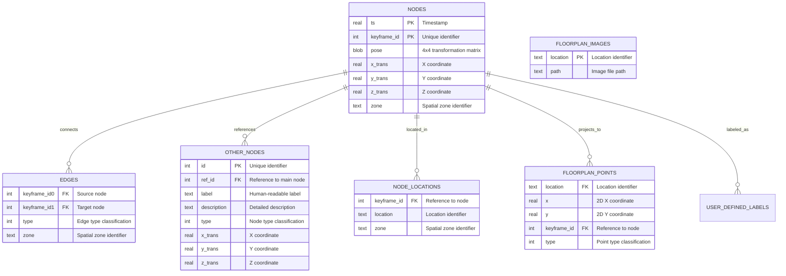

## Configuration Architecture

### Multi-Layer Configuration System

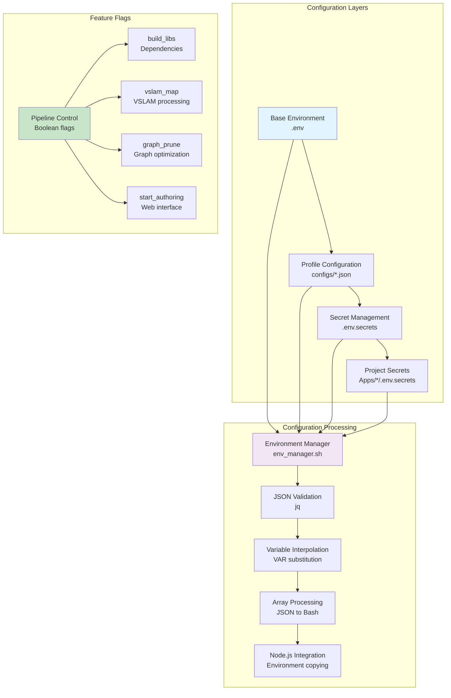

## Deployment Architecture

### Docker Container Architecture

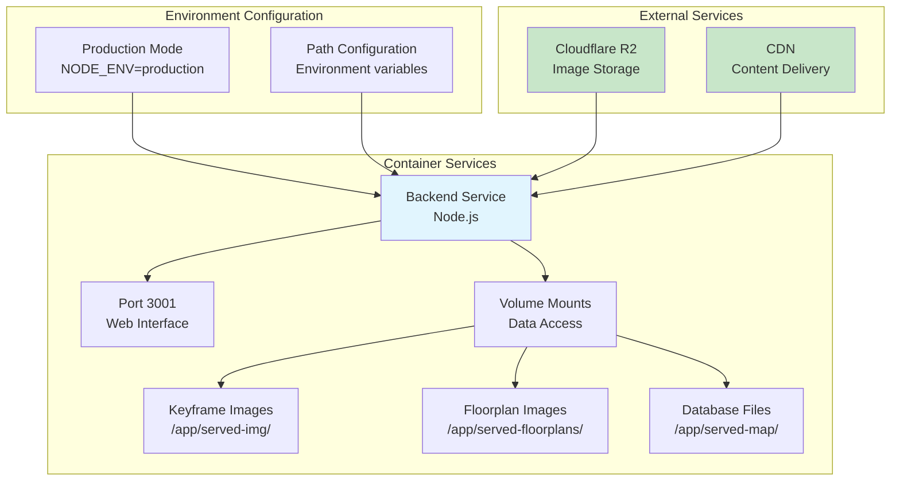

### Multi-Environment Support

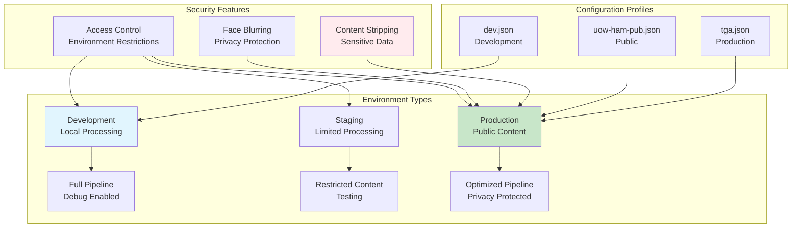

## Performance Architecture

### Optimization Strategies

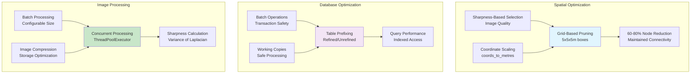

## Security Architecture

### Privacy Protection

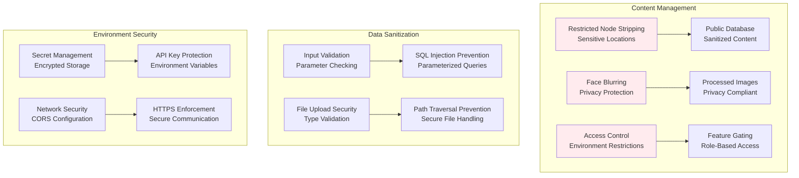

## Monitoring Architecture

### Logging and Monitoring

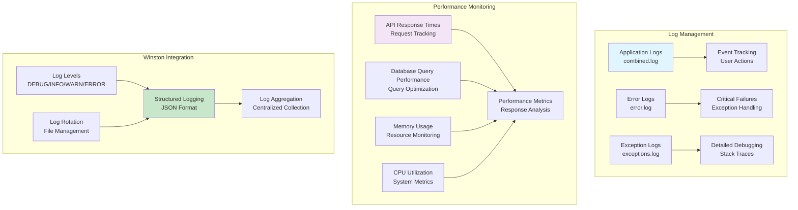

## Integration Architecture

### External Service Integration

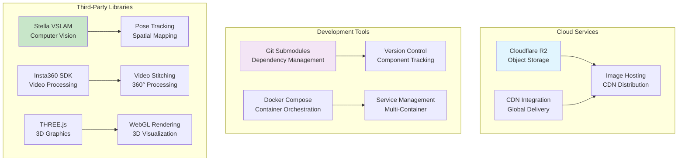

This architecture documentation provides a comprehensive overview of the Sitexplorer system's design, components, and relationships. The modular architecture allows for flexible deployment and customization while maintaining system integrity and performance.