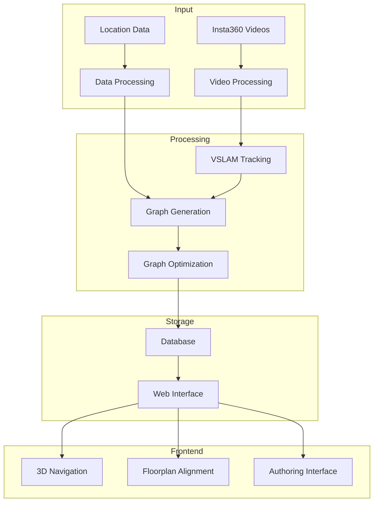
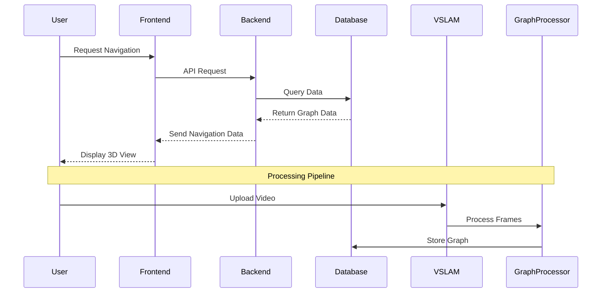
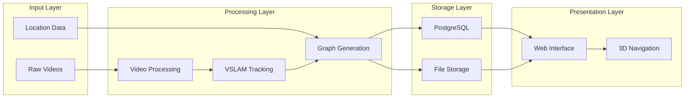
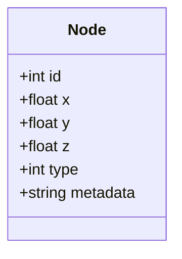
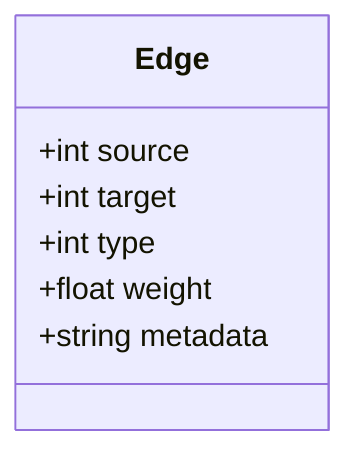
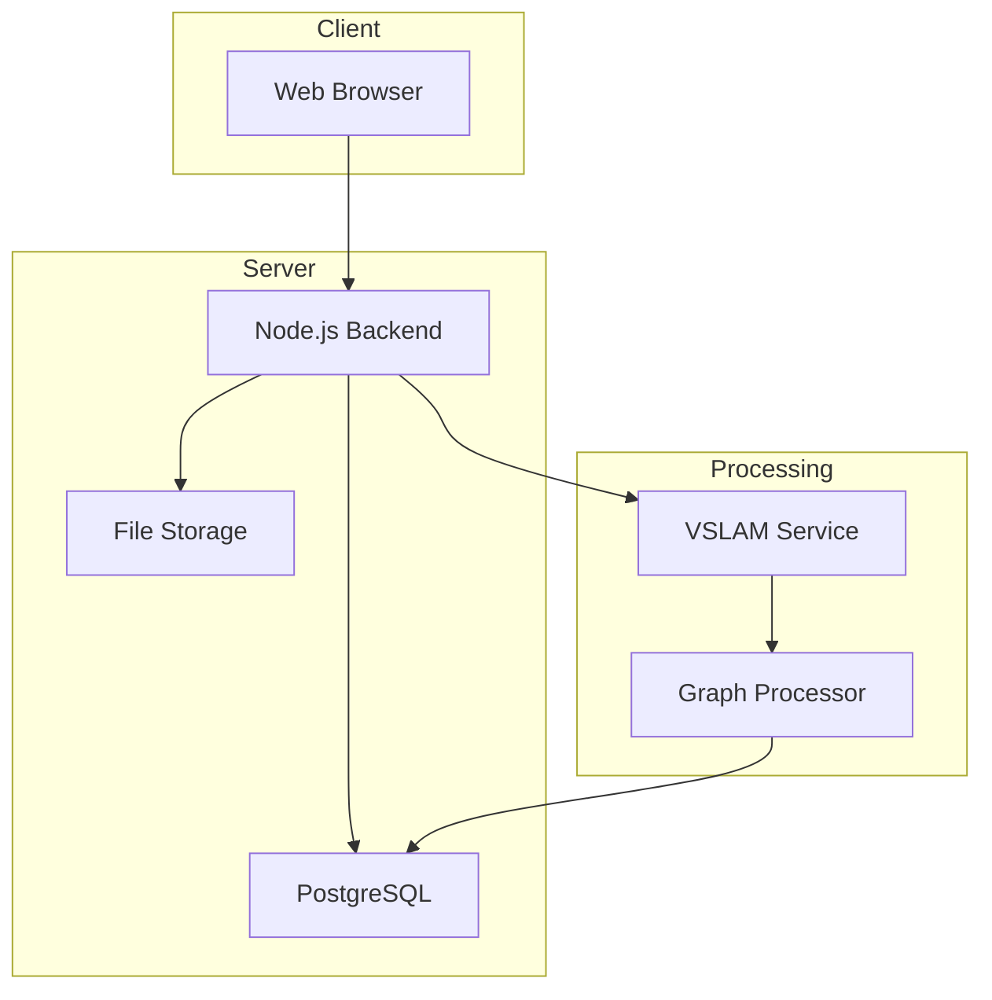
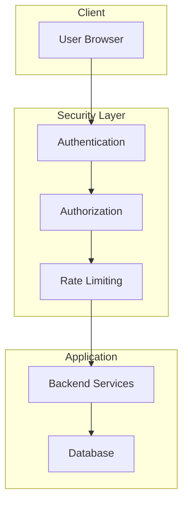

# CampusVirtual Architecture

This document outlines the high-level architecture of the CampusVirtual system, including component interactions, data flow, and system design.

## System Architecture

## Component Interaction

## Data Flow

## System Components

### 1. Input Processing
- Video ingestion and processing
- Location data parsing
- Initial data validation

### 2. Core Processing
- VSLAM tracking
- Graph generation
- Path optimization

### 3. Storage
- Database management
- File system organization
- Data persistence

### 4. Presentation
- Web interface
- 3D visualization
- User interaction

## Data Models

### Node Structure

### Edge Structure

## Deployment Architecture

## Security Architecture

## Performance Considerations

1. **Database Optimization**
   - Indexed queries
   - Efficient graph storage
   - Connection pooling

2. **Processing Pipeline**
   - Parallel processing
   - Batch operations
   - Resource management

3. **Frontend Performance**
   - Asset optimization
   - Lazy loading
   - Caching strategies 