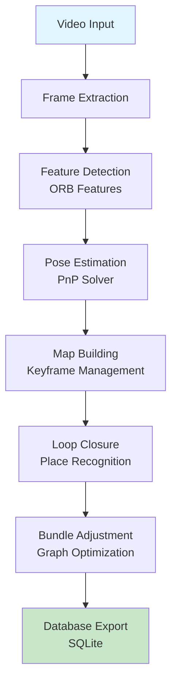
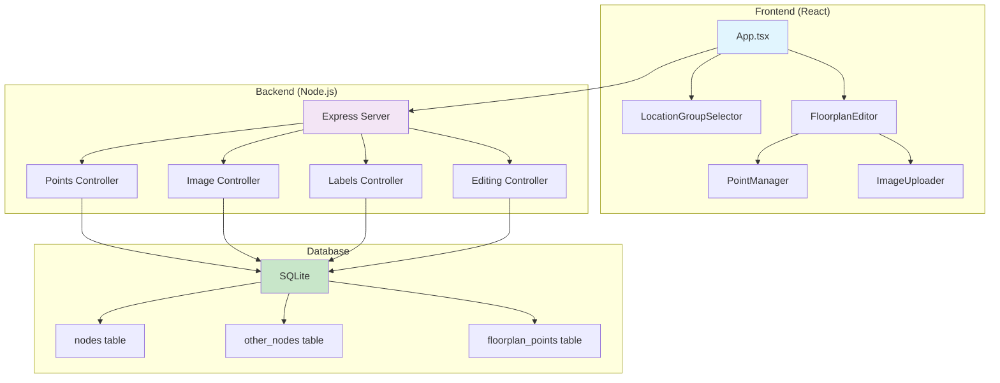
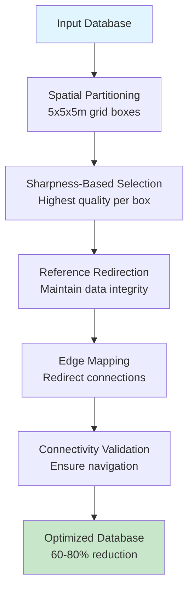
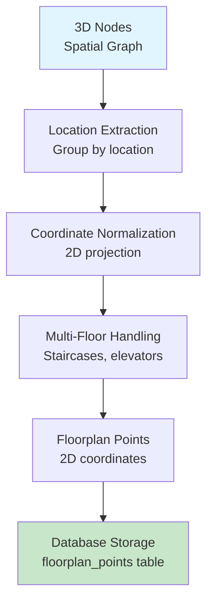
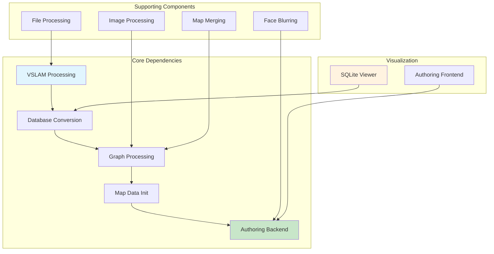

# Sitexplorer Components Documentation

## Component Overview

Sitexplorer consists of multiple interconnected components that work together to create panoramic virtual tours. This document provides detailed information about each component, its purpose, and how it integrates with the overall system.

## Core Components

### 1. VSLAM Processing (`Apps/SLAM/`)

**Purpose**: Visual Simultaneous Localization and Mapping for 360° video processing

**Key Files**:
- `SitexplorerInterface/src/map.cc`: Main mapping tool
- `SitexplorerInterface/src/view.cc`: Static map viewer
- `SitexplorerInterface/src/slam_to_sqlite.cc`: Database conversion

**Architecture**:


**Key Features**:
- Monocular camera setup for 360° video
- Real-time pose tracking and map building
- JSON-based location metadata integration
- Iridescence viewer integration for real-time visualization

**Configuration**:
- Camera configuration: `indoors.yaml`
- Vocabulary file: `orb_vocab.fbow`
- Location metadata: JSON files

### 2. Authoring Backend (`Apps/authoring-backend/`)

**Purpose**: Web-based interface for editing spatial data and managing virtual tours

**Architecture**:


**Key Features**:
- Interactive floorplan editing with drag-and-drop
- Point management and spatial editing
- Image upload and management
- Real-time collaboration support
- THREE.js integration for 3D transformations

**API Endpoints**:
- `GET/POST /api/points`: Point CRUD operations
- `GET/POST /api/images`: Image management
- `GET/POST /api/labels`: Label management
- `GET/POST /api/editing`: Spatial editing operations

### 3. Graph Processing (`Apps/GraphProcessor/`)

**Purpose**: Spatial graph optimization and pruning for navigation performance

**Key Files**:
- `grid_pruner.py`: Grid-based pruning algorithm
- `db_manager.py`: Database management utilities
- `run_pruning.py`: Main execution script

**Algorithm**:


**Key Features**:
- Grid-based spatial partitioning
- Sharpness-based node selection
- Reference redirection for data integrity
- Connectivity validation
- Batch processing with transaction safety

**Performance**: Achieves 60-80% node reduction while maintaining connectivity

### 4. Image Processing (`Apps/SharpnessCalculator/`)

**Purpose**: Image quality analysis for optimal node selection

**Key Files**:
- `sharpness.py`: Core sharpness calculation
- `main.py`: Command-line interface

**Algorithm**:
```python
def calculate_sharpness(image_path):
    with Image.open(image_path) as img:
        grayscale_img = img.convert("L")
        laplacian = grayscale_img.filter(ImageFilter.FIND_EDGES)
        laplacian_array = np.array(laplacian)
        sharpness = laplacian_array.var()
    return sharpness
```

**Key Features**:
- Variance of Laplacian for sharpness calculation
- Concurrent processing with ThreadPoolExecutor
- JSON output for integration with graph pruning
- PIL-based image processing

### 5. Map Data Initialization (`Apps/meta_data_init/`)

**Purpose**: Converts 3D spatial data to 2D floorplan projections

**Key Files**:
- `src/initData.ts`: Main initialization logic
- `src/consts.ts`: Configuration constants

**Process**:


**Key Features**:
- 3D to 2D coordinate transformation
- Multi-floor connection handling
- Location-based clustering
- Table prefixing support for refined/unrefined data

### 6. SQLite Viewer (`Apps/SQLiteViewer/`)

**Purpose**: 3D visualization tool for spatial graph data

**Key Files**:
- `view.py`: Main visualization script
- `SPECIFICATION.md`: Component specification

**Features**:
- Interactive 3D graph visualization
- Node and edge inspection
- Spatial proximity analysis
- PyVista-based rendering

## Supporting Components

### 7. Face Blurring (`Apps/blur360-images/`)

**Purpose**: Privacy protection for 360° images

**Key Features**:
- Face detection and blurring
- Privacy compliance
- Batch processing capabilities

### 8. Map Merging (`Apps/MapMerge/`)

**Purpose**: Combines multiple VSLAM maps into unified navigation graphs

**Key Features**:
- Multi-session map integration
- Spatial alignment
- Graph merging algorithms

### 9. File Processing (`Apps/Sitexplorer-FileProcessing/`)

**Purpose**: Video file processing and preparation

**Key Features**:
- Insta360 SDK integration
- Video stitching capabilities
- Format conversion

## Component Integration

### Data Flow Between Components


### Component Dependencies



## Configuration and Environment

### Component-Specific Configuration

Each component has its own configuration requirements:

**VSLAM Processing**:
- Camera configuration files
- Vocabulary files
- Location metadata JSON

**Authoring Backend**:
- Database connection settings
- File upload paths
- Port configuration

**Graph Processing**:
- Grid size parameters
- Sharpness thresholds
- Coordinate scaling factors

### Environment Variables

Common environment variables used across components:

```bash
# Core paths
SX_HOME_DIR=/path/to/sitexplorer
SX_KEYFRAME_IMG_DIR=/path/to/images
SX_DB_DIR=/path/to/databases

# Processing parameters
SX_COORDS_TO_METRES=10
SX_PRUNE_GRID_SIZE=5.0
SX_AUTHORING_PORT=3005

# Feature flags
SX_VSLAM_MAP=true
SX_GRAPH_PRUNE=true
SX_START_AUTHORING=true
```

## Development Guidelines

### Adding New Components

1. **Create component directory** in `Apps/`
2. **Define configuration** in profile JSON files
3. **Add build scripts** to `BUILD_SITEXPLORER.sh`
4. **Update environment manager** for configuration
5. **Add pipeline integration** to `RUNME.sh`

### Component Communication

Components communicate through:
- **File system**: Shared data directories
- **Database**: SQLite for spatial data
- **Environment variables**: Configuration sharing
- **JSON files**: Metadata and configuration

### Testing Components

Each component should include:
- **Unit tests** for core functionality
- **Integration tests** for component interaction
- **Configuration validation** for environment setup
- **Performance benchmarks** for optimization

## Troubleshooting

### Common Issues

1. **VSLAM Processing Failures**:
   - Check camera configuration files
   - Verify vocabulary file paths
   - Ensure video format compatibility

2. **Graph Processing Errors**:
   - Validate database schema
   - Check coordinate scaling parameters
   - Verify sharpness data availability

3. **Authoring Backend Issues**:
   - Check database connectivity
   - Verify file upload permissions
   - Validate environment configuration

### Debugging Tools

- **SQLite Viewer**: Visual inspection of spatial data
- **Log files**: Component-specific logging
- **Environment validation**: Configuration checking
- **Performance monitoring**: Resource usage tracking

This components documentation provides a comprehensive overview of each component's purpose, architecture, and integration within the Sitexplorer system.