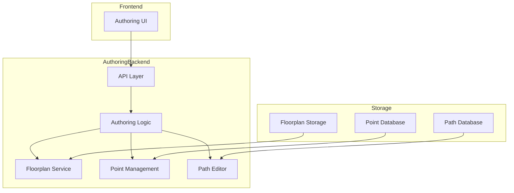
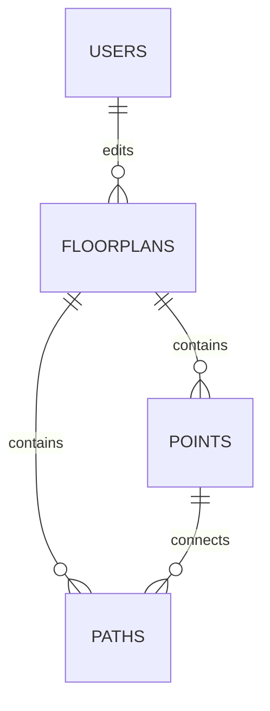

# Authoring Backend

## Overview
The Authoring Backend is a specialized component of the CampusVirtual system that provides tools and APIs for creating and editing virtual tours. It includes features for floorplan alignment, point management, and navigation path editing.

## Architecture



## Component Structure

### 1. API Layer
- RESTful endpoints
- WebSocket support
- File upload handling
- Real-time collaboration

### 2. Authoring Logic
- Floorplan management
- Point positioning
- Path creation
- Validation rules

### 3. Floorplan Service
- Image processing
- Coordinate mapping
- Scale management
- Layer handling

### 4. Point Management
- Node creation
- Position adjustment
- Type assignment
- Metadata handling

### 5. Path Editor
- Edge creation
- Path optimization
- Validation
- Export functionality

## Key Features

### 1. Floorplan Management
- Upload and process floorplans
- Align points to floorplans
- Handle multiple floors
- Scale and rotation

### 2. Point Editing
- Create and edit nodes
- Position adjustment
- Type assignment
- Metadata management

### 3. Path Creation
- Draw navigation paths
- Edit existing paths
- Validate connections
- Optimize routes

### 4. Real-time Collaboration
- Multiple user support
- Change synchronization
- Conflict resolution
- User presence

## Technical Details

### Dependencies
```json
{
  "dependencies": {
    "express": "^4.17.1",
    "socket.io": "^4.4.1",
    "sharp": "^0.29.3",
    "typescript": "^4.5.4"
  }
}
```

### Database Schema


### API Endpoints

#### Floorplan Management
- `GET /api/floorplans` - List floorplans
- `POST /api/floorplans` - Upload floorplan
- `PUT /api/floorplans/:id` - Update floorplan
- `DELETE /api/floorplans/:id` - Delete floorplan

#### Point Management
- `GET /api/floorplans/:id/points` - List points
- `POST /api/floorplans/:id/points` - Add point
- `PUT /api/floorplans/:id/points/:pointId` - Update point
- `DELETE /api/floorplans/:id/points/:pointId` - Delete point

#### Path Management
- `GET /api/floorplans/:id/paths` - List paths
- `POST /api/floorplans/:id/paths` - Create path
- `PUT /api/floorplans/:id/paths/:pathId` - Update path
- `DELETE /api/floorplans/:id/paths/:pathId` - Delete path

## Development Guidelines

### Code Structure
```
src/
├── api/          # API endpoints
├── services/     # Business logic
├── models/       # Data models
├── utils/        # Utility functions
└── config/       # Configuration
```

### Best Practices
1. Use TypeScript for type safety
2. Implement real-time updates
3. Handle concurrent edits
4. Validate user input
5. Optimize image processing

### Performance Optimization
1. Image compression
2. Caching strategies
3. WebSocket optimization
4. Database indexing

## Deployment

### Docker Configuration
```dockerfile
FROM node:16
WORKDIR /app
COPY package*.json ./
RUN npm install
COPY . .
RUN npm run build
EXPOSE 3001
CMD ["npm", "start"]
```

### Environment Variables
```env
PORT=3001
NODE_ENV=production
STORAGE_PATH=/data/floorplans
DB_HOST=localhost
DB_PORT=5432
```

## Monitoring and Logging

### Log Files
- `combined.log` - Combined application logs
- `error.log` - Error logs
- `exceptions.log` - Exception logs

### Metrics
- API response times
- Image processing performance
- WebSocket connections
- Memory usage

## Security Considerations

1. **Authentication**
   - JWT-based authentication
   - Session management
   - Role-based access

2. **File Security**
   - File type validation
   - Size limits
   - Virus scanning
   - Access control

3. **Data Protection**
   - Input validation
   - XSS protection
   - CSRF protection

## Troubleshooting

### Common Issues
1. Image processing errors
2. Real-time sync issues
3. File upload problems
4. Performance bottlenecks

### Debugging
1. Check application logs
2. Monitor WebSocket connections
3. Review image processing
4. Analyze database queries 