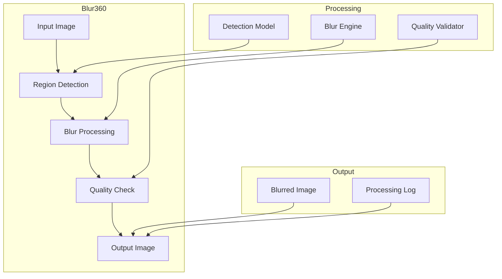
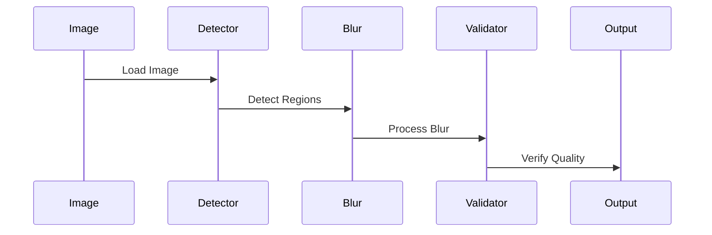

# Blur360 Images Component

## Overview
The Blur360 Images component is a specialized tool in the CampusVirtual system that processes and blurs sensitive or restricted areas in 360-degree panoramic images. It uses computer vision techniques to detect and blur specific regions while maintaining the overall quality and usability of the virtual tour experience.

## Architecture



## Component Structure

### 1. Region Detection
- Object detection
- Region identification
- Sensitivity analysis
- Metadata handling

### 2. Blur Processing
- Blur algorithm
- Region masking
- Edge handling
- Quality preservation

### 3. Quality Control
- Blur verification
- Image quality
- Edge detection
- Error checking

### 4. Output Management
- File organization
- Metadata preservation
- Log generation
- Error reporting

## Key Features

### 1. Image Processing
- 360-degree support
- Multiple blur types
- Quality preservation
- Metadata handling

### 2. Region Management
- Automatic detection
- Manual selection
- Region tracking
- Edge handling

### 3. Quality Assurance
- Blur verification
- Image quality
- Format validation
- Error detection

### 4. Performance
- GPU acceleration
- Batch processing
- Memory efficiency
- Progress tracking

## Technical Details

### Dependencies
```cpp
// Required libraries
#include <opencv2/opencv.hpp>
#include <torch/torch.h>
#include <filesystem>
#include <string>
#include <vector>
```

### Data Flow


### Configuration
```cpp
struct BlurConfig {
    // Detection settings
    struct {
        float confidence_threshold;
        int min_region_size;
        std::vector<std::string> target_classes;
    } detection;

    // Blur settings
    struct {
        int blur_radius;
        std::string blur_type;
        float edge_smoothing;
    } blur;

    // Output settings
    struct {
        std::string output_format;
        bool preserve_metadata;
        bool generate_logs;
    } output;
};
```

## Development Guidelines

### Code Structure
```
src/
├── detection/   # Region detection
├── blur/        # Blur processing
├── validation/  # Quality checks
├── utils/       # Utilities
└── models/      # ML models
```

### Best Practices
1. Quality preservation
2. Error handling
3. Progress tracking
4. Resource management
5. Performance optimization

### Performance Optimization
1. GPU acceleration
2. Batch processing
3. Memory management
4. Parallel processing

## Integration

### Input/Output
- Image format support
- Metadata handling
- Log generation
- Error reporting

### API Interface
```cpp
class Blur360Processor {
public:
    Blur360Processor(const BlurConfig& config);
    
    bool processImage(const std::string& input_path);
    bool processBatch(const std::vector<std::string>& input_paths);
    std::vector<ProcessingResult> getResults();
    void cleanup();
};
```

## Monitoring and Debugging

### Metrics
- Processing time
- Memory usage
- Detection accuracy
- Blur quality

### Logging
- Processing progress
- Detection results
- Error reports
- Performance stats

## Troubleshooting

### Common Issues
1. Detection accuracy
2. Blur quality
3. Memory usage
4. Performance issues

### Solutions
1. Model tuning
2. Parameter adjustment
3. Resource management
4. Performance optimization

## Future Improvements

### Planned Features
1. Advanced detection
2. Real-time processing
3. Cloud integration
4. Custom blur patterns

### Research Areas
1. Object detection
2. Blur algorithms
3. Performance optimization
4. Quality metrics 