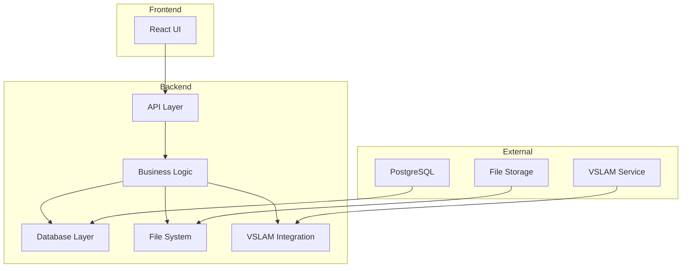
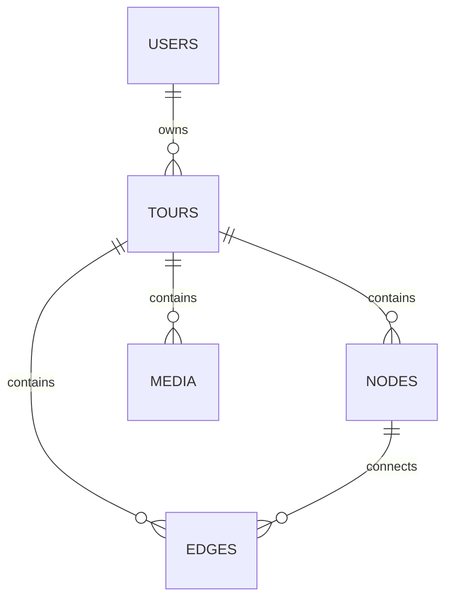

# Sitexplorer Backend

## Overview
The Sitexplorer Backend is the core server component of the Sitexplorer system, providing the main API endpoints, database interactions, and business logic for the virtual tour platform.

## Architecture



## Component Structure

### 1. API Layer
- RESTful endpoints
- WebSocket support
- Authentication middleware
- Request validation

### 2. Business Logic
- Tour management
- User management
- Graph operations
- Media processing

### 3. Database Layer
- PostgreSQL integration
- Query optimization
- Transaction management
- Data models

### 4. File System
- Media storage
- File organization
- Access control
- Backup management

## Key Features

### 1. Tour Management
- Create and edit tours
- Manage navigation paths
- Handle floor transitions
- Process location data

### 2. User Management
- Authentication
- Authorization
- User preferences
- Access control

### 3. Graph Operations
- Node management
- Edge operations
- Path finding
- Graph optimization

### 4. Media Processing
- Video handling
- Image processing
- Metadata management
- Storage optimization

## Technical Details

### Dependencies
```json
{
  "dependencies": {
    "express": "^4.17.1",
    "pg": "^8.7.1",
    "socket.io": "^4.4.1",
    "typescript": "^4.5.4"
  }
}
```

### Database Schema


### API Endpoints

#### Tour Management
- `GET /api/tours` - List all tours
- `POST /api/tours` - Create new tour
- `GET /api/tours/:id` - Get tour details
- `PUT /api/tours/:id` - Update tour
- `DELETE /api/tours/:id` - Delete tour

#### Node Management
- `GET /api/tours/:id/nodes` - List nodes
- `POST /api/tours/:id/nodes` - Add node
- `PUT /api/tours/:id/nodes/:nodeId` - Update node
- `DELETE /api/tours/:id/nodes/:nodeId` - Delete node

#### Edge Management
- `GET /api/tours/:id/edges` - List edges
- `POST /api/tours/:id/edges` - Add edge
- `PUT /api/tours/:id/edges/:edgeId` - Update edge
- `DELETE /api/tours/:id/edges/:edgeId` - Delete edge

## Development Guidelines

### Code Structure
```
src/
├── api/          # API endpoints
├── models/       # Data models
├── services/     # Business logic
├── utils/        # Utility functions
└── config/       # Configuration
```

### Best Practices
1. Use TypeScript for type safety
2. Follow RESTful API design
3. Implement proper error handling
4. Write unit tests
5. Document API endpoints

### Performance Optimization
1. Use connection pooling
2. Implement caching
3. Optimize database queries
4. Handle file uploads efficiently

## Deployment

### Docker Configuration
```dockerfile
FROM node:16
WORKDIR /app
COPY package*.json ./
RUN npm install
COPY . .
RUN npm run build
EXPOSE 3000
CMD ["npm", "start"]
```

### Environment Variables
```env
DB_HOST=localhost
DB_PORT=5432
DB_NAME=sitexplorer
DB_USER=postgres
DB_PASSWORD=secret
PORT=3000
NODE_ENV=production
```

## Monitoring and Logging

### Log Files
- `combined.log` - Combined application logs
- `error.log` - Error logs
- `exceptions.log` - Exception logs

### Metrics
- API response times
- Database query performance
- Memory usage
- CPU utilization

## Security Considerations

1. **Authentication**
   - JWT-based authentication
   - Session management
   - Password hashing

2. **Authorization**
   - Role-based access control
   - Resource permissions
   - API key management

3. **Data Protection**
   - Input validation
   - SQL injection prevention
   - XSS protection

## Troubleshooting

### Common Issues
1. Database connection issues
2. File system permissions
3. Memory leaks
4. API performance

### Debugging
1. Check application logs
2. Monitor system resources
3. Use debugging tools
4. Review error reports 