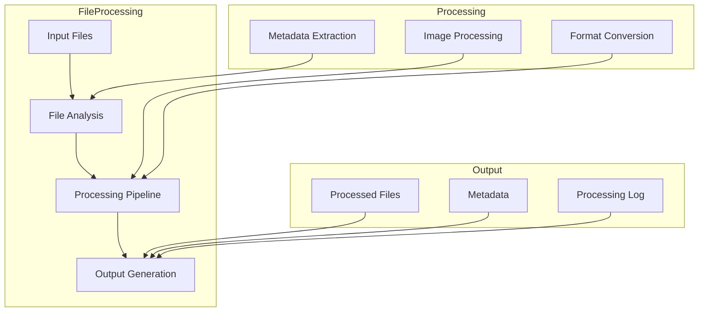
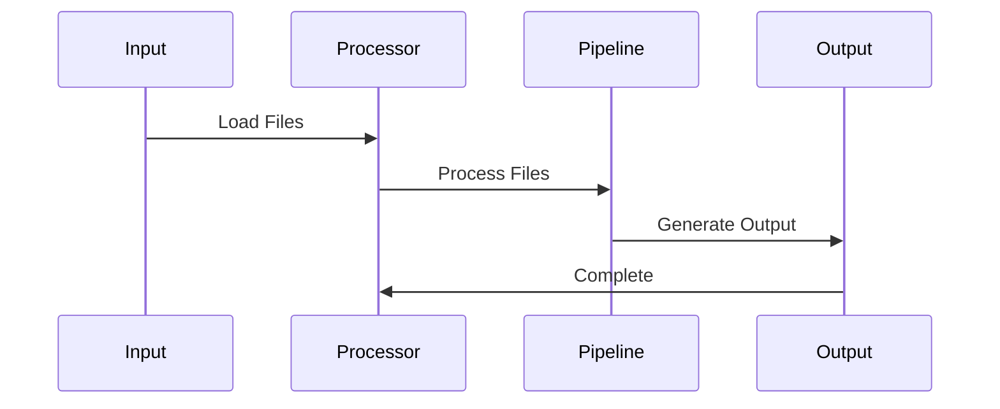

# CampusVirtual File Processing Component

## Overview
The CampusVirtual File Processing component is a C++-based utility that handles the processing and transformation of various file types used in the virtual tour system. It provides functionality for image processing, metadata extraction, and file format conversion, ensuring compatibility with the CampusVirtual platform.

## Architecture



## Component Structure

### 1. File Analysis
- File type detection
- Metadata extraction
- Validation checks
- Error handling

### 2. Processing Pipeline
- Image processing
- Format conversion
- Quality optimization
- Metadata management

### 3. Output Generation
- File organization
- Metadata storage
- Log generation
- Error reporting

### 4. Integration Layer
- API interface
- Command-line interface
- Error handling
- Progress reporting

## Key Features

### 1. File Processing
- Image optimization
- Format conversion
- Metadata extraction
- Quality control

### 2. Media Handling
- Image processing
- Video processing
- Audio processing
- Metadata management

### 3. Integration
- API interface
- Command-line tools
- Error handling
- Progress tracking

### 4. Quality Control
- Image quality
- Format validation
- Metadata verification
- Error checking

## Technical Details

### Dependencies
```cpp
// Required libraries
#include <opencv2/opencv.hpp>
#include <exiv2/exiv2.hpp>
#include <filesystem>
#include <string>
#include <vector>
```

### Data Flow


### Configuration
```cpp
struct ProcessingConfig {
    // File settings
    struct {
        std::string inputPath;
        std::string outputPath;
        std::vector<std::string> supportedFormats;
    } files;

    // Processing settings
    struct {
        bool extractMetadata;
        bool optimizeImages;
        bool convertFormats;
        int qualityLevel;
    } processing;

    // Output settings
    struct {
        bool generateLogs;
        bool preserveMetadata;
        std::string outputFormat;
    } output;
};
```

## Development Guidelines

### Code Structure
```
src/
├── core/         # Core processing
├── utils/        # Utilities
├── io/           # Input/Output
└── config/       # Configuration
```

### Best Practices
1. Error handling
2. Resource management
3. Performance optimization
4. Memory efficiency
5. Thread safety

### Performance Optimization
1. Batch processing
2. Memory management
3. Thread pooling
4. I/O optimization

## Integration

### Input/Output
- File input
- Processed output
- Metadata files
- Log files

### API Interface
```cpp
class FileProcessor {
public:
    FileProcessor(const ProcessingConfig& config);
    
    bool processFiles();
    bool validateFiles();
    std::vector<ProcessingResult> getResults();
    void cleanup();
};
```

## Monitoring and Debugging

### Metrics
- Processing time
- File sizes
- Memory usage
- Error rates

### Logging
- Processing progress
- Error reports
- Performance data
- Resource usage

## Troubleshooting

### Common Issues
1. File access errors
2. Memory issues
3. Processing failures
4. Format compatibility

### Solutions
1. Error handling
2. Resource management
3. Format validation
4. Performance tuning

## Future Improvements

### Planned Features
1. GPU acceleration
2. Cloud processing
3. Real-time monitoring
4. Advanced optimization

### Research Areas
1. Performance optimization
2. Format support
3. Processing algorithms
4. Resource management 