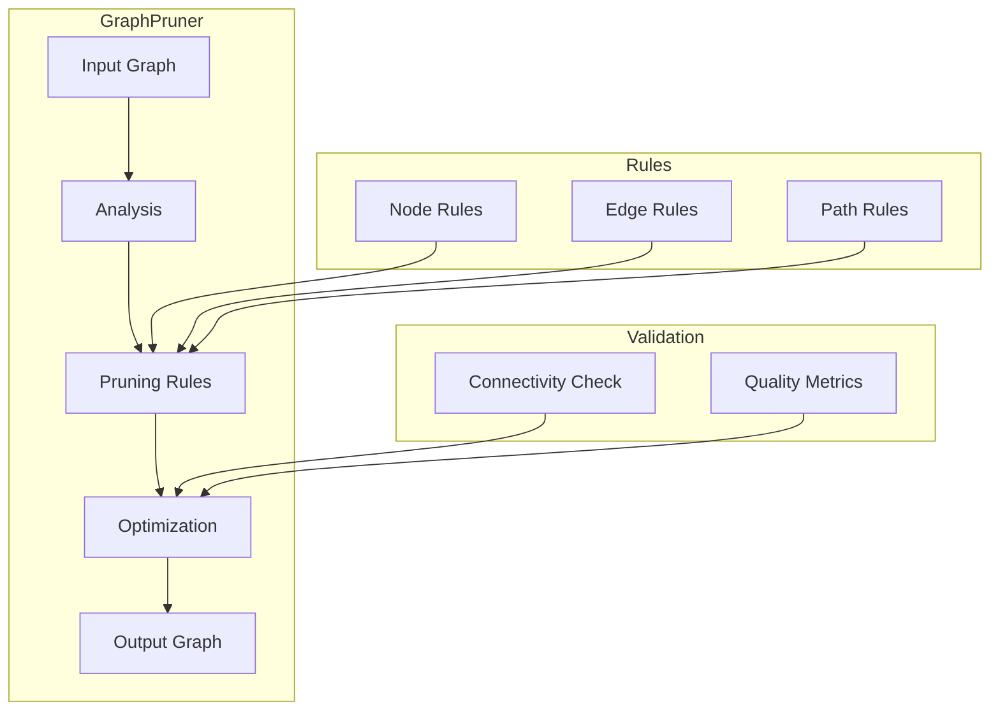
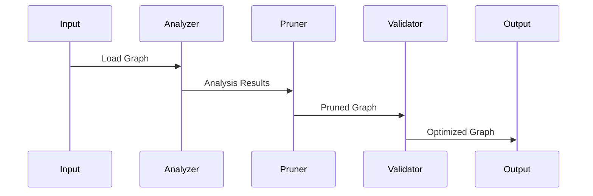

# Graph Pruner Component

## Overview
The Graph Pruner is a specialized component of the Sitexplorer system that optimizes navigation graphs by removing redundant nodes and edges while maintaining essential connectivity. It helps improve performance and reduce memory usage in large-scale virtual tours.

## Architecture



## Component Structure

### 1. Graph Analysis
- Node analysis
- Edge analysis
- Path analysis
- Metric computation

### 2. Pruning Rules
- Node removal criteria
- Edge contraction rules
- Path optimization
- Quality thresholds

### 3. Optimization
- Graph simplification
- Path preservation
- Quality maintenance
- Memory optimization

### 4. Validation
- Connectivity verification
- Path validation
- Quality assessment
- Error checking

## Key Features

### 1. Node Pruning
- Redundant node removal
- Critical node preservation
- Type-based filtering
- Metadata handling

### 2. Edge Optimization
- Edge contraction
- Path simplification
- Weight adjustment
- Type preservation

### 3. Path Management
- Essential path preservation
- Alternative path generation
- Distance optimization
- Quality maintenance

### 4. Quality Control
- Graph metrics
- Path quality
- Memory usage
- Performance impact

## Technical Details

### Dependencies
```json
{
  "dependencies": {
    "typescript": "^4.5.4",
    "graph-data-structure": "^1.12.0",
    "lodash": "^4.17.21"
  }
}
```

### Data Flow


### Configuration
```yaml
pruning:
  nodes:
    min_distance: 0.5
    max_neighbors: 10
    quality_threshold: 0.7
  edges:
    max_length: 5.0
    min_quality: 0.6
    contraction_threshold: 0.8
  paths:
    preservation_ratio: 0.9
    optimization_level: 2
```

## Development Guidelines

### Code Structure
```
src/
├── analysis/     # Graph analysis
├── pruning/      # Pruning rules
├── optimization/ # Graph optimization
├── validation/   # Quality checks
└── utils/        # Utilities
```

### Best Practices
1. Maintain graph connectivity
2. Preserve critical paths
3. Optimize memory usage
4. Handle edge cases
5. Document rules

### Performance Optimization
1. Efficient algorithms
2. Memory management
3. Parallel processing
4. Caching strategies

## Integration

### Input/Output
- Graph format conversion
- Data validation
- Error handling
- Progress reporting

### API Interface
- Configuration options
- Progress monitoring
- Result validation
- Error reporting

## Monitoring and Debugging

### Metrics
- Node reduction
- Edge reduction
- Path preservation
- Memory usage

### Logging
- Pruning decisions
- Quality metrics
- Error reports
- Performance stats

## Troubleshooting

### Common Issues
1. Connectivity loss
2. Path degradation
3. Memory overflow
4. Performance issues

### Solutions
1. Rule adjustment
2. Parameter tuning
3. Algorithm optimization
4. Memory management

## Future Improvements

### Planned Features
1. Advanced pruning rules
2. Machine learning integration
3. Real-time optimization
4. Cloud processing

### Research Areas
1. Graph algorithms
2. Path optimization
3. Quality metrics
4. Performance scaling 