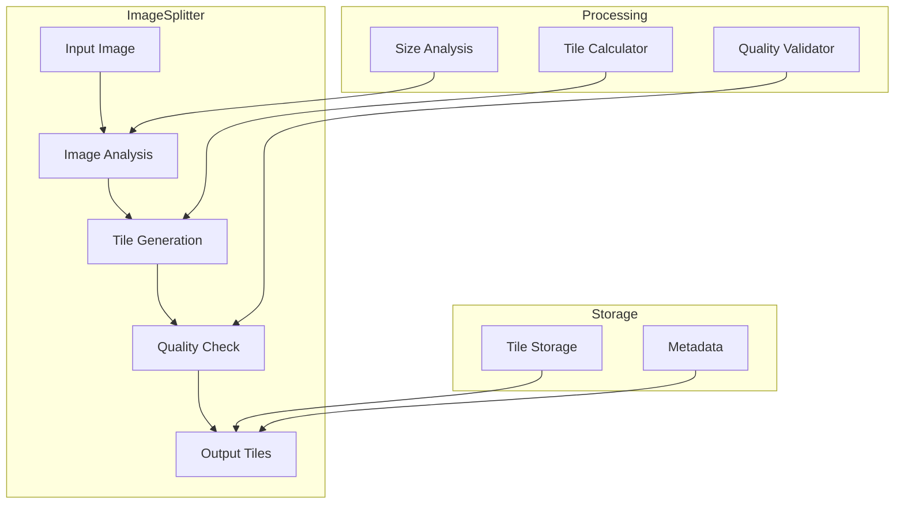
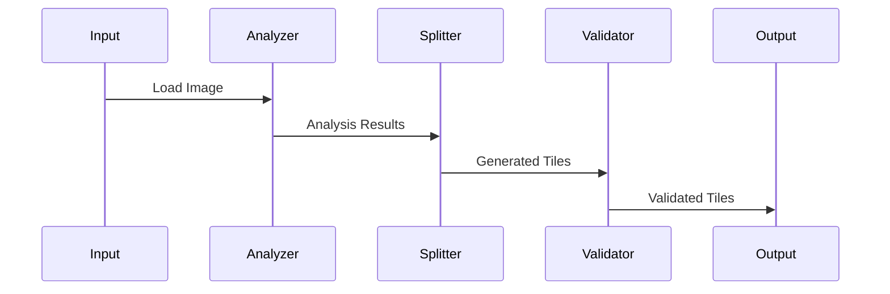

# Image Splitter Component

## Overview
The Image Splitter is a utility component in the CampusVirtual system that processes equirectangular images by splitting them into smaller, more manageable tiles. This component is crucial for optimizing memory usage and improving performance in the virtual tour system.

## Architecture



## Component Structure

### 1. Image Analysis
- Size detection
- Format validation
- Quality assessment
- Metadata extraction

### 2. Tile Generation
- Size calculation
- Tile creation
- Overlap handling
- Format conversion

### 3. Quality Control
- Tile validation
- Format verification
- Size checking
- Error detection

### 4. Output Management
- File organization
- Metadata generation
- Storage optimization
- Access patterns

## Key Features

### 1. Image Processing
- Format support
- Size optimization
- Quality preservation
- Metadata handling

### 2. Tile Management
- Dynamic sizing
- Overlap control
- Format conversion
- Storage optimization

### 3. Quality Assurance
- Format validation
- Size verification
- Quality checks
- Error handling

### 4. Performance
- Memory efficiency
- Processing speed
- Storage optimization
- Access patterns

## Technical Details

### Dependencies
```json
{
  "dependencies": {
    "sharp": "^0.29.3",
    "typescript": "^4.5.4",
    "fs-extra": "^10.0.0"
  }
}
```

### Data Flow


### Configuration
```typescript
interface SplitterConfig {
    // Tile configuration
    tileSize: {
        width: number;
        height: number;
    };
    overlap: number;
    format: 'jpeg' | 'png' | 'webp';
    quality: number;

    // Processing options
    parallel: boolean;
    maxConcurrent: number;
    outputDir: string;
}
```

## Development Guidelines

### Code Structure
```
src/
├── analysis/     # Image analysis
├── splitting/    # Tile generation
├── validation/   # Quality checks
├── storage/      # File management
└── utils/        # Utilities
```

### Best Practices
1. Memory management
2. Error handling
3. Progress tracking
4. Quality control
5. Performance optimization

### Performance Optimization
1. Parallel processing
2. Memory efficiency
3. Storage optimization
4. Caching strategies

## Integration

### Input/Output
- Image format support
- Tile organization
- Metadata handling
- Error reporting

### API Interface
```typescript
class ImageSplitter {
    // Main split function
    async splitImage(
        inputPath: string,
        config: SplitterConfig
    ): Promise<SplitResult>;

    // Progress monitoring
    onProgress(callback: ProgressCallback): void;

    // Error handling
    onError(callback: ErrorCallback): void;
}
```

## Monitoring and Debugging

### Metrics
- Processing time
- Memory usage
- Tile quality
- Storage efficiency

### Logging
- Processing progress
- Quality metrics
- Error reports
- Performance stats

## Troubleshooting

### Common Issues
1. Memory overflow
2. Format problems
3. Quality issues
4. Performance bottlenecks

### Solutions
1. Memory management
2. Format conversion
3. Quality settings
4. Performance tuning

## Future Improvements

### Planned Features
1. GPU acceleration
2. Advanced formats
3. Real-time processing
4. Cloud integration

### Research Areas
1. Image compression
2. Tile optimization
3. Storage patterns
4. Performance scaling 