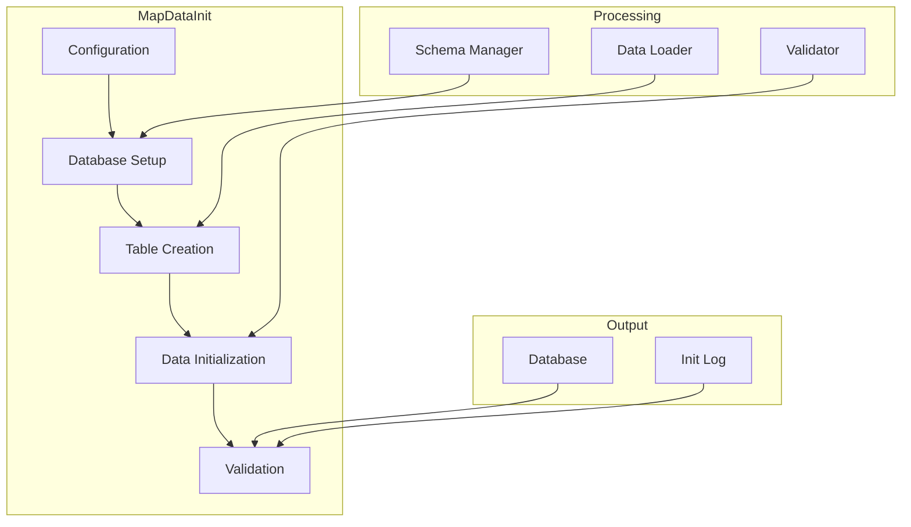
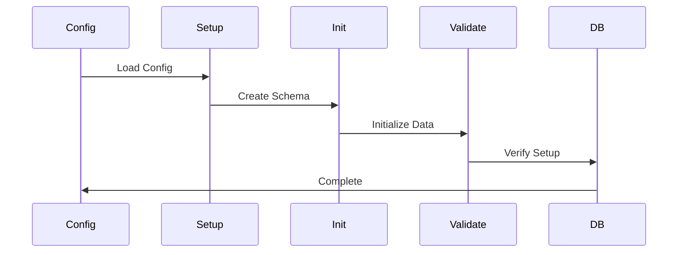

# Map Data Initialization Component

## Overview
The Map Data Initialization component is a crucial part of the CampusVirtual system that handles the initial setup and configuration of map data. It prepares the database structure, initializes necessary tables, and sets up the initial data required for the virtual tour system.

## Architecture



## Component Structure

### 1. Configuration Management
- Environment setup
- Database config
- Schema definition
- Initial data

### 2. Database Setup
- Connection management
- Schema creation
- Index setup
- Constraint definition

### 3. Data Initialization
- Table population
- Default data
- Reference data
- Metadata setup

### 4. Validation
- Schema verification
- Data validation
- Constraint checking
- Error handling

## Key Features

### 1. Database Management
- Schema creation
- Table setup
- Index management
- Constraint handling

### 2. Data Setup
- Initial data loading
- Reference data
- Default values
- Metadata initialization

### 3. Configuration
- Environment setup
- Database config
- Schema definition
- Data mapping

### 4. Validation
- Schema validation
- Data verification
- Constraint checking
- Error reporting

## Technical Details

### Dependencies
```json
{
  "dependencies": {
    "pg": "^8.7.1",
    "typescript": "^4.5.4",
    "dotenv": "^10.0.0"
  }
}
```

### Data Flow


### Configuration
```typescript
interface InitConfig {
    // Database settings
    db: {
        host: string;
        port: number;
        database: string;
        user: string;
        password: string;
    };
    
    // Schema settings
    schema: {
        version: string;
        tables: string[];
        indexes: string[];
    };
    
    // Data settings
    data: {
        initialData: boolean;
        referenceData: boolean;
        metadata: boolean;
    };
}
```

## Development Guidelines

### Code Structure
```
src/
├── config/      # Configuration
├── database/    # Database setup
├── schema/      # Schema management
├── data/        # Data initialization
└── utils/       # Utilities
```

### Best Practices
1. Safe initialization
2. Error handling
3. Data validation
4. Logging
5. Rollback support

### Performance Optimization
1. Batch processing
2. Connection pooling
3. Transaction management
4. Memory efficiency

## Integration

### Input/Output
- Configuration files
- Database connection
- Schema files
- Data files

### API Interface
```typescript
class MapDataInitializer {
    constructor(config: InitConfig) {
        this.config = config;
    }

    async initialize(): Promise<boolean> {
        // Initialize database and data
    }

    async validate(): Promise<ValidationResult> {
        // Validate setup
    }

    async rollback(): Promise<boolean> {
        // Rollback changes if needed
    }
}
```

## Monitoring and Debugging

### Metrics
- Setup time
- Data volume
- Error rate
- Performance stats

### Logging
- Setup progress
- Error reports
- Validation results
- Performance data

## Troubleshooting

### Common Issues
1. Connection errors
2. Schema conflicts
3. Data validation
4. Performance issues

### Solutions
1. Connection management
2. Schema verification
3. Data validation
4. Performance tuning

## Future Improvements

### Planned Features
1. Automated testing
2. Cloud deployment
3. Real-time monitoring
4. Advanced validation

### Research Areas
1. Schema management
2. Data validation
3. Performance optimization
4. Deployment automation 