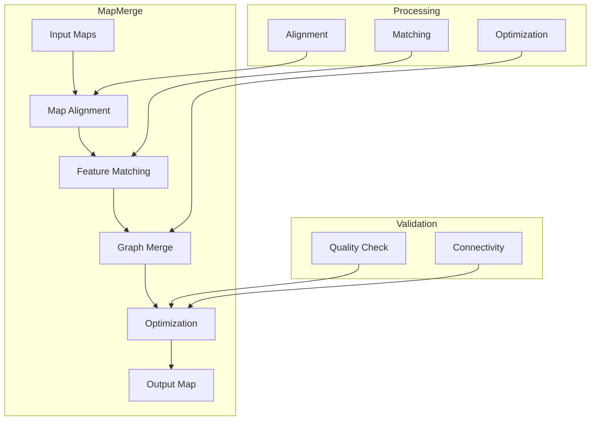
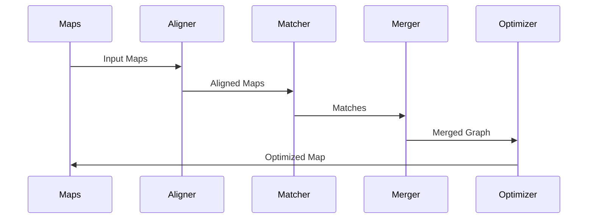

# Map Merge Component

## Overview
The Map Merge component is a specialized tool in the CampusVirtual system that combines multiple SLAM maps into a single unified map. It handles map alignment, loop closure, and graph optimization to create a seamless navigation experience across different recording sessions.

## Architecture



## Component Structure

### 1. Map Alignment
- Initial alignment
- Transform estimation
- Scale matching
- Coordinate system unification

### 2. Feature Matching
- Feature detection
- Descriptor matching
- Correspondence finding
- Outlier rejection

### 3. Graph Merge
- Node merging
- Edge connection
- Path integration
- Metadata handling

### 4. Optimization
- Bundle adjustment
- Graph optimization
- Loop closure
- Quality improvement

## Key Features

### 1. Map Alignment
- 6-DOF alignment
- Scale estimation
- Coordinate transformation
- Error minimization

### 2. Feature Matching
- Robust matching
- Outlier detection
- Quality assessment
- Match verification

### 3. Graph Integration
- Node fusion
- Edge connection
- Path preservation
- Type handling

### 4. Quality Control
- Alignment quality
- Match verification
- Graph consistency
- Error checking

## Technical Details

### Dependencies
```cpp
// Required libraries
#include <opencv2/opencv.hpp>
#include <g2o/core/sparse_optimizer.h>
#include <Eigen/Core>
```

### Data Flow


### Configuration
```cpp
struct MergeConfig {
    // Alignment parameters
    double min_inliers = 100;
    double ransac_threshold = 3.0;
    int max_iterations = 1000;

    // Matching parameters
    double match_ratio = 0.7;
    double min_distance = 0.5;
    int max_features = 2000;

    // Optimization parameters
    double optimization_threshold = 1e-6;
    int max_iterations_optimization = 50;
};
```

## Development Guidelines

### Code Structure
```
MapMerge/
├── src/
│   ├── alignment/    # Map alignment
│   ├── matching/     # Feature matching
│   ├── merging/      # Graph merging
│   ├── optimization/ # Graph optimization
│   └── utils/        # Utilities
└── include/          # Header files
```

### Best Practices
1. Robust alignment
2. Accurate matching
3. Efficient merging
4. Quality validation
5. Error handling

### Performance Optimization
1. Parallel processing
2. Memory management
3. Algorithm efficiency
4. GPU acceleration

## Integration

### Input/Output
- Map format handling
- Data validation
- Error reporting
- Progress tracking

### API Interface
```cpp
class MapMerger {
public:
    // Main merge function
    bool mergeMaps(const Map& map1, const Map& map2, Map& result);
    
    // Configuration
    void setConfig(const MergeConfig& config);
    
    // Progress monitoring
    void setProgressCallback(ProgressCallback callback);
};
```

## Monitoring and Debugging

### Metrics
- Alignment quality
- Match statistics
- Graph metrics
- Performance stats

### Logging
- Alignment progress
- Match results
- Optimization steps
- Error reports

## Troubleshooting

### Common Issues
1. Poor alignment
2. Insufficient matches
3. Graph inconsistencies
4. Performance problems

### Solutions
1. Parameter tuning
2. Algorithm adjustment
3. Quality thresholds
4. Resource management

## Future Improvements

### Planned Features
1. Deep learning integration
2. Real-time merging
3. Multi-map support
4. Cloud processing

### Research Areas
1. Alignment algorithms
2. Feature matching
3. Graph optimization
4. Performance scaling 