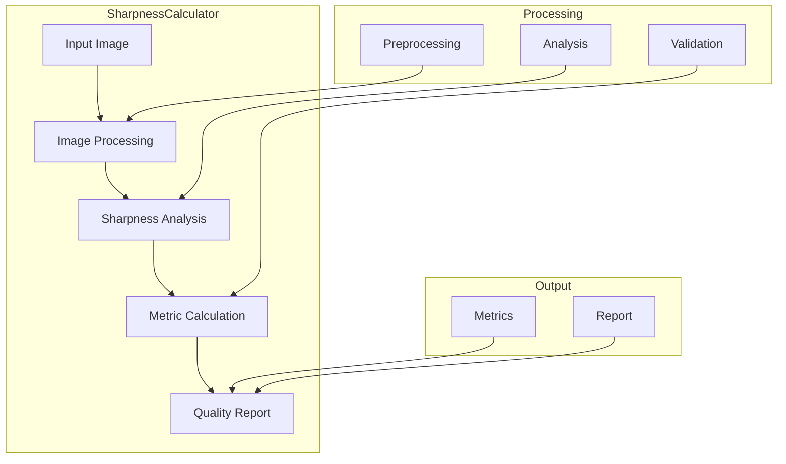
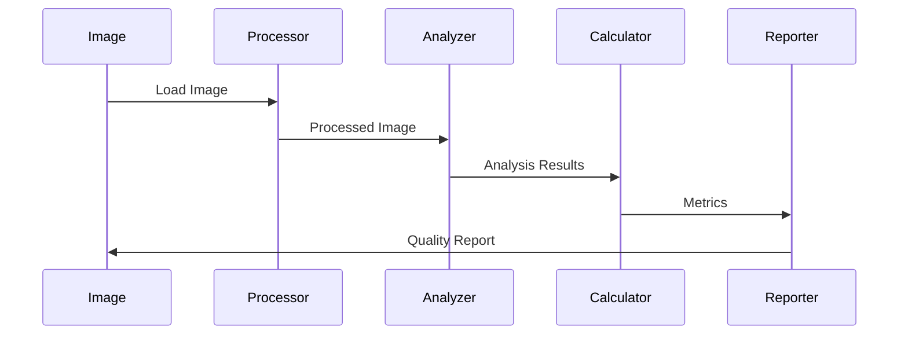

# Sharpness Calculator Component

## Overview
The Sharpness Calculator is a specialized component in the Sitexplorer system that analyzes image quality by calculating sharpness metrics. This tool helps ensure high-quality virtual tour experiences by identifying and filtering out blurry or low-quality images.

## Architecture



## Component Structure

### 1. Image Processing
- Image loading
- Format conversion
- Preprocessing
- Region selection

### 2. Sharpness Analysis
- Edge detection
- Frequency analysis
- Contrast measurement
- Noise assessment

### 3. Metric Calculation
- Sharpness score
- Quality metrics
- Threshold checking
- Result validation

### 4. Reporting
- Score generation
- Quality assessment
- Recommendation
- Error reporting

## Key Features

### 1. Image Analysis
- Multiple metrics
- Region analysis
- Format support
- Batch processing

### 2. Quality Assessment
- Sharpness scoring
- Quality thresholds
- Comparative analysis
- Trend detection

### 3. Performance
- Fast processing
- Memory efficiency
- Batch support
- Progress tracking

### 4. Integration
- API support
- File handling
- Error management
- Result export

## Technical Details

### Dependencies
```python
# requirements.txt
opencv-python>=4.5.4
numpy>=1.21.0
```

### Data Flow


### Configuration
```python
class SharpnessConfig:
    # Analysis parameters
    min_sharpness = 100.0
    max_sharpness = 1000.0
    threshold = 0.5
    
    # Processing options
    region_size = (100, 100)
    overlap = 0.1
    batch_size = 10
```

## Development Guidelines

### Code Structure
```
SharpnessCalculator/
├── src/
│   ├── processing/  # Image processing
│   ├── analysis/    # Sharpness analysis
│   ├── metrics/     # Metric calculation
│   └── utils/       # Utilities
└── tests/           # Unit tests
```

### Best Practices
1. Image validation
2. Error handling
3. Progress tracking
4. Result verification
5. Performance optimization

### Performance Optimization
1. Parallel processing
2. Memory management
3. Batch processing
4. Caching strategies

## Integration

### Input/Output
- Image format support
- Batch processing
- Result export
- Error handling

### API Interface
```python
class SharpnessCalculator:
    def __init__(self, config: SharpnessConfig):
        self.config = config

    def calculate_sharpness(self, image_path: str) -> float:
        """Calculate sharpness score for an image."""
        pass

    def batch_process(self, image_paths: List[str]) -> Dict[str, float]:
        """Process multiple images in batch."""
        pass

    def get_quality_report(self, score: float) -> QualityReport:
        """Generate quality report for a sharpness score."""
        pass
```

## Monitoring and Debugging

### Metrics
- Processing time
- Memory usage
- Accuracy
- Performance stats

### Logging
- Processing progress
- Quality metrics
- Error reports
- Performance data

## Troubleshooting

### Common Issues
1. Memory overflow
2. Processing errors
3. Accuracy issues
4. Performance problems

### Solutions
1. Memory management
2. Error handling
3. Parameter tuning
4. Performance optimization

## Future Improvements

### Planned Features
1. Deep learning integration
2. Real-time analysis
3. Advanced metrics
4. Cloud processing

### Research Areas
1. Image quality
2. Sharpness metrics
3. Performance optimization
4. Accuracy improvement 