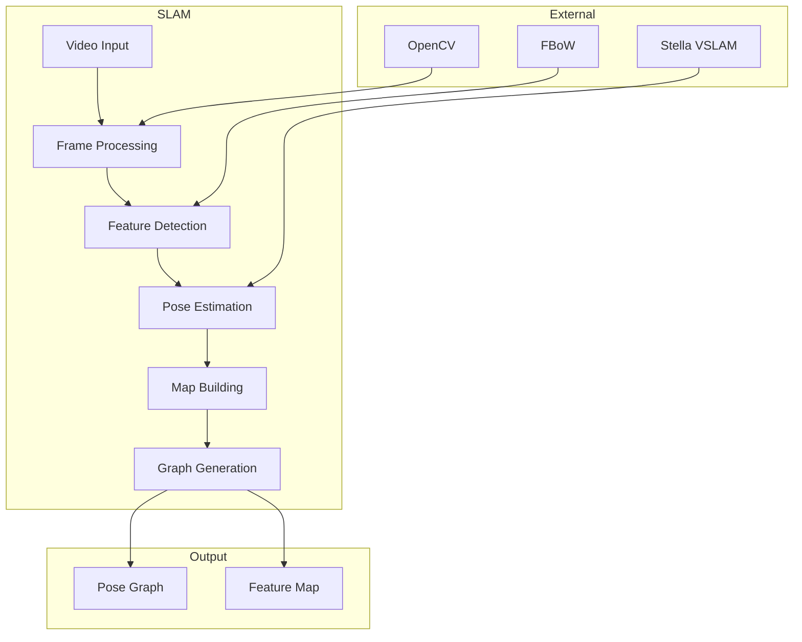
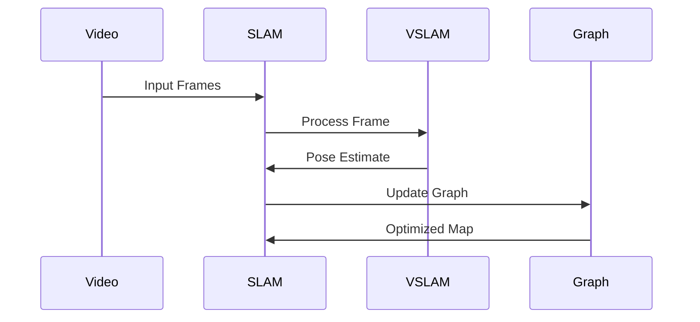

# SLAM Component

## Overview
The SLAM (Simultaneous Localization and Mapping) component is a critical part of the Sitexplorer system that handles camera pose tracking and map building from equirectangular videos. It uses a modified version of Stella VSLAM for accurate pose estimation and feature tracking.

## Architecture



## Component Structure

### 1. Video Processing
- Frame extraction
- Image preprocessing
- Metadata handling
- Quality assessment

### 2. Feature Detection
- Keypoint detection
- Feature matching
- Descriptor computation
- FBoW integration

### 3. Pose Estimation
- Camera tracking
- Motion estimation
- Loop closure detection
- Bundle adjustment

### 4. Map Building
- 3D point reconstruction
- Map optimization
- Graph generation
- Data export

## Key Features

### 1. Camera Tracking
- Real-time pose estimation
- Motion prediction
- Drift correction
- Multi-camera support

### 2. Feature Management
- Robust feature detection
- Efficient matching
- Descriptor optimization
- Memory management

### 3. Map Generation
- Sparse point cloud
- Keyframe selection
- Graph optimization
- Data compression

### 4. Integration
- Sitexplorer interface
- Database export
- Real-time feedback
- Error handling

## Technical Details

### Dependencies
```json
{
  "dependencies": {
    "opencv": "^4.5.4",
    "stella_vslam": "custom",
    "g2o": "^2021.3.1",
    "eigen": "^3.4.0"
  }
}
```

### Data Flow


### Configuration
```yaml
slam:
  camera:
    type: equirectangular
    width: 3840
    height: 1920
  tracking:
    min_features: 100
    max_features: 2000
    matching_ratio: 0.7
  mapping:
    keyframe_interval: 10
    min_parallax: 10.0
    max_depth: 100.0
```

## Development Guidelines

### Code Structure
```
SLAM/
├── FBoW/              # Feature Bag of Words
├── SitexplorerInterface/  # Integration layer
└── src/
    ├── tracking/      # Pose tracking
    ├── mapping/       # Map building
    ├── features/      # Feature detection
    └── utils/         # Utilities
```

### Best Practices
1. Optimize memory usage
2. Handle real-time constraints
3. Implement error recovery
4. Maintain accuracy
5. Document parameters

### Performance Optimization
1. Parallel processing
2. GPU acceleration
3. Memory management
4. Algorithm tuning

## Integration

### Sitexplorer Interface
- Data format conversion
- Real-time updates
- Error reporting
- Status monitoring

### Database Export
- Graph serialization
- Feature storage
- Metadata handling
- Version control

## Monitoring and Debugging

### Logging
- Tracking status
- Feature statistics
- Performance metrics
- Error reports

### Visualization
- Camera trajectory
- Feature points
- Map structure
- Loop closures

## Troubleshooting

### Common Issues
1. Tracking loss
2. Feature matching
3. Memory overflow
4. Performance drops

### Solutions
1. Parameter tuning
2. Memory optimization
3. Algorithm adjustment
4. Hardware acceleration

## Future Improvements

### Planned Features
1. Deep learning integration
2. Multi-session support
3. Real-time optimization
4. Cloud processing

### Research Areas
1. Feature detection
2. Loop closure
3. Map optimization
4. Performance scaling 