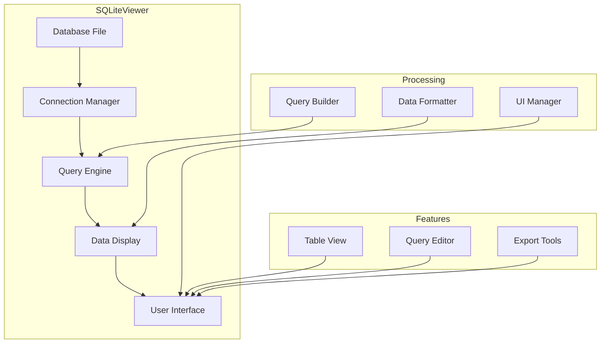
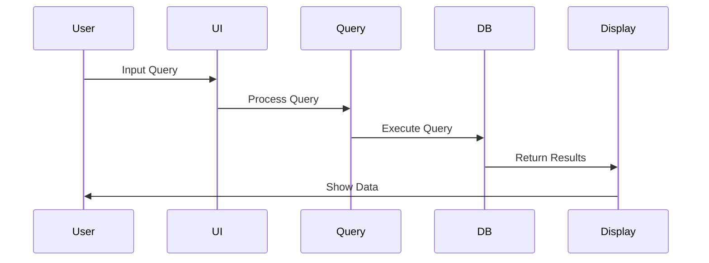

# SQLite Viewer Component

## Overview
The SQLite Viewer is a utility component in the Sitexplorer system that provides a graphical interface for viewing and analyzing SQLite databases. It helps developers and administrators inspect and debug database contents, particularly useful for examining SLAM maps and navigation graphs.

## Architecture



## Component Structure

### 1. Connection Management
- Database connection
- Connection pooling
- Error handling
- Security

### 2. Query Processing
- Query execution
- Result handling
- Error management
- Performance optimization

### 3. Data Display
- Table visualization
- Data formatting
- Export options
- Search functionality

### 4. User Interface
- Table browser
- Query editor
- Result viewer
- Export tools

## Key Features

### 1. Database Navigation
- Table browsing
- Schema viewing
- Index inspection
- Data preview

### 2. Query Tools
- SQL editor
- Query history
- Result export
- Query optimization

### 3. Data Management
- Data export
- Table modification
- Index management
- Backup tools

### 4. Analysis Tools
- Data statistics
- Relationship viewer
- Performance metrics
- Debug tools

## Technical Details

### Dependencies
```python
# requirements.txt
sqlite3
tkinter
pandas
```

### Data Flow


### Configuration
```python
class ViewerConfig:
    # Database settings
    db_path: str
    max_connections: int = 5
    timeout: int = 30
    
    # Display settings
    max_rows: int = 1000
    page_size: int = 100
    refresh_interval: int = 5
    
    # Export settings
    export_formats = ['csv', 'json', 'excel']
    max_export_size = 1000000
```

## Development Guidelines

### Code Structure
```
SQLiteViewer/
├── src/
│   ├── connection/  # Database connection
│   ├── query/      # Query processing
│   ├── display/    # Data display
│   ├── ui/         # User interface
│   └── utils/      # Utilities
└── tests/          # Unit tests
```

### Best Practices
1. Connection management
2. Query optimization
3. Error handling
4. UI responsiveness
5. Data validation

### Performance Optimization
1. Query caching
2. Connection pooling
3. Data pagination
4. Memory management

## Integration

### Input/Output
- Database connection
- Query execution
- Result display
- Export handling

### API Interface
```python
class SQLiteViewer:
    def __init__(self, config: ViewerConfig):
        self.config = config

    def connect(self, db_path: str) -> bool:
        """Connect to a SQLite database."""
        pass

    def execute_query(self, query: str) -> QueryResult:
        """Execute a SQL query."""
        pass

    def export_data(self, data: QueryResult, format: str) -> bool:
        """Export query results."""
        pass
```

## Monitoring and Debugging

### Metrics
- Query performance
- Memory usage
- Connection stats
- UI responsiveness

### Logging
- Query execution
- Error reports
- Performance data
- User actions

## Troubleshooting

### Common Issues
1. Connection errors
2. Query performance
3. Memory usage
4. UI responsiveness

### Solutions
1. Connection management
2. Query optimization
3. Memory management
4. UI optimization

## Future Improvements

### Planned Features
1. Advanced query builder
2. Data visualization
3. Real-time monitoring
4. Cloud integration

### Research Areas
1. Query optimization
2. Data visualization
3. Performance scaling
4. User experience 