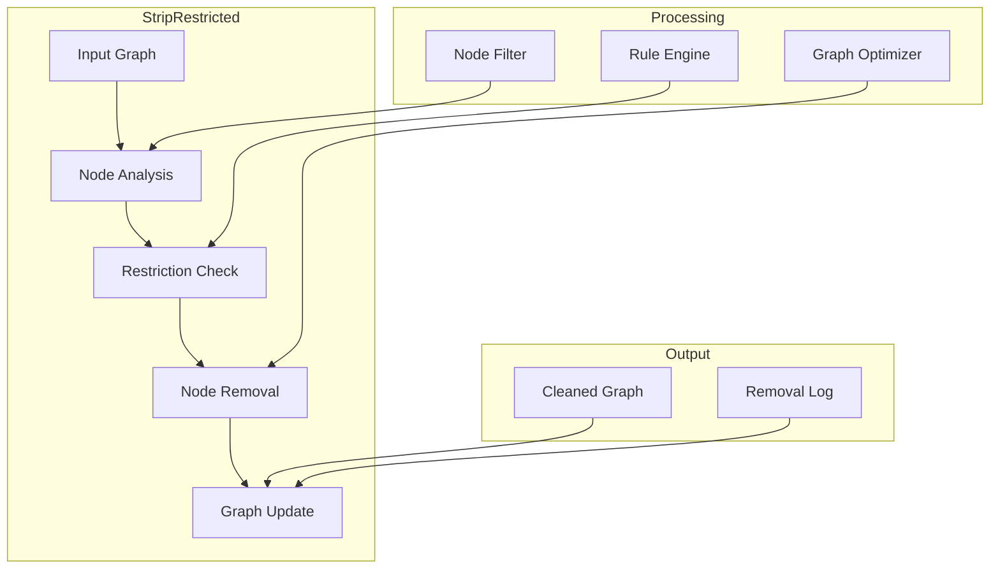
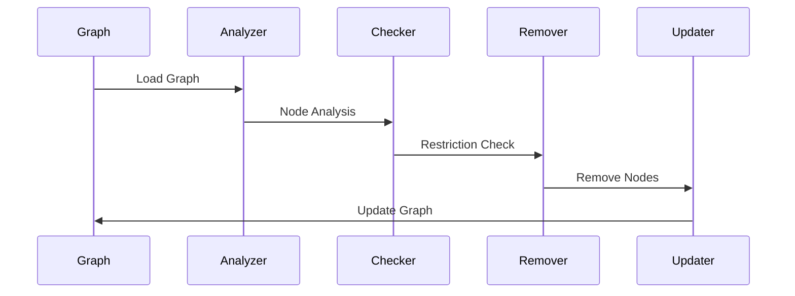

# Strip Restricted Component

## Overview
The Strip Restricted component is a utility tool in the Sitexplorer system that removes restricted or sensitive nodes from the navigation graph. It helps maintain privacy and security by filtering out areas that should not be accessible in the virtual tour.

## Architecture



## Component Structure

### 1. Node Analysis
- Node identification
- Type checking
- Metadata analysis
- Access control

### 2. Restriction Check
- Rule evaluation
- Access validation
- Policy enforcement
- Exception handling

### 3. Node Removal
- Safe removal
- Edge handling
- Graph maintenance
- Path preservation

### 4. Graph Update
- Graph optimization
- Path recalculation
- Metadata update
- Validation

## Key Features

### 1. Node Filtering
- Type-based filtering
- Metadata filtering
- Access control
- Policy enforcement

### 2. Graph Maintenance
- Safe node removal
- Edge management
- Path preservation
- Graph optimization

### 3. Security
- Access control
- Policy enforcement
- Audit logging
- Exception handling

### 4. Integration
- Graph format support
- Policy management
- Logging system
- Error handling

## Technical Details

### Dependencies
```python
# Required libraries
import networkx as nx
import json
import logging
```

### Data Flow


### Configuration
```python
class StripConfig:
    # Node filtering
    restricted_types = [1, 2, 3]  # Node types to remove
    metadata_keys = ['restricted', 'private']
    
    # Graph maintenance
    preserve_paths = True
    optimize_graph = True
    
    # Logging
    log_removals = True
    log_file = 'strip_restricted.log'
```

## Development Guidelines

### Code Structure
```
strip_restricted/
├── src/
│   ├── analysis/    # Node analysis
│   ├── rules/       # Restriction rules
│   ├── removal/     # Node removal
│   ├── update/      # Graph update
│   └── utils/       # Utilities
└── tests/           # Unit tests
```

### Best Practices
1. Safe node removal
2. Path preservation
3. Error handling
4. Logging
5. Policy compliance

### Performance Optimization
1. Efficient filtering
2. Graph optimization
3. Memory management
4. Batch processing

## Integration

### Input/Output
- Graph format support
- Policy management
- Logging system
- Error handling

### API Interface
```python
class StripRestricted:
    def __init__(self, config: StripConfig):
        self.config = config

    def process_graph(self, graph: nx.Graph) -> nx.Graph:
        """Process and clean the graph."""
        pass

    def remove_nodes(self, nodes: List[int]) -> bool:
        """Remove specific nodes from the graph."""
        pass

    def get_removal_log(self) -> List[Dict]:
        """Get log of removed nodes."""
        pass
```

## Monitoring and Debugging

### Metrics
- Node removal count
- Graph size
- Processing time
- Memory usage

### Logging
- Removal operations
- Policy violations
- Error reports
- Performance stats

## Troubleshooting

### Common Issues
1. Graph connectivity
2. Path preservation
3. Policy conflicts
4. Performance issues

### Solutions
1. Graph validation
2. Path optimization
3. Policy adjustment
4. Performance tuning

## Future Improvements

### Planned Features
1. Advanced policies
2. Real-time processing
3. Cloud integration
4. Machine learning

### Research Areas
1. Policy management
2. Graph optimization
3. Security models
4. Performance scaling 