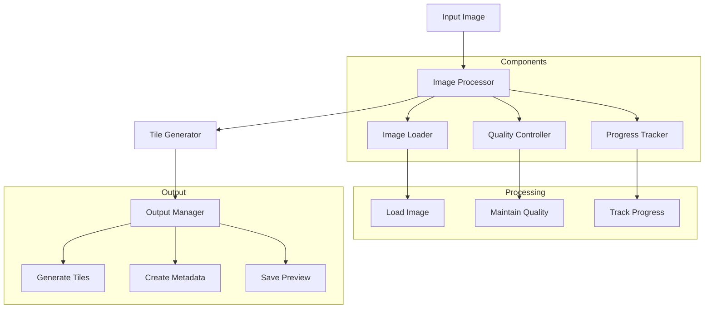

# ImageSplitter

## Overview

The ImageSplitter component is a utility tool designed to split large images into smaller, manageable tiles. This component is particularly useful for processing large campus maps, floor plans, and high-resolution images that need to be displayed efficiently in the Campus Virtual system.

## Features

- Image tiling and splitting
- Custom tile size configuration
- Multiple output format support
- Progress tracking
- Batch processing capabilities
- Quality preservation

## Architecture



## Usage

### Command Line Interface

```bash
# Basic usage
imagesplitter --input large_image.jpg --output tiles/ --tile-size 256

# With additional options
imagesplitter --input large_image.jpg --output tiles/ --tile-size 256 --format png --quality 90 --overlap 0
```

### Parameters

- `--input`: Input image path (required)
- `--output`: Output directory for tiles (required)
- `--tile-size`: Size of each tile in pixels (default: 256)
- `--format`: Output format (jpg/png) (default: jpg)
- `--quality`: Output quality (1-100) (default: 90)
- `--overlap`: Tile overlap in pixels (default: 0)

## Integration

### Python API

```python
from imagesplitter import ImageSplitter

# Initialize splitter
splitter = ImageSplitter(
    tile_size=256,
    output_format='jpg',
    quality=90
)

# Process image
splitter.process(
    input_path='large_image.jpg',
    output_dir='tiles/'
)
```

### Node.js API

```javascript
const { ImageSplitter } = require('imagesplitter');

const splitter = new ImageSplitter({
    tileSize: 256,
    outputFormat: 'jpg',
    quality: 90
});

await splitter.process('large_image.jpg', 'tiles/');
```

## Configuration

The component can be configured through environment variables or configuration files:

- `DEFAULT_TILE_SIZE`: Default tile size in pixels
- `DEFAULT_FORMAT`: Default output format
- `DEFAULT_QUALITY`: Default output quality
- `MAX_MEMORY_USAGE`: Maximum memory usage in MB
- `TEMP_DIR`: Directory for temporary files

## Development

### Prerequisites

- Python 3.8+
- Pillow
- NumPy
- OpenCV (optional)

### Setup

1. Create virtual environment:
   ```bash
   python -m venv venv
   source venv/bin/activate
   ```

2. Install dependencies:
   ```bash
   pip install -r requirements.txt
   ```

3. Install the package:
   ```bash
   pip install -e .
   ```

### Building

```bash
python setup.py build
```

## Output Structure

The component generates a structured output:

```
output_directory/
├── tiles/
│   ├── 0_0.jpg
│   ├── 0_1.jpg
│   ├── 1_0.jpg
│   └── 1_1.jpg
├── metadata.json
└── preview.jpg
```

## Performance Considerations

- Memory usage scales with input image size
- Processing time depends on:
  - Input image dimensions
  - Tile size
  - Output format
  - System resources

## Best Practices

1. **Tile Size Selection**
   - Consider target device capabilities
   - Balance between performance and quality
   - Account for network bandwidth

2. **Format Selection**
   - Use JPG for photographs
   - Use PNG for diagrams and text
   - Consider WebP for web delivery

3. **Quality Settings**
   - Higher quality for detailed images
   - Lower quality for background images
   - Test different settings for optimal results

## Troubleshooting

Common issues and their solutions:

1. **Memory Issues**
   - Reduce tile size
   - Process in batches
   - Increase system swap space

2. **Quality Problems**
   - Adjust quality settings
   - Check input image format
   - Verify output format compatibility

3. **Performance Issues**
   - Optimize tile size
   - Use appropriate output format
   - Consider hardware acceleration

## Support

For support, please:
1. Check the documentation
2. Review existing issues
3. Create a new issue if needed 