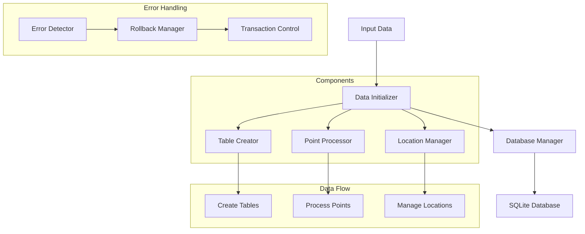
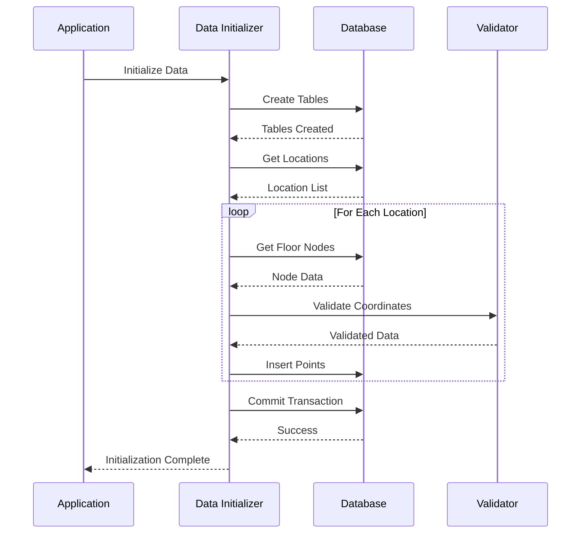
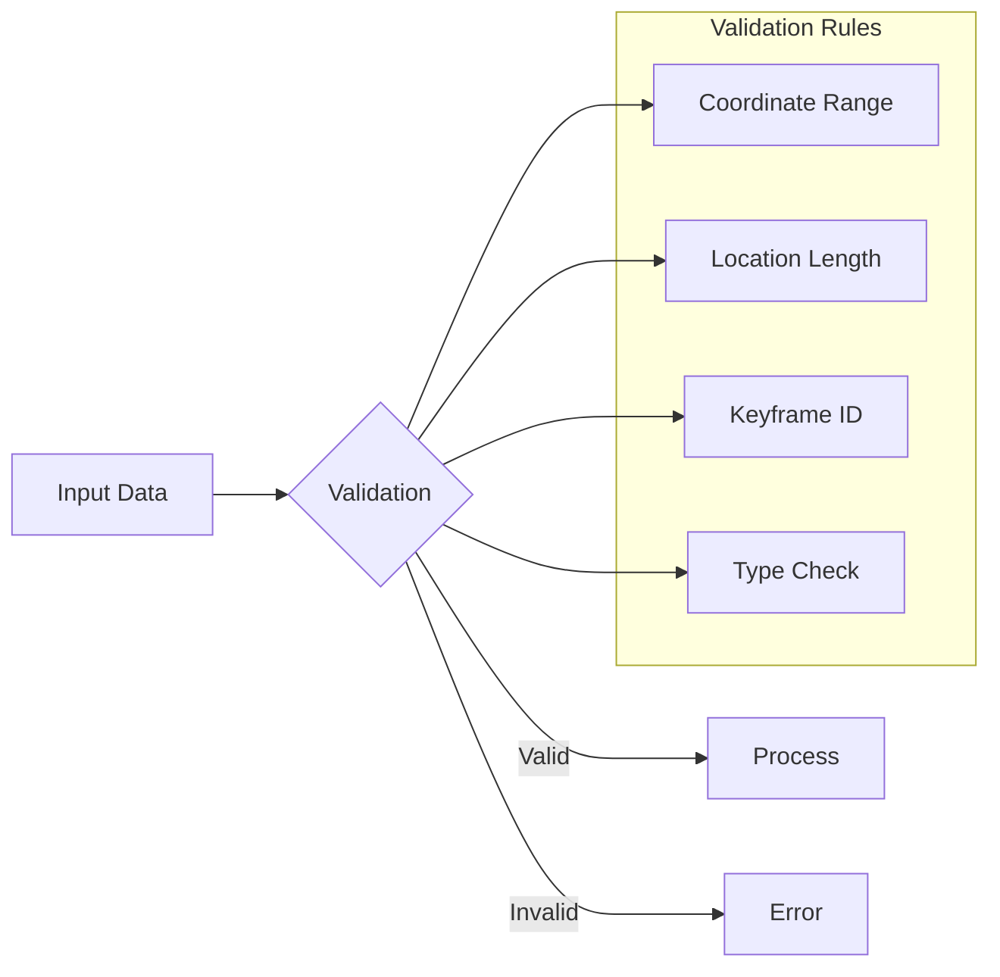

# Map Data Initializer

## Overview

The Map Data Initializer is a crucial component in the Campus Virtual system that handles the initialization and setup of map-related data structures in the SQLite database. It creates and manages tables for floorplan images and points, ensuring proper spatial data organization for the virtual campus environment.

## Features

- Database table initialization
- Floorplan point management
- Location-based data organization
- Automatic coordinate normalization
- Transaction-based data integrity
- Error handling and rollback support

## Architecture



## Usage

### Command Line Interface

```bash
# Basic usage
npm run start

# With environment variables
CV_INIT_DB_NAME=custom.db CV_DB_DIR=/path/to/db npm run start

# Skip if already configured
CV_INIT_DONT_OVERWRITE_MAP_POINTS=true npm run start
```

### Environment Variables

- `CV_INIT_DB_NAME`: Database name (default: "tga-building.db")
- `CV_DB_DIR`: Database directory path
- `CV_INIT_USE_TABLE_PREFIX`: Enable table prefixing
- `CV_INIT_DONT_OVERWRITE_MAP_POINTS`: Skip if map points exist

## Database Structure

### Floorplan Images Table
```sql
CREATE TABLE floorplan_images (
    location TEXT PRIMARY KEY,
    path TEXT DEFAULT ''
);
```

### Floorplan Points Table
```sql
CREATE TABLE floorplan_points (
    location TEXT NOT NULL,
    x DOUBLE PRECISION DEFAULT 0 NOT NULL,
    y DOUBLE PRECISION DEFAULT 0 NOT NULL,
    keyframe_id INTEGER REFERENCES nodes (keyframe_id) ON DELETE CASCADE,
    type INTEGER DEFAULT 0 NOT NULL,
    PRIMARY KEY (keyframe_id, location)
);
```

## Data Processing Flow



## Integration

### TypeScript API

```typescript
import initData from './initData';

// Initialize with default settings
await initData();

// Skip if tables exist
await initData(true);
```

### Database Operations

```typescript
// Insert point on map
async function insertPointOnMap(
    location: string,
    keyframe_id: number,
    type: number,
    x: number,
    y: number
): Promise<boolean>

// Insert location into images
async function insertLocationIntoImages(
    location: string
): Promise<boolean>
```

## Configuration

The component can be configured through environment variables:

- `SQLITE_DB_NAME`: Database filename
- `SQLITE_DB_DIR`: Database directory
- `USE_TABLE_PREFIX`: Enable table prefixing
- `SKIP_IF_MAP_ALREADY_CONFIGED`: Skip existing maps

## Development

### Prerequisites

- Node.js 14+
- TypeScript 4+
- better-sqlite3
- dotenv

### Setup

1. Install dependencies:
   ```bash
   npm install
   ```

2. Build the project:
   ```bash
   npm run build
   ```

3. Run the initializer:
   ```bash
   npm run start
   ```

## Data Validation



## Best Practices

1. **Data Initialization**
   - Always use transactions
   - Validate input data
   - Handle errors gracefully

2. **Coordinate Management**
   - Normalize coordinates (0-1 range)
   - Validate coordinate bounds
   - Handle edge cases

3. **Database Operations**
   - Use prepared statements
   - Implement proper indexing
   - Maintain referential integrity

## Troubleshooting

Common issues and their solutions:

1. **Database Connection**
   - Check file permissions
   - Verify database path
   - Ensure proper initialization

2. **Data Validation**
   - Review coordinate ranges
   - Check location names
   - Verify keyframe IDs

3. **Transaction Issues**
   - Monitor rollback conditions
   - Check error handling
   - Verify commit success

## Support

For support, please:
1. Check the documentation
2. Review existing issues
3. Create a new issue if needed 