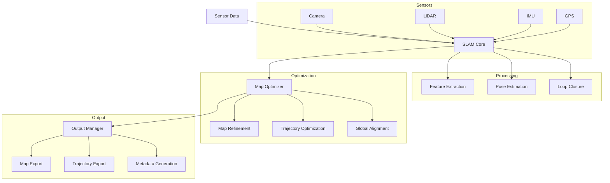

# SLAM

## Overview

The SLAM (Simultaneous Localization and Mapping) component is a sophisticated tool for creating and updating maps of the campus environment while simultaneously tracking the position of the mapping device. This component is essential for creating accurate and up-to-date spatial representations of the campus.

## Features

- Real-time mapping
- Position tracking
- Loop closure detection
- Map optimization
- Multi-sensor fusion
- Export to various formats

## Architecture



## Usage

### Command Line Interface

```bash
# Basic usage
slam --input sensor_data/ --output map.json

# With specific sensors
slam --input sensor_data/ --output map.json --sensors camera,lidar

# With optimization
slam --input sensor_data/ --output map.json --optimize --loop-closure
```

### Parameters

- `--input`: Input sensor data directory (required)
- `--output`: Output map file path (required)
- `--sensors`: Sensors to use (default: all)
- `--optimize`: Enable map optimization
- `--loop-closure`: Enable loop closure detection

## Integration

### Python API

```python
from slam import SLAMProcessor

# Initialize processor
processor = SLAMProcessor(
    sensors=['camera', 'lidar'],
    optimize=True,
    loop_closure=True
)

# Process data
result = processor.process(
    input_dir='sensor_data/',
    output_file='map.json'
)
```

### C++ API

```cpp
#include <slam/slam_processor.hpp>

SLAMProcessor processor({
    .sensors = {"camera", "lidar"},
    .optimize = true,
    .loop_closure = true
});

processor.process("sensor_data/", "map.json");
```

## Sensor Support

### Camera
- RGB cameras
- Depth cameras
- 360-degree cameras
- Stereo cameras

### LiDAR
- 2D LiDAR
- 3D LiDAR
- Multi-beam LiDAR

### Other Sensors
- IMU
- GPS
- Odometry
- Wheel encoders

## Map Data Structure

The component generates maps in a standardized format:

```json
{
  "metadata": {
    "version": "string",
    "timestamp": "string",
    "sensors": ["string"],
    "resolution": "number"
  },
  "map": {
    "points": [
      {
        "x": "number",
        "y": "number",
        "z": "number",
        "intensity": "number"
      }
    ],
    "features": [
      {
        "type": "string",
        "points": ["number"],
        "properties": {}
      }
    ]
  },
  "trajectory": [
    {
      "timestamp": "string",
      "position": {
        "x": "number",
        "y": "number",
        "z": "number"
      },
      "orientation": {
        "x": "number",
        "y": "number",
        "z": "number",
        "w": "number"
      }
    }
  ]
}
```

## Configuration

The component can be configured through environment variables or configuration files:

- `DEFAULT_SENSORS`: Default sensors to use
- `MAP_RESOLUTION`: Map resolution in meters
- `LOOP_CLOSURE_THRESHOLD`: Loop closure detection threshold
- `OPTIMIZATION_INTERVAL`: Map optimization interval
- `MAX_MEMORY_USAGE`: Maximum memory usage in MB

## Development

### Prerequisites

- C++17 or higher
- CMake 3.10+
- OpenCV
- PCL (Point Cloud Library)
- Eigen
- GTSAM (optional)

### Setup

1. Install dependencies:
   ```bash
   sudo apt-get install libopencv-dev libpcl-dev libeigen3-dev
   ```

2. Build the project:
   ```bash
   mkdir build && cd build
   cmake ..
   make
   ```

3. Install:
   ```bash
   sudo make install
   ```

## Performance Considerations

- Processing requirements:
  - CPU: Multi-core recommended
  - RAM: 8GB minimum
  - GPU: Optional for acceleration
- Real-time constraints:
  - Sensor data processing
  - Map updates
  - Position tracking

## Best Practices

1. **Sensor Setup**
   - Calibrate sensors
   - Ensure synchronization
   - Verify data quality

2. **Mapping Strategy**
   - Plan coverage
   - Consider loop closures
   - Monitor map quality

3. **Optimization**
   - Regular map updates
   - Loop closure detection
   - Quality assessment

## Troubleshooting

Common issues and their solutions:

1. **Tracking Loss**
   - Check sensor data
   - Verify calibration
   - Adjust parameters

2. **Map Quality**
   - Review sensor setup
   - Check data quality
   - Optimize parameters

3. **Performance Issues**
   - Reduce map resolution
   - Optimize sensor rate
   - Use hardware acceleration

## Support

For support, please:
1. Check the documentation
2. Review existing issues
3. Create a new issue if needed 