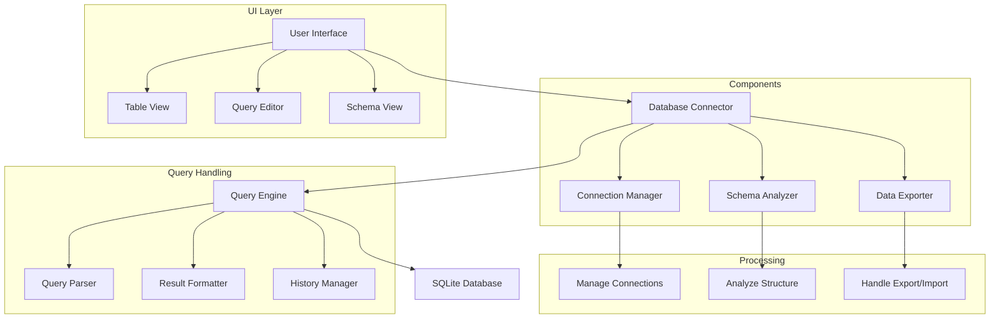

# SQLiteViewer

## Overview

The SQLiteViewer component is a utility tool for viewing, analyzing, and managing SQLite databases used in the Campus Virtual system. It provides a user-friendly interface for database inspection and maintenance, making it easier to work with the system's data storage.

## Features

- Database browsing
- SQL query execution
- Table structure viewing
- Data export/import
- Schema visualization
- Query history

## Architecture



## Usage

### Command Line Interface

```bash
# Basic usage
sqliteviewer --database campus.db

# With specific table
sqliteviewer --database campus.db --table locations

# With query
sqliteviewer --database campus.db --query "SELECT * FROM locations"
```

### Parameters

- `--database`: Database file path (required)
- `--table`: Specific table to view
- `--query`: SQL query to execute
- `--export`: Export format (csv/json)
- `--schema`: Show database schema

## Integration

### Python API

```python
from sqliteviewer import DatabaseViewer

# Initialize viewer
viewer = DatabaseViewer(
    database_path='campus.db',
    read_only=False
)

# Execute query
results = viewer.execute_query(
    "SELECT * FROM locations WHERE type = 'building'"
)

# Get schema
schema = viewer.get_schema()
```

### Node.js API

```javascript
const { DatabaseViewer } = require('sqliteviewer');

const viewer = new DatabaseViewer({
    databasePath: 'campus.db',
    readOnly: false
});

const results = await viewer.executeQuery(
    "SELECT * FROM locations WHERE type = 'building'"
);
```

## Database Structure

The component supports standard SQLite database structures:

```sql
-- Example table structure
CREATE TABLE locations (
    id INTEGER PRIMARY KEY,
    name TEXT NOT NULL,
    type TEXT,
    coordinates TEXT,
    metadata TEXT,
    created_at TIMESTAMP DEFAULT CURRENT_TIMESTAMP
);

-- Example index
CREATE INDEX idx_locations_type ON locations(type);
```

## Query Examples

### Basic Queries
```sql
-- Select all records
SELECT * FROM locations;

-- Filter by type
SELECT * FROM locations WHERE type = 'building';

-- Join tables
SELECT l.name, m.floor
FROM locations l
JOIN maps m ON l.id = m.location_id;
```

### Advanced Queries
```sql
-- Aggregation
SELECT type, COUNT(*) as count
FROM locations
GROUP BY type;

-- Subquery
SELECT name
FROM locations
WHERE id IN (
    SELECT location_id
    FROM maps
    WHERE floor > 1
);
```

## Configuration

The component can be configured through environment variables or configuration files:

- `DEFAULT_DATABASE`: Default database path
- `QUERY_TIMEOUT`: Query execution timeout
- `MAX_RESULTS`: Maximum results to display
- `EXPORT_DIR`: Default export directory
- `HISTORY_SIZE`: Query history size

## Development

### Prerequisites

- Python 3.8+
- SQLite3
- pandas
- sqlalchemy

### Setup

1. Create virtual environment:
   ```bash
   python -m venv venv
   source venv/bin/activate
   ```

2. Install dependencies:
   ```bash
   pip install -r requirements.txt
   ```

3. Install the package:
   ```bash
   pip install -e .
   ```

### Building

```bash
python setup.py build
```

## Data Export Formats

### CSV Export
```csv
id,name,type,coordinates,metadata,created_at
1,Main Building,building,"[x,y,z]",{},2024-01-01
2,Library,building,"[x,y,z]",{},2024-01-01
```

### JSON Export
```json
{
  "locations": [
    {
      "id": 1,
      "name": "Main Building",
      "type": "building",
      "coordinates": [x, y, z],
      "metadata": {},
      "created_at": "2024-01-01"
    }
  ]
}
```

## Best Practices

1. **Query Optimization**
   - Use appropriate indexes
   - Limit result sets
   - Avoid complex joins

2. **Data Management**
   - Regular backups
   - Schema versioning
   - Data validation

3. **Security**
   - Use read-only mode
   - Validate queries
   - Limit access

## Troubleshooting

Common issues and their solutions:

1. **Connection Issues**
   - Check file permissions
   - Verify database path
   - Check file locks

2. **Query Performance**
   - Review query plan
   - Add indexes
   - Optimize joins

3. **Data Integrity**
   - Verify constraints
   - Check foreign keys
   - Validate data types

## Support

For support, please:
1. Check the documentation
2. Review existing issues
3. Create a new issue if needed 