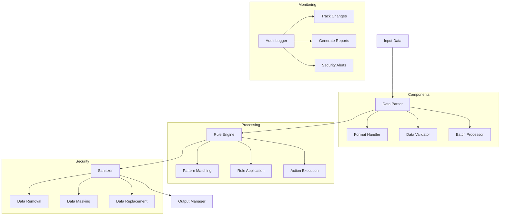

# Strip Restricted

## Overview

The Strip Restricted component is a security-focused tool designed to remove or sanitize sensitive information from data before it's used in the Campus Virtual system. This component ensures that restricted or private information is properly handled according to privacy and security requirements.

## Features

- Data sanitization
- Pattern-based filtering
- Custom rule support
- Batch processing
- Audit logging
- Multiple format support

## Architecture



## Usage

### Command Line Interface

```bash
# Basic usage
strip_restricted --input data.json --output sanitized.json

# With specific rules
strip_restricted --input data.json --output sanitized.json --rules privacy_rules.json

# Batch processing
strip_restricted --input "data/*.json" --output sanitized/ --batch
```

### Parameters

- `--input`: Input file or directory (required)
- `--output`: Output file or directory (required)
- `--rules`: Rules file path
- `--format`: Input/output format (json/csv)
- `--batch`: Enable batch processing

## Integration

### Python API

```python
from strip_restricted import DataSanitizer

# Initialize sanitizer
sanitizer = DataSanitizer(
    rules_file='privacy_rules.json',
    format='json'
)

# Process data
result = sanitizer.process(
    input_path='data.json',
    output_path='sanitized.json'
)
```

### Node.js API

```javascript
const { DataSanitizer } = require('strip-restricted');

const sanitizer = new DataSanitizer({
    rulesFile: 'privacy_rules.json',
    format: 'json'
});

await sanitizer.process('data.json', 'sanitized.json');
```

## Rule Definition

Rules are defined in JSON format:

```json
{
  "rules": [
    {
      "name": "remove_personal_info",
      "pattern": "\\b[A-Za-z0-9._%+-]+@[A-Za-z0-9.-]+\\.[A-Z|a-z]{2,}\\b",
      "action": "replace",
      "replacement": "[EMAIL]"
    },
    {
      "name": "mask_phone_numbers",
      "pattern": "\\b\\d{3}[-.]?\\d{3}[-.]?\\d{4}\\b",
      "action": "mask",
      "mask_char": "*"
    }
  ],
  "default_action": "remove"
}
```

## Supported Data Types

### Personal Information
- Email addresses
- Phone numbers
- Names
- Addresses
- ID numbers

### Sensitive Data
- Passwords
- API keys
- Access tokens
- Configuration secrets
- Internal paths

## Configuration

The component can be configured through environment variables or configuration files:

- `DEFAULT_RULES`: Default rules file path
- `LOG_LEVEL`: Logging level
- `BATCH_SIZE`: Batch processing size
- `TEMP_DIR`: Temporary directory
- `AUDIT_LOG`: Audit log file path

## Development

### Prerequisites

- Python 3.8+
- regex
- jsonschema
- pandas

### Setup

1. Create virtual environment:
   ```bash
   python -m venv venv
   source venv/bin/activate
   ```

2. Install dependencies:
   ```bash
   pip install -r requirements.txt
   ```

3. Install the package:
   ```bash
   pip install -e .
   ```

### Building

```bash
python setup.py build
```

## Processing Pipeline

1. Data Input
   - Read input file
   - Parse format
   - Validate structure

2. Rule Application
   - Load rules
   - Apply patterns
   - Process matches

3. Data Output
   - Format data
   - Write output
   - Generate report

## Best Practices

1. **Rule Definition**
   - Use specific patterns
   - Test thoroughly
   - Document rules

2. **Data Handling**
   - Validate input
   - Backup original data
   - Verify output

3. **Security**
   - Secure rule storage
   - Audit logging
   - Access control

## Troubleshooting

Common issues and their solutions:

1. **Pattern Matching**
   - Review regex patterns
   - Test with sample data
   - Check rule order

2. **Performance Issues**
   - Optimize patterns
   - Adjust batch size
   - Use appropriate format

3. **Data Loss**
   - Verify backups
   - Check rule actions
   - Review logs

## Support

For support, please:
1. Check the documentation
2. Review existing issues
3. Create a new issue if needed 