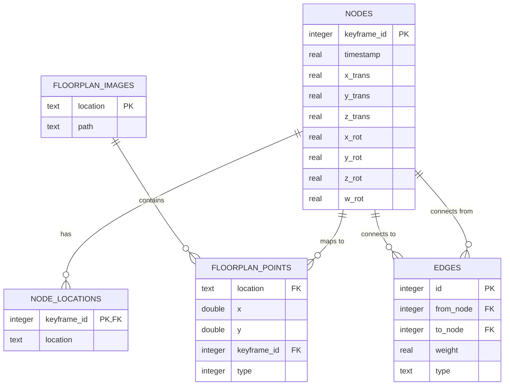

# Database Structure

## Overview

The Campus Virtual system uses SQLite as its primary database, with a well-defined schema that supports various components including SLAM, GraphPruner, and map data initialization. This document outlines the complete database structure and relationships between different tables.

## Core Tables

### Nodes Table
```sql
CREATE TABLE nodes (
    keyframe_id INTEGER PRIMARY KEY,
    timestamp REAL NOT NULL,
    x_trans REAL NOT NULL,
    y_trans REAL NOT NULL,
    z_trans REAL NOT NULL,
    x_rot REAL NOT NULL,
    y_rot REAL NOT NULL,
    z_rot REAL NOT NULL,
    w_rot REAL NOT NULL
);
```
- Stores keyframe information for SLAM tracking
- Contains position and orientation data
- Primary key: `keyframe_id`

### Node Locations Table
```sql
CREATE TABLE node_locations (
    keyframe_id INTEGER PRIMARY KEY,
    location TEXT NOT NULL,
    FOREIGN KEY (keyframe_id) REFERENCES nodes(keyframe_id) ON DELETE CASCADE
);
```
- Maps nodes to physical locations
- Links SLAM data to campus locations
- Foreign key relationship with nodes table

### Floorplan Images Table
```sql
CREATE TABLE floorplan_images (
    location TEXT PRIMARY KEY,
    path TEXT DEFAULT ''
);
```
- Stores floorplan image paths
- Maps locations to their visual representations
- Primary key: `location`

### Floorplan Points Table
```sql
CREATE TABLE floorplan_points (
    location TEXT NOT NULL,
    x DOUBLE PRECISION DEFAULT 0 NOT NULL,
    y DOUBLE PRECISION DEFAULT 0 NOT NULL,
    keyframe_id INTEGER REFERENCES nodes(keyframe_id) ON DELETE CASCADE,
    type INTEGER DEFAULT 0 NOT NULL,
    PRIMARY KEY (keyframe_id, location)
);
```
- Stores point data for floorplans
- Links points to locations and nodes
- Composite primary key: `(keyframe_id, location)`

## Graph Structure

### Edges Table
```sql
CREATE TABLE edges (
    id INTEGER PRIMARY KEY,
    from_node INTEGER NOT NULL,
    to_node INTEGER NOT NULL,
    weight REAL DEFAULT 1.0,
    type TEXT DEFAULT 'default',
    FOREIGN KEY (from_node) REFERENCES nodes(keyframe_id) ON DELETE CASCADE,
    FOREIGN KEY (to_node) REFERENCES nodes(keyframe_id) ON DELETE CASCADE
);
```
- Represents connections between nodes
- Supports weighted and typed edges
- Foreign key relationships with nodes table

### Graph Metadata Table
```sql
CREATE TABLE graph_metadata (
    key TEXT PRIMARY KEY,
    value TEXT NOT NULL,
    updated_at TIMESTAMP DEFAULT CURRENT_TIMESTAMP
);
```
- Stores graph-level metadata
- Tracks graph version and properties
- Primary key: `key`

## Data Flow



## Indexes

### Performance Indexes
```sql
-- Nodes table indexes
CREATE INDEX idx_nodes_timestamp ON nodes(timestamp);
CREATE INDEX idx_nodes_location ON nodes(x_trans, y_trans, z_trans);

-- Edges table indexes
CREATE INDEX idx_edges_from ON edges(from_node);
CREATE INDEX idx_edges_to ON edges(to_node);
CREATE INDEX idx_edges_type ON edges(type);

-- Floorplan points indexes
CREATE INDEX idx_floorplan_points_location ON floorplan_points(location);
CREATE INDEX idx_floorplan_points_type ON floorplan_points(type);
```

## Data Types

### Node Types
- `FLOOR_POINT_DEFAULT_TYPE`: 0
- `BORDERING_FLOOR_POINT_DEFAULT_TYPE`: 50

### Edge Types
- `default`: Standard connection
- `loop_closure`: Loop closure connection
- `temporal`: Temporal connection

## Best Practices

1. **Data Integrity**
   - Use foreign key constraints
   - Implement cascading deletes
   - Validate data before insertion

2. **Performance**
   - Use appropriate indexes
   - Optimize query patterns
   - Monitor query performance

3. **Maintenance**
   - Regular database backups
   - Index maintenance
   - Data validation

## Common Queries

### Node Queries
```sql
-- Get nodes for a specific location
SELECT n.* 
FROM nodes n
JOIN node_locations nl ON n.keyframe_id = nl.keyframe_id
WHERE nl.location = ?;

-- Get connected nodes
SELECT n.* 
FROM nodes n
JOIN edges e ON n.keyframe_id = e.to_node
WHERE e.from_node = ?;
```

### Floorplan Queries
```sql
-- Get all points for a location
SELECT fp.*, n.timestamp
FROM floorplan_points fp
JOIN nodes n ON fp.keyframe_id = n.keyframe_id
WHERE fp.location = ?;

-- Get floorplan image path
SELECT path 
FROM floorplan_images
WHERE location = ?;
```

## Configuration

The database can be configured through environment variables:

- `CV_INIT_DB_NAME`: Database filename
- `CV_DB_DIR`: Database directory
- `USE_TABLE_PREFIX`: Enable table prefixing
- `SKIP_IF_MAP_ALREADY_CONFIGED`: Skip existing maps

## Support

For database-related issues:
1. Check the documentation
2. Review existing issues
3. Create a new issue if needed 